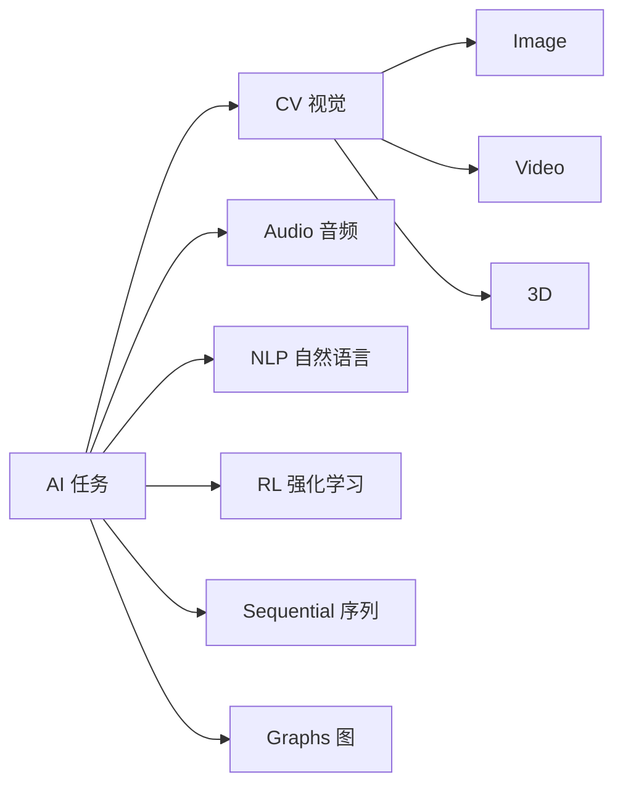

---
Title | ML Tasks
-- | --
Created @ | `2021-08-31T07:41:22Z`
Updated @| `2026-11-26T10:21:17Z`
Labels | ``
Edit @| [here](https://github.com/junxnone/aiwiki/issues/3)

---
# ML/DL 常见任务

**AI 任务来源于生活，包括我们身边的方方面面：**
CV/Audio/NLP/RL/Sequential/Graphs...

图中：任务按数据类型分为视觉、音频、自然语言、强化学习、序列和图；视觉又分图像、视频和三维。

## CV - 视觉任务

- **研究趋势** 
  - `2D Image` --> `3D Image`
  - `Image` --> `Video`
- **Image** 
  - [Classification - 图像分类](https://github.com/junxnone/aiwiki/issues/61)
  - [Object Detection - 目标检测](https://github.com/junxnone/aiwiki/issues/152)
  - [Semantic Segmentation - 语义分割](https://github.com/junxnone/aiwiki/issues/159)
  - Instance Segmentation - 实例分割
  - 全景分割
  - Pose Estimation - 姿态估计
  - [异常检测](https://github.com/junxnone/aiwiki/issues/277)
  - GAN
  - [Image Retrival - 图像检索](https://github.com/junxnone/aiwiki/issues/278)
- **Video**
  - Object Tracking - 目标跟踪
  - [Motion Detection](https://github.com/junxnone/aiwiki/issues/243)
- 一些精细的研究领域取得了比较好的成果
  - 人脸检测识别
  - 人脸关键点
  - 表情识别
  - 人体骨骼关键点
- **3D**（见 [3D 算法](https://github.com/junxnone/aiwiki/issues/422)）
  - 点云配准
  - 点云识别
  - Semantic Segmentation
  - Object Detection

| 任务 | 输入 | 输出 | 常用指标 |
| --- | --- | --- | --- |
| 分类 | 图像 | 类别 | 准确率 Accuracy |
| 目标检测 | 图像 | 框 + 类别 | mAP |
| 语义分割 | 图像 | 逐像素类别 | mIoU |
| 图像检索 | 查询图像 | 相似图像列表 | 召回率、mAP |
| 异常检测 | 图像 | 是否异常 / 异常位置 | AUROC |

表中：

- **mAP**：mean Average Precision，各类别平均精度的均值；**mIoU**：mean Intersection over Union，各类别交并比的均值；**AUROC**：ROC 曲线下面积
- 对比结论：不同任务输出形式不同，评价指标也不同，指标的计算见 [ML Metrics](https://github.com/junxnone/aiwiki/issues/138)

## Auido

- 语音识别
- 实时翻译

## NLP - 自然语言

- 翻译/QA

## CV&NLP

- 图像/视频 <--> 语言

## RL - 强化学习

- 游戏/设计/筛选...
- 详见 [RL Tasks](https://github.com/junxnone/aiwiki/issues/457)

## Sequential
- 时间序列数据，见 [TimeSeries](https://github.com/junxnone/aiwiki/issues/603)

## Graphs

- 图数据：节点分类、链接预测、图分类

