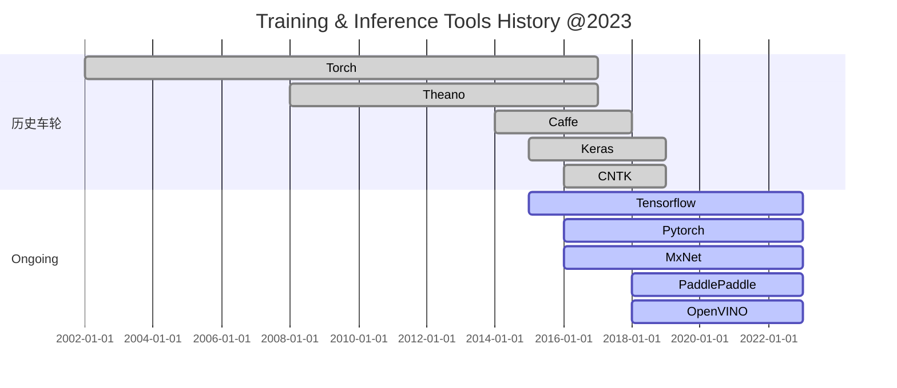

---
Title | Tools TIHistory
-- | --
Created @ | `2021-08-31T08:43:50Z`
Updated @| `2026-11-26T10:21:13Z`
Labels | ``
Edit @| [here](https://github.com/junxnone/aiwiki/issues/5)

---
# Training & Inference Tools History

深度学习训练与推理工具（框架）的时间线，以及各工具的定位。

图中：

- 横轴是年份，每条横条表示一个工具从诞生到图示时间（2023）的存续区间
- 「历史车轮」中的工具（Torch、Theano、Caffe、Keras、CNTK）已停止主流使用或被合并；「Ongoing」中的工具仍在活跃维护
- 关键结论：框架格局从早期百花齐放，逐渐收敛到 TensorFlow 和 PyTorch 两大主流

Name | Description
-- | --
[Tensorflow](https://github.com/junxnone/aiwiki/issues/140) | Google 主导开发的开源训练工具
[Pytorch](https://github.com/junxnone/aiwiki/issues/168) | Facebook 主导开发的开源训练工具
Paddle | Baidu 主导开发的开源训练工具
MXNet | Apache 主导开发的开源训练工具
ONNX  | Microsoft 主导，多家支持开发的开源模型交换格式
[Darknet](https://github.com/junxnone/aiwiki/issues/260) | YOLO Model Tools

表中：

- **Name**：工具名称；**Description**：主导方和定位；ONNX 实际是一种模型交换格式，用于在框架之间转换模型
- 对比结论：研究与新模型以 PyTorch 为主，工业部署和生态完整性上 TensorFlow 仍有优势

## Inference Only Tools
Name | Description
-- | --
[OpenVINO](https://github.com/junxnone/aiwiki/issues/185) | Intel 主导开发的Inference工具

表中：Inference Only 指只用于推理、不用于训练的工具；对比结论：训练用框架，部署用推理工具，通过 ONNX 或各自的转换工具衔接。

