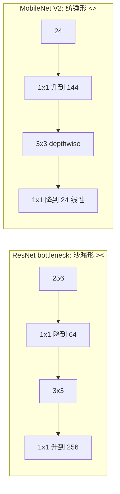

---
Title | ML Tasks Image Classification MobileNet V2
-- | --
Created @ | `2020-02-25T10:15:57Z`
Updated @| `2026-11-26T01:26:36Z`
Labels | `index`
Edit @| [here](https://github.com/junxnone/aiwiki/issues/43)

---
# MobileNet V2

## Brief

- Inverted Residual Blocks
- Linear Bottleneck 

##  Inverted Residual Blocks
>来源于 ResNet

- ResNet 使用 标准卷积 提特征，MobileNet 始终使用 DW卷积 提特征
- ResNet 先降维 (0.25倍)、卷积、再升维，而 MobileNet V2 则是 先升维 (6倍)、卷积、再降维
> 直观的形象上来看，ResNet 的微结构是沙漏形 `><`，而 MobileNet V2 则是纺锤形 `<>`，刚好相反。因此 MobileNet V2 的结构被称为 **Inverted Residual Block**

## Linear Bottleneck

**对比 Mobilenet v1:**
- 在每个DW前增加了PW
  - Depth-Wise 卷积由于本身的计算特性不能改变通道数, 上一层多少通道，只能输出多少通道。当上一层给的通道数很少时，DW 只能在低维空间提特征，因此效果不够好。
  - 在每个 DW 之前增加一个 PW，用于升维，定义升维系数 `t = 6`, 这样不管输入通道数 `Cin` 是多是少，经过第一个 PW 升维之后，DW 都在相对的更高维 `t*Cin`工作。
- 去掉了第二个PW的激活函数
  - 激活函数在高维空间能够有效的增加非线性，而在低维空间时则会破坏特征，不如线性的效果好。
  - 第二个 PW 的主要功能是降维，降维之后就不宜再使用 ReLU6 。
> 此处被称为 `Linear Bottleneck`

## 网络结构 - 54 layers = 1 + 17*3 + 2

- t  是输入通道的倍增系数（即中间部分的通道数是输入通道数的多少倍）
- n 是该模块重复次数
- c 是输出通道数
- s 是该模块第一次重复时的 stride（后面重复都是 stride 1）

## 性能对比

## 倒残差块

下图对比 ResNet 的 bottleneck 与 MobileNet V2 的 inverted residual block，说明中间是宽还是窄：

图中：

- ResNet 的块是「宽 → 窄 → 宽」，MobileNet V2 是「窄 → 宽 → 窄」，所以叫 inverted (倒置)
- 在 V2 里，两端 (窄处) 的张量才是块之间传递和做 shortcut 的对象，内部 $6$ 倍宽的特征只存在于块内部，因此显存和访存开销小
- 例中 $24\to144$ 对应扩张系数 $t=6$；最后的降维层不接激活函数 (linear)

块内的运算：

$$
\mathbf y=\mathbf x+W_{3}\,\mathrm{ReLU6}\bigl(W_{dw}\ast\,\mathrm{ReLU6}(W_{1}\mathbf x)\bigr),\qquad
\mathrm{ReLU6}(z)=\min(\max(0,z),6)
$$

其中：

- $\mathbf x\in\mathbb R^{H\times W\times C}$：输入；$W_1$：$1\times1$ 升维卷积，输出 $tC$ 通道；$W_{dw}$：$3\times3$ depthwise 卷积，通道数不变；$W_3$：$1\times1$ 降维卷积，输出回到 $C'$ 通道，其后没有非线性
- 只有 stride 为 $1$ 且输入输出通道相同 ($C=C'$) 时才有 shortcut $\mathbf x+\cdots$，否则直接输出
- ReLU6 把激活上限限制为 $6$，在低精度 (定点) 部署时数值范围更稳定

块的乘加次数：

$$
\text{MACs}=H\,W\,C\,t\,(C+k^2+C')
$$

其中：$k$ 是 depthwise 的核边长 (取 $3$)；括号里的三项依次对应升维 $1\times1$、depthwise、降维 $1\times1$。

## 为什么是线性瓶颈

- 流形假设：图像在网络中的有效信息分布在高维空间里的一个低维流形上
- ReLU 把负值全部置零，如果特征所在的空间维度不够高，就会不可逆地丢失信息；论文的实验是把二维螺旋线用随机矩阵嵌入 $n$ 维再经 ReLU 还原，$n=2,3$ 时严重失真，$n=15,30$ 时还原较好
- 因此：在高维 (扩张后) 处使用 ReLU6 是安全的，在低维 (压缩后的瓶颈) 处用线性，避免破坏信息

## 与 V1 的对比

维度 | [V1](/0042_ML_Tasks_Image_Classification_MobileNet_V1) | V2
-- | -- | --
基本块 | depthwise + pointwise | 扩张 pointwise + depthwise + 线性 pointwise
shortcut | 无 | 有 (倒残差)
瓶颈处激活 | ReLU | 线性 (无激活)
参数量 | 4.2 M | 3.4 M
MACs | 569 M | 300 M
ImageNet top-1 | 70.6% | 72.0%

表中：V2 参数和计算量都更少，精度反而更高，说明块结构的改进比单纯加宽更有效。网络的 $t,c,n,s$ 配置说明见上图，其中扩张系数 $t$ 除第一个块为 $1$ 外都是 $6$。

## Reference
- 2018 **MobileNet V2** MobileNetV2: Inverted Residuals and Linear Bottlenecks [[paper](https://arxiv.org/pdf/1801.04381.pdf)]
- [MobileNet V2 论文初读](https://zhuanlan.zhihu.com/p/33075914)
- [轻量化网络：MobileNet-V2](https://blog.csdn.net/u011995719/article/details/79135818)
- [tensorflow/models - Mobilenet v2](https://github.com/tensorflow/models/tree/master/research/slim/nets/mobilenet)

