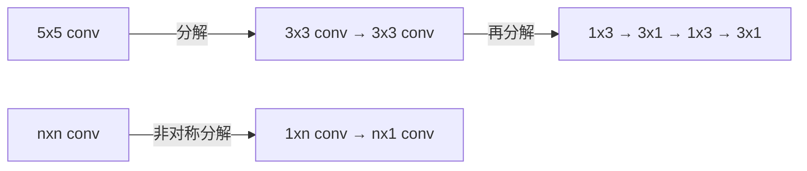

---
Title | ML Tasks Image Classification Inception V2V3
-- | --
Created @ | `2019-12-04T09:37:22Z`
Updated @| `2026-11-26T01:26:23Z`
Labels | ``
Edit @| [here](https://github.com/junxnone/aiwiki/issues/46)

---
# Inception V2V3

## Brief
- Inception V2 和 V3 是同一篇 paper 提出，各种 Improve 最终版的 V2 即 V3
- Inception Module 设计准则
  - 避免大kernel 导致的表达瓶颈
  - 高维特征更易处理
  - 低维空间聚合无需担心丢失信息
  - 平衡网络宽度和深度
- **使用了Batch Normalization**
- **分解卷积 - Factorizing Convolutions**
  - 使用包括 2 个 3x3 的 卷积 Mini-network 替换 5x5 的卷积
  - 任意nxn的卷积都可以通过1xn卷积后接nx1 非对称卷积来替代
- RMSProp优化器
- 使用了Label Smoothing

## Factorizing Convolutions - Mini-network
- 2个 3x3 的 卷积替换 5x5 的卷积

- 任意nxn的卷积都可以通过1xn卷积后接nx1 非对称卷积来替代

Original Inception module | 
-- | --
 Mini-network  | 
Mini-network 1xn/nx1 | 
-- | 

## 减小特征图大小的方法
- 先 Pooling 会导致特征表示遇到瓶颈（特征缺失）
- 后 Pooling 会导致计算量很大
--- 

---
**解决方案**
- 使用并行化的 module 来降低减小特征图大小，并降低计算量

## Label smoothing

- softmax loss过于注重使模型学习分类出正确的类别, 当在新数据集扩展时, 容易过拟合, 可以使用label的先验分布信息对其loss进行校正

## 网络结构图

## 测试结果

> BN-auxiliary:在辅助层的全连接层后面也进行BN操作, 此model被命名为 `Inception V3`

## 分解卷积的计算量

$$
\frac{3^2C^2+3^2C^2}{5^2C^2}=\frac{18}{25}=72\%,\qquad
\frac{1\cdot n+n\cdot1}{n\cdot n}=\frac{2}{n}
$$

其中：

- 第一个式子比较「两个 $3\times3$」与「一个 $5\times5$」的参数量/计算量，$C$ 为输入输出通道数 (假设相同)：前者只有后者的 $72\%$，节省 $28\%$
- 第二个式子比较「$1\times n$ 接 $n\times1$」与「$n\times n$」：比值为 $2/n$，$n=3$ 时只需 $67\%$ (节省 $33\%$)，$n=7$ 时只需 $29\%$
- 两个小卷积叠加的感受野与一个大卷积相同，且多了一层非线性

下图是 $5\times5$ 卷积被分解成两个 $3\times3$、再进一步分解成非对称卷积的过程：

图中：

- 箭头表示「用后者代替前者」，感受野不变，计算量逐步减小
- 非对称分解对特征图较大的浅层效果不好，论文建议用在中等大小的特征图 (尺寸 $12\sim20$) 上

## Label Smoothing

$$
q'(k)=(1-\epsilon)\,\delta_{k,y}+\frac{\epsilon}{K},\qquad
L=-\sum_{k=1}^{K}q'(k)\log p(k)
$$

其中：

- $K$：类别数；$y$：真实类别；$\delta_{k,y}$：当 $k=y$ 时为 $1$，否则为 $0$ (one-hot 标签)
- $\epsilon$：平滑系数，论文取 $0.1$；平滑后真实类别的目标概率为 $1-\epsilon+\epsilon/K$，其他类别各为 $\epsilon/K$
- $p(k)$：模型预测的第 $k$ 类 softmax 概率；$L$：用平滑标签 $q'$ 计算的交叉熵
- 作用：不再追求把 logit 推到无穷大，防止过度自信和过拟合；论文报告它带来约 $0.2\%$ 的 top-1/top-5 提升 `[待核实]`

## 特征图下采样

- 先池化再卷积：特征图先变小，通道的表示能力出现瓶颈
- 先卷积再池化：在大特征图上做卷积，计算量大
- 方案：并行一条步长为 $2$ 的卷积分支和一条池化分支，把两路输出在通道维拼接，既不损失表示能力，又不增加太多计算

## 与 V1 的对比

维度 | [Inception V1](/0048_ML_Tasks_Image_Classification_Inception_V1) | Inception V2/V3
-- | -- | --
$5\times5$ 卷积 | 直接使用 | 两个 $3\times3$ 代替
$n\times n$ 卷积 | 直接使用 | 可用 $1\times n$ + $n\times1$ 代替
归一化 | 无 | BatchNorm
辅助分类器 | 用于缓解梯度消失 | 主要起正则化作用 (加 BN)
正则化 | Dropout | Label Smoothing
优化器 | SGD | RMSProp
输入尺寸 | $224\times224$ | $299\times299$

表中：V3 是 V2 的最终版，在 V2 基础上给辅助分类器加了 BN 并用 RMSProp、Label Smoothing 等训练技巧。

## Reference
- 2015 **Inception V2 & V3** Rethinking the Inception Architecture for Computer Vision [[paper](https://arxiv.org/pdf/1512.00567.pdf)]
- [Inception结构](https://baike.baidu.com/item/Inception%E7%BB%93%E6%9E%84/22761220?fr=aladdin)
- [一文概览Inception家族的「奋斗史」](https://www.chainnews.com/articles/727946354364.htm)
- [深入浅出——网络模型中Inception的作用与结构全解析](https://blog.csdn.net/u010402786/article/details/52433324)
- [图像分类丨Inception家族进化史「GoogleNet、Inception、Xception」](https://www.cnblogs.com/vincent1997/p/10920036.html)

