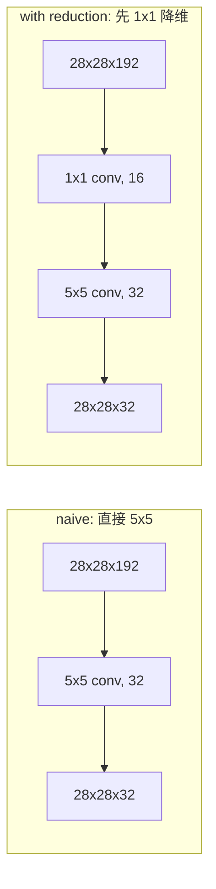

---
Title | ML Tasks Image Classification Inception V1
-- | --
Created @ | `2019-12-04T09:27:53Z`
Updated @| `2026-11-26T01:26:20Z`
Labels | ``
Edit @| [here](https://github.com/junxnone/aiwiki/issues/48)

---
# Inception V1

## Brief
- `GoogLeNet` 是对 `Yann LeCuns` 的 `LeNet` 致敬, 代号为Inception
- 获得了 `ILSVRC14` 比赛的冠军, 刷新了**图像分类与检测**的性能记录
- 用的参数比ILSVRC2012的冠军AlexNet少12倍，但准确率更高
- **图像尺度变化大的问题:**  全局信息使用大卷积核, 局部信息使用小卷积核
- **Inception Module**
  - 基于Hebbian法则, 稀疏连接有可能保持神经网络的性能
  - 1x1, 3x3, 5x5 Conv 并行结构
- 使用了辅助分类器

## GoogLeNet 网络结构

## Inception module

- naive :  5x5 卷积核计算量较大
- with dimension reductions:  为了降低特征图厚度，每层之前增加了 1x1 Conv

Name | Module
-- | --
naive version | 
with dimension reductions | 

下图以一个具体尺寸说明为什么要先用 $1\times1$ 卷积降维，计算对象是 `Inception 3a` 之后常见的 $28\times28\times192$ 输入，要输出 $32$ 个 $5\times5$ 卷积通道：

图中：

- 两条路径的输入输出尺寸相同，区别只是 `5x5` 卷积前是否多了一层 `1x1` 降维到 16 通道
- 左边直接卷积，右边先把 192 通道压到 16 通道再做 `5x5`，计算量大幅下降

$$
\text{MACs}_{naive}=H\,W\,C_{in}\,K^2\,C_{out},\qquad
\text{MACs}_{reduce}=H\,W\,C_{in}\,C_{r}+H\,W\,C_{r}\,K^2\,C_{out}
$$

其中：

- $H,W$：特征图高、宽，这里为 $28$；$C_{in}$：输入通道 $192$；$K$：卷积核边长 $5$；$C_{out}$：输出通道 $32$
- $C_r$：降维后的通道数，这里为 $16$
- 代入得 $\text{MACs}_{naive}=28\cdot28\cdot192\cdot25\cdot32\approx120.4\text{M}$，$\text{MACs}_{reduce}=28\cdot28\cdot192\cdot16+28\cdot28\cdot16\cdot25\cdot32\approx12.4\text{M}$，约节省 $10$ 倍

## Inception 模块的通道

$$
C_{out}=C_{1\times1}+C_{3\times3}+C_{5\times5}+C_{pool}
$$

其中：

- 四条并行分支 ($1\times1$、$3\times3$、$5\times5$、池化后 $1\times1$) 的输出在通道维度拼接 (concat)，所以总输出通道是各分支通道之和
- 例：`3a` 模块的各分支为 $64$、$128$ ($3\times3$，之前有 $96$ 通道的 $1\times1$ 降维)、$32$ ($5\times5$，之前 $16$ 通道降维)、$32$ (池化投影)，输出 $64+128+32+32=256$ 通道

## 辅助分类器

- 在中间的 4a、4d 之后接两个辅助分类器 (平均池化 + $1\times1$ 卷积 + 全连接 + softmax)
- 训练时总损失为 $L=L_{main}+0.3\,(L_{aux1}+L_{aux2})$，其中 $0.3$ 是辅助损失的权重；它给浅层额外的梯度，缓解深层网络的梯度消失，并有轻微的正则化作用
- 推理时丢弃辅助分类器

## 小结

- 22 层 (带参数的层)，9 个 Inception 模块，参数约 $6.8\text{M}$ `[待核实]`，ILSVRC-2014 分类 top-5 错误率约 $6.67\%$
- 用全局平均池化代替 [AlexNet](/0027_ML_Tasks_Image_Classification_AlexNet)、[VGGNet](/0146_ML_Tasks_Image_Classification_VGGNet) 的大全连接层，是参数骤减的主要原因
- 后续改进见 [Inception V2/V3](/0046_ML_Tasks_Image_Classification_Inception_V2V3)、[Inception V4](/0047_ML_Tasks_Image_Classification_Inception_V4)，总览见 [Inception](/0049_ML_Tasks_Image_Classification_Inception)

## Reference
-  2014 **Inception V1 / GoogleNet** Going deeper with convolutions [[paper](https://arxiv.org/pdf/1409.4842.pdf)]
- [深度学习---GoogLeNet](https://blog.csdn.net/qq_38906523/article/details/80061075)
- [Going deeper with convolutions](https://arxiv.org/pdf/1409.4842v1.pdf)
- [Inception结构](https://baike.baidu.com/item/Inception%E7%BB%93%E6%9E%84/22761220?fr=aladdin)
- [一文概览Inception家族的「奋斗史」](https://www.chainnews.com/articles/727946354364.htm)
- [深入浅出——网络模型中Inception的作用与结构全解析](https://blog.csdn.net/u010402786/article/details/52433324)
- [图像分类丨Inception家族进化史「GoogleNet、Inception、Xception」](https://www.cnblogs.com/vincent1997/p/10920036.html)
- [GoogLeNet系列解读](https://blog.csdn.net/shuzfan/article/details/50738394)
- [Hebbian theory - 赫布理论](https://zh.wikipedia.org/wiki/%E8%B5%AB%E5%B8%83%E7%90%86%E8%AE%BA)

