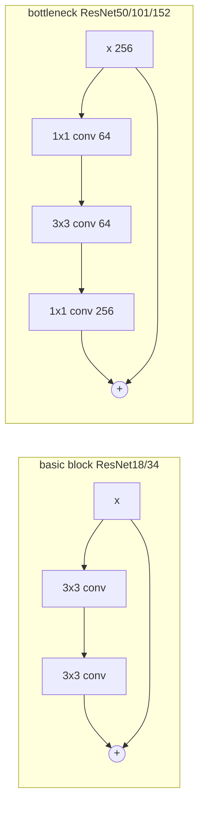

---
Title | ML Tasks Image Classification ResNet
-- | --
Created @ | `2019-02-12T01:59:44Z`
Updated @| `2026-11-26T01:26:31Z`
Labels | ``
Edit @| [here](https://github.com/junxnone/aiwiki/issues/51)

---
## Brief
- ResNet - Residual Network - 残差网络
- ResNet 提出于 2015 年，在 ImageNet 比赛 Classification 任务上获得第一名
- 解决的问题
  - 简单地增加网络层数会导致梯度消失和梯度爆炸，表现为收敛变慢，准确率变差
  - 归一化初始化和 BatchNorm 已基本解决梯度消失/爆炸，但网络更深后仍会出现退化问题 (degradation)：训练误差也变高，所以不是过拟合
  - 精度下降并不是由过拟合导致的
- 网络中增加直连通道 - shortcut connection
  - 让深度网络实现和浅层网络一样的性能，即让深度网络后面的层至少实现恒等映射的作用
- 很多其他网络借鉴了 ResNet: Alpha zero/MobileNetv2

梯度消失 精度下降 | 
-- | --

## Net 

---
**ResNet 101 -  101 Layers = 1 + 33 x 3  + 1**
- 7x7x64 卷积
- 3x3 max poool
- 经过3 + 4 + 23 + 3 = 33个building block，每个block为3层，所以有33 x 3 = 99层
- 最后有个fc层(用于分类)
>101层网络仅仅指卷积或者全连接层，而激活层或者Pooling层并没有计算在内

---
**ResNet 34**

### shortcut connection 
- 来源于 Highway Network 的思想: 允许原始输入信息直接传到后面的层中
- 残差：观测值与估计值之间的差。
  - 

---
- 
  - H(x) : 观测值
  - x : 估计值, 称为identity mapping
  - F(x) : residual mapping
- 在极端情况下如果 identity mapping 就能达到最佳了, 则另 F(x) = 0

### building block
- ResNet34 `buildingblock`
- ResNet50/101/152 `bottleneck` building block`
  - 1x1x64 到 64 channel 的 featuremap
  - 3x3x64 的卷积计算
  - 1x1x256 恢复 256 channel 
  - 目的：缩小计算量，减小 training 时间

## Residual Network Improve
> paper - Identity Mappings in Deep Residual Networks

## 不同的 shortcut connections 

--- 
Result
- 还是 `original` 比较好点

## 不同的 activation 用法

---
Result
- pre-activation 有所提升
  - 把 BN 和 ReLU 放在卷积的前面

## 残差学习公式

$$
y=\mathcal F(x,\{W_i\})+x,\qquad
\frac{\partial L}{\partial x}=\frac{\partial L}{\partial y}\left(1+\frac{\partial\mathcal F}{\partial x}\right)
$$

其中：

- $x$：残差块的输入；$y$：输出；$\mathcal F(x,\{W_i\})$：由若干卷积层组成的残差映射，$\{W_i\}$ 是这些层的权重
- 期望学到的映射为 $H(x)=\mathcal F(x)+x$，即网络学习的是相对输入的「残差」；当恒等映射已经最优时，只需把 $\mathcal F$ 学成 $0$，比直接让多层非线性网络拟合恒等映射容易得多
- 反向传播时梯度多了常数项 $1$：无论 $\partial\mathcal F/\partial x$ 多小，梯度都能通过 shortcut 直接传回浅层，这是深层网络能够训练的关键
- shortcut 要求 $x$ 与 $\mathcal F(x)$ 形状相同；通道数或尺寸变化时用 $1\times1$ 卷积 (步长 $2$) 做投影：$y=\mathcal F(x)+W_sx$，$W_s$ 为投影矩阵

下图是两种 building block 的结构，说明 bottleneck 如何用 $1\times1$ 卷积降低计算量：

图中：

- 每个方框是一层卷积 (后接 BN 和 ReLU)，`+` 是逐元素相加，从 `x` 直接连到 `+` 的线是 shortcut
- basic block 由两个 $3\times3$ 卷积组成；bottleneck 先用 $1\times1$ 把 $256$ 通道压到 $64$，在低维做 $3\times3$，再用 $1\times1$ 恢复到 $256$
- 参数量 (忽略 BN 和偏置)：bottleneck 为 $256\cdot64+3\cdot3\cdot64\cdot64+64\cdot256=69{,}632$，如果直接用两个 $3\times3\times256$ 卷积则为 $2\times589{,}824=1{,}179{,}648$，约少 $17$ 倍

## 不同深度的 ResNet

模型 | block 类型 | 各阶段 block 数 | 带权重层数 | 参数量 | 计算量 (MACs)
-- | -- | -- | -- | -- | --
ResNet-18 | basic | $[2,2,2,2]$ | $2+2\times8=18$ | 约 11.7 M | 约 1.8 G
ResNet-34 | basic | $[3,4,6,3]$ | $2+2\times16=34$ | 约 21.8 M | 约 3.6 G
ResNet-50 | bottleneck | $[3,4,6,3]$ | $2+3\times16=50$ | 约 25.6 M | 约 3.8 G
ResNet-101 | bottleneck | $[3,4,23,3]$ | $2+3\times33=101$ | 约 44.5 M | 约 7.6 G
ResNet-152 | bottleneck | $[3,8,36,3]$ | $2+3\times50=152$ | 约 60.2 M | 约 11.3 G

表中：`带权重层数` = 首个 $7\times7$ 卷积 + 末尾全连接 (共 $2$) + 每个 block 内的卷积层数 ($2$ 或 $3$) 乘以 block 总数；与上面 ResNet-101 的 $1+33\times3+1$ 一致。输入为 $224\times224$ 时，4 个阶段的特征图尺寸依次为 $56,28,14,7$，通道数为 $64,128,256,512$ (bottleneck 输出为 4 倍)。ResNet-152 在 ImageNet 上 3 个模型集成的 top-5 错误率为 $3.57\%$，获得 ILSVRC-2015 分类冠军。

## 与 VGG 的对比

- [VGG](/0146_ML_Tasks_Image_Classification_VGGNet)-19 约 $19.6\text{G}$ MACs 和 $144\text{M}$ 参数，ResNet-152 的计算量只有它的约 $58\%$，参数只有约 $42\%$，但层数是它的 $8$ 倍，精度更高
- 主要原因：用全局平均池化取代大全连接层，bottleneck 降低计算量，残差连接使 150 层以上的网络也能训练

## Identity Mappings 的改进

在恒等 shortcut 且把 BN、ReLU 放到卷积之前 (pre-activation) 时：

$$
x_{l+1}=x_l+\mathcal F(x_l),\qquad
x_L=x_l+\sum_{i=l}^{L-1}\mathcal F(x_i)
$$

$$
\frac{\partial L}{\partial x_l}=\frac{\partial L}{\partial x_L}\left(1+\frac{\partial}{\partial x_l}\sum_{i=l}^{L-1}\mathcal F(x_i)\right)
$$

其中：

- $x_l$：第 $l$ 个残差块的输入；$L$：总的残差块数
- 任意深层 $x_L$ 都等于浅层 $x_l$ 加上中间所有残差之和，信息可以不经任何非线性直接前传
- 梯度中的常数项 $1$ 保证梯度不会消失；如果 shortcut 上再加缩放、门控或 $1\times1$ 卷积，这个直通性就会被破坏，所以论文实验里 `original` (纯恒等) 效果最好
- pre-activation 在 ResNet-1001 这样极深的网络上提升明显

## 后续变体

- [Wide ResNet](https://arxiv.org/pdf/1605.07146.pdf)：减少深度、增加每层通道数，更容易并行
- ResNeXt：用分组卷积的 bottleneck；DenseNet：把相加改成拼接，每层连接所有之前的层
- SENet：在块内加入通道注意力 (Squeeze-and-Excitation)，见 [历史](/0166_ML_Tasks_Image_Classification_History)
- 残差思想被 [MobileNet V2](/0043_ML_Tasks_Image_Classification_MobileNet_V2)、[Inception-ResNet](/0047_ML_Tasks_Image_Classification_Inception_V4)、[UNet](/0161_ML_Tasks_Image_Segmentation_UNet)、Transformer 等广泛借鉴

## Reference
- 2015 **ResNet** Deep Residual Learning for Image Recognition [[paper](https://arxiv.org/abs/1512.03385)]
- 2016 Identity Mappings in Deep Residual Networks [[paper](https://arxiv.org/pdf/1603.05027.pdf)]
- [ResNet 解析](https://blog.csdn.net/lanran2/article/details/79057994)
- [paper - Wide Residual Networks](https://arxiv.org/pdf/1605.07146.pdf)
- [ResNet详解](https://www.jianshu.com/p/23c73b90657f)
- [大话深度残差网络（DRN）ResNet网络原理](https://my.oschina.net/u/876354/blog/1622896)
- [ResNet 分析](https://www.jianshu.com/p/d63ac154c8fc)
- [深度学习网络篇——ResNet](https://blog.csdn.net/weixin_43624538/article/details/85049699)
- [一文简述ResNet及其多种变体](http://baijiahao.baidu.com/s?id=1598536455758606033&wfr=spider&for=pc)
- [极深网络（ResNet/DenseNet）: Skip Connection为何有效及其它](https://blog.csdn.net/malefactor/article/details/67637785)
- [netscope - ResNet-50](http://ethereon.github.io/netscope/#/gist/8a6783850bd61e657234afce5196d772)

