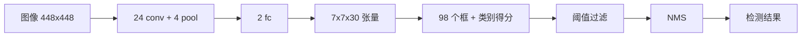

---
Title | ML Tasks Image Detection YOLO V1
-- | --
Created @ | `2020-01-13T06:31:10Z`
Updated @| `2026-11-25T16:51:30Z`
Labels | ``
Edit @| [here](https://github.com/junxnone/aiwiki/issues/54)

---

# YOLO V1

- One-Stage / Single-Stage
  - 转化为回归问题 - 拟合函数，从特征映射到(x,y,w,h)
- **Pipeline**
  - Preprocessing
    - Image Augmentation 
    - Resize 448x448
  - 24 Conv Layers + 4 Max Pooling Layers + 2 FC Layers => 98 BBox confidence - 7x7x30 
  - 阈值去掉置信度较低值
  - NMS 去重复

## Preprocessing
- **Augmentation**
  - scale
  - translation
  - exposure 
  - saturation
- **Resize**

## Arch

- 激活函数: 最后一层使用线性激活函数,其他使用  `leaky rectified linear activation`

> ReLU - Rectified Linear Unit

---
## Output(BBox)
- 每张图片分为 S x S 个格子
- 每个格子Predict B 个 BBox
- 获取Tensor : S x S x ( B x 5 + C ) 
- 5 : 每个 BBox 包含 5 个预测值 - `x, y, w, h, confidence`
  - 此处 confidence 指 BBox confidence
- C 指每个格子 Predict C Class probabilities

Confidence | 
-- | --
Probabilities | 

> YOLO - Pascal VOC : S=7 , B=2, C=20 ==> tensor=7x7x30

## NMS 去重复过程
- 1 将 score 低于阈值 `T-score` 的置 0 剔除
- 2 将每一类 BBox 按 score 排序, 选出每类最大值 `C-M-score-BBox`
- 3 遍历 BBox, 去掉和 `C-M-score-BBox` 重叠 IoU 超过阈值 `T-IoU` 的 BBox
- 4 从剩余的 BBox 中再次选出 `C-M-score-BBox`, 重复 3
- 5 重复剔除 BBox 后剩余的即为 NMS 结果
> 以上过程中每类 BBox 单独处理

## Loss - 损失函数
- 使用均方差损失函数

**从上到下损失:**
- 1 中心坐标损失
- 2 BBox 宽高损失
> 位置损失只计算和 GTBBox IoU 最大的 Predict BBox
- 3-1 BBox 置信度损失(含Object)
- 3-2 BBox 置信度损失(不含Object)
- 4 每个格子的类别损失

Name | Weight | Comment
-- | -- | --
λ coord | 5 | Localization 比分类更重要
λ noobj | 0.5 | 减少不含 Object 的权重

---

**Cell 误差**
- 含 Object : 位置误差 + 置信度误差 + 分类误差
- 不含 Object : 置信度误差

## Limitations
- 对重叠物体或相邻物体检测能力较差
  - 每个格子只能 Predict 2 个 BBox 和一个类别

## Reference
- 2015 **YOLO V1** You Only Look Once: Unified, Real-Time Object Detection [[paper](https://arxiv.org/pdf/1506.02640.pdf)] [[netscope](http://ethereon.github.io/netscope/#/gist/96209c6940e02b17c34009f6c3fee75e)] [[Code](https://pjreddie.com/darknet/yolo/)] [[Code2 - AlexeyAB](https://github.com/AlexeyAB/darknet)]
- [目标检测（九）--YOLO v1,v2,v3](https://blog.csdn.net/App_12062011/article/details/77554288)
- [pjreddie Publications](https://pjreddie.com/publications/)
- [yoloV1，看过好多篇，这篇感觉讲的最通俗易懂](https://blog.csdn.net/m0_37192554/article/details/81092514)
- [目标检测之YOLO V2 V3](http://www.cnblogs.com/wangguchangqing/p/10480995.html)
- [Yolo V1 - darknet - pjreddie ](https://pjreddie.com/darknet/yolov1/)
- [【目标检测】YOLO](https://zhuanlan.zhihu.com/p/63507794)
- [【目标检测】基础知识：IoU、NMS、Bounding box regression](https://zhuanlan.zhihu.com/p/60794316)
- [YOLO - PPT - deepsystems.io](https://docs.google.com/presentation/d/14H2c8UuUN0L5l9cDeG-M96UPE6U0CrZN0ChAUr-gN7o/edit#slide=id.p)
- [图解YOLO](https://zhuanlan.zhihu.com/p/24916786)

## 公式

### 置信度与类别得分

$$
\text{conf}=\Pr(\text{Object})\cdot\mathrm{IoU}^{truth}_{pred},\qquad
\text{score}_{c}=\Pr(\text{Class}_c\mid\text{Object})\cdot\text{conf}
$$

其中：

- $\Pr(\text{Object})$：该 BBox 里有物体的概率，训练时有物体取 $1$，没有取 $0$
- $\mathrm{IoU}^{truth}_{pred}$：预测框与真实框的交并比，因此置信度同时反映「有没有物体」和「框准不准」
- $\Pr(\text{Class}_c\mid\text{Object})$：格子里有物体时它属于第 $c$ 类的条件概率，每个格子只预测一组 ($C=20$)
- $\text{score}_c$：测试时每个 BBox 对第 $c$ 类的最终得分；$7\times7\times2=98$ 个框各有 $20$ 个得分，再经阈值和 NMS 得到结果

### 输出张量

$$
S\times S\times(B\cdot5+C)=7\times7\times(2\times5+20)=7\times7\times30=1470
$$

其中：$S=7$ 为网格数，$B=2$ 为每个格子预测的框数，$5$ 为 $(x,y,w,h,\text{conf})$，$C=20$ 为 PASCAL VOC 类别数；最后的全连接层输出 $4096\to1470$ 个值，再 reshape 成 $7\times7\times30$。其中 $x,y$ 是框中心相对所在格子的偏移 (归一化到 $[0,1]$)，$w,h$ 是相对整张图宽高的比例。

### 损失函数

$$
\begin{aligned}
L={}&\lambda_{coord}\sum_{i=0}^{S^2}\sum_{j=0}^{B}\mathbb 1^{obj}_{ij}\left[(x_i-\hat x_i)^2+(y_i-\hat y_i)^2\right]\\
&+\lambda_{coord}\sum_{i=0}^{S^2}\sum_{j=0}^{B}\mathbb 1^{obj}_{ij}\left[(\sqrt{w_i}-\sqrt{\hat w_i})^2+(\sqrt{h_i}-\sqrt{\hat h_i})^2\right]\\
&+\sum_{i=0}^{S^2}\sum_{j=0}^{B}\mathbb 1^{obj}_{ij}(C_i-\hat C_i)^2
+\lambda_{noobj}\sum_{i=0}^{S^2}\sum_{j=0}^{B}\mathbb 1^{noobj}_{ij}(C_i-\hat C_i)^2\\
&+\sum_{i=0}^{S^2}\mathbb 1^{obj}_{i}\sum_{c}\left(p_i(c)-\hat p_i(c)\right)^2
\end{aligned}
$$

其中：

- 带帽的量 $\hat x,\hat y,\hat w,\hat h,\hat C,\hat p$ 为网络预测值，不带帽的是真实值
- $\mathbb 1^{obj}_{ij}$：第 $i$ 个格子的第 $j$ 个预测框「负责」某个真实物体 (在该格子的 $B$ 个框中与真实框 IoU 最大) 时为 $1$，否则为 $0$；$\mathbb 1^{noobj}_{ij}$ 恰好相反；$\mathbb 1^{obj}_i$：第 $i$ 个格子里有物体中心
- 第 1 项：中心坐标误差；第 2 项：宽高误差，对宽高取平方根，使大框的偏差比小框的同样偏差代价更小 (小框对相同像素误差更敏感)
- 第 3、4 项：置信度误差，分别对有物体和没有物体的框；第 5 项：类别概率误差，只在有物体的格子里计算
- $\lambda_{coord}=5$：提高定位误差的权重；$\lambda_{noobj}=0.5$：降低没有物体的框的权重，因为绝大多数框都是背景，否则会把置信度整体推向 $0$ 并压制有物体的梯度

下图是推理流程：

图中：

- 前三步是网络前向：卷积提取特征，全连接层直接回归出 $7\times7\times30$ 的张量，整个过程只需看一次图像，所以叫 You Only Look Once
- 后三步是后处理：把每个框的得分按阈值过滤，再对每个类别单独做 NMS，见 [Detection](/0152_ML_Tasks_Image_Detection)

## 优缺点

- 速度：论文中 YOLO 达到 $45$ FPS，Fast YOLO (更小的网络) 达到 $155$ FPS，VOC 2007 mAP 分别为 $63.4\%$ 和 $52.7\%$ (相比 Faster R-CNN 精度较低，但快很多)
- 背景误检少：因为看的是整张图的全局信息，不像基于候选区域的方法只看局部
- 局限：
  - 每个格子最多预测 $2$ 个框、$1$ 个类别，对密集的小物体 (如鸟群) 效果差
  - 输出分辨率只有 $7\times7$，定位较粗
  - 对新的长宽比泛化差，因为框是直接回归而不是基于 anchor
  - 这些问题在 [YOLO V2](/0055_ML_Tasks_Image_Detection_YOLO_V2) 里通过 anchor、更高分辨率特征和多尺度训练缓解

