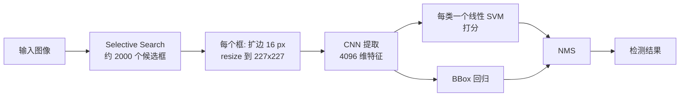

---
Title | ML Tasks Image Detection RCNN
-- | --
Created @ | `2019-12-11T05:17:38Z`
Updated @| `2026-11-25T16:51:41Z`
Labels | ``
Edit @| [here](https://github.com/junxnone/aiwiki/issues/57)

---
## Reference

- 2014 **R-CNN** Rich feature hierarchies for accurate object detection and semantic segmentation [[paper](https://arxiv.org/pdf/1311.2524.pdf)] [[Code](https://github.com/rbgirshick/rcnn)]
- [Ross Girshick blog -  一作](http://www.rossgirshick.info/)

## Brief
- **RCNN** - `Region-based Convolutional Neural Networks`
  - Object Detection
  - Semantic Segmentation
- 目标检测 = 目标定位 + 目标分类
- 滑动窗口 - 提取候选框 
- ImageNet 预训练的权重在 PASCAL VOC 上 fine-tune
- **Pipeline**
  - Region Proposals - 使用 Selective Search 方法提取 `2000 候选框` 
  - Feature extraction - 提取每个候选框的特征向量 `4096 vector`
  - CNN + SVM 对每个候选框进行分类
  - NMS 去重复

---

## 提取候选框 - Region Proposal
- Selective Search 方法提取 Region Proposal
- 膨胀处理 认为添加边框 - 16 pixels
- 所有的框预处理直接 resize 到 227 x 227 作为 特征提取的输入 (CNN要求的Input)

## 提取特征向量
- AlexNet 提取 4096 维特征向量

## 目标分类
- SVM
- IoU 非极大性抑制
  - 剔除重叠区域
- SGD - lr 0.001 - mini-batch 128 = 32 positive + 96 background 

## Bounding Box Regression - BBox 回归

## Semantic  Segmentation
- CPMC regions
- full + fg

## Test Result

## Tips
- UVA System - UVA 指 `University of Amsterdam` , 整体指论文 `Selective Search for Object Recognition` 中的的实现

## 流程图

下图是 R-CNN 推理时的完整流程，说明为什么它慢：

图中：

- 候选框由 Selective Search 提取，与深度网络无关；每个候选框都单独裁剪、缩放后送入 CNN，即一张图要做约 $2000$ 次完整的前向传播，这是 R-CNN 最大的速度瓶颈
- CNN 输出的 $4096$ 维特征同时送入两个分支：每个类别一个线性 SVM 做分类，一个回归器微调框的位置
- 最后对每个类别分别做 NMS，见 [Detection](/0152_ML_Tasks_Image_Detection)

## 训练细节

阶段 | 训练内容 | 正负样本定义
-- | -- | --
1. 预训练 | ImageNet 分类 (AlexNet) | -
2. 微调 CNN | 用 $N+1$ 类 (含背景) softmax 在 VOC 上微调 | 与真实框 $\mathrm{IoU}\ge0.5$ 为正，其余为背景；每个 mini-batch 128 个：$32$ 个正样本 + $96$ 个背景
3. 训练 SVM | 每类一个二分类线性 SVM，输入为 CNN 的 $4096$ 维特征 | 正样本：仅真实框；负样本：与该类所有真实框 $\mathrm{IoU}<0.3$
4. BBox 回归 | 每类一个岭回归，输入是 pool5 特征 | 与真实框 $\mathrm{IoU}\ge0.6$ 的候选框

表中：微调和 SVM 的正样本定义不同 (阶段 2 宽松，阶段 3 严格)，这是个经验选择：微调时需要足够多的正样本防止过拟合，SVM 训练则要求更精确的框；softmax 微调后再单独训练 SVM 也使它的精度略高于直接使用 softmax 分类，这一步在后来的 [Fast R-CNN](/0058_ML_Tasks_Image_Detection_FastRCNN) 里被去掉。

## BBox 回归

$$
\hat G_x=P_wd_x(P)+P_x,\quad \hat G_y=P_hd_y(P)+P_y,\quad
\hat G_w=P_w\exp\bigl(d_w(P)\bigr),\quad \hat G_h=P_h\exp\bigl(d_h(P)\bigr)
$$

其中：

- $P=(P_x,P_y,P_w,P_h)$：候选框的中心坐标和宽高；$\hat G$：校正后的预测框
- $d_\ast(P)$：回归器输出，是候选框特征的线性函数 $d_\ast(P)=\mathbf w_\ast^\top\phi(P)$，$\phi(P)$ 为 pool5 特征，$\mathbf w_\ast$ 由岭回归求解
- 中心的偏移按候选框宽高归一化，宽高用指数保证为正，与 [Detection](/0152_ML_Tasks_Image_Detection) 里的 $t_x,t_y,t_w,t_h$ 编码是同一套形式

## 结果与局限

- 结果：PASCAL VOC 2010 上 mAP $53.7\%$，明显超过之前最好的 DPM 方法 (约 $35\%$) `[待核实]`，证明了 CNN 特征用于检测的价值
- 局限：
  - 慢：每张图要对 $2000$ 个候选框做 CNN 前向，论文中 VGG-16 约 $47$ 秒/张 (GPU)
  - 占存储：要把所有候选框的特征存盘供 SVM 训练使用，需要数百 GB
  - 多阶段训练：CNN 微调、SVM、回归器分别训练，不能端到端
  - 候选框被强行缩放到 $227\times227$，会造成形变
- 这些问题依次被 [Fast R-CNN](/0058_ML_Tasks_Image_Detection_FastRCNN)、[Faster R-CNN](/0059_ML_Tasks_Image_Detection_FasterRCNN) 解决，三者对比见 [RCNNs](/0060_ML_Tasks_Image_Detection_RCNNs)

