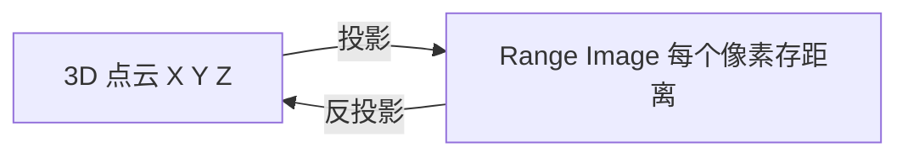

---
Title | 3D Tools PCL RangeImage
-- | --
Created @ | `2021-05-24T02:19:25Z`
Updated @| `2026-11-26T09:13:40Z`
Labels | ``
Edit @| [here](https://github.com/junxnone/aiwiki/issues/84)

---
# Range Image

> A range image (or depth map) is an image whose pixel values represent a distance or depth from the sensor’s origin

- Range Image <--> Point Cloud
- 视角 - Camera 作为 原点

- Green - `-INFINITY` - 不可见区域
- Blue - 远程

图中：该图为 PCL 文档的 Range Image 示意图；绿色表示 $-\infty$（该方向没有测到点，即不可见区域），蓝色表示距离较远的点。

## 与点云的转换

图中：

- 投影：以传感器为原点，把每个 3D 点投影到像素网格，像素值存该点到传感器的距离
- 反投影：由像素位置和距离恢复出 3D 点
- 关键结论：Range Image 把无序的点云变成有序的二维结构，便于使用图像处理方法

针孔相机模型下的投影和反投影：

$$
u=f_x\frac{X}{Z}+c_x,\quad v=f_y\frac{Y}{Z}+c_y,\qquad X=\frac{(u-c_x)Z}{f_x},\quad Y=\frac{(v-c_y)Z}{f_y}
$$

其中：

- $(X,Y,Z)$：点在相机坐标系下的坐标，$Z$ 为深度；$(u,v)$：像素坐标
- $f_x,f_y$：以像素为单位的焦距；$c_x,c_y$：主点（光心）的像素坐标
- 对激光雷达，PCL 使用球面投影：像素由方位角和俯仰角（按角分辨率划分）确定，像素值为距离 $r=\sqrt{X^2+Y^2+Z^2}$

## 特点

| 特点 | 说明 |
| --- | --- |
| 有序 | 像素排列固定，邻域查询简单 |
| 视角相关 | 只包含传感器能看到的点，被遮挡的点缺失 |
| 无效值 | 没有测到的像素用特殊值（如 $-\infty$）表示 |
| 用途 | 边缘检测、特征提取（如 NARF）、可见性判断 |

表中：对比结论：Range Image 的优势是有序和高效，代价是丢失遮挡后的信息。

## Reference
- [Range Image - pcl](https://pcl.readthedocs.io/en/latest/walkthrough.html?highlight=range%20image#range-image)

