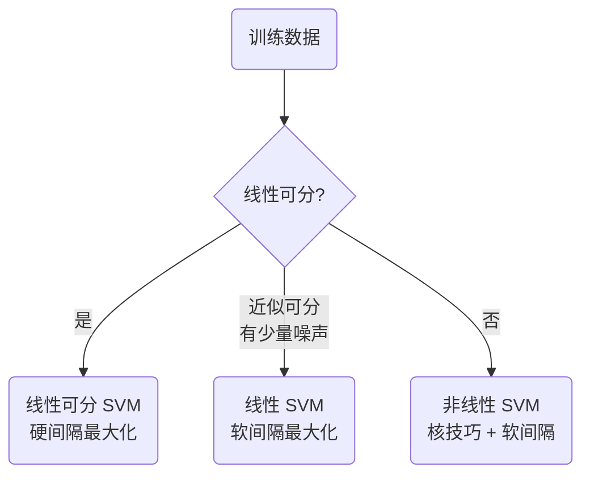

---
Title | ML OML SVM
-- | --
Created @ | `2019-05-11T13:48:41Z`
Updated @| `2026-11-24T05:37:15Z`
Labels | ``
Edit @| [here](https://github.com/junxnone/aiwiki/issues/115)

---
# SVM 支持向量机

- SVM - Support Vector Machine - 支持向量机
- [SVM 原理推导](/0116_ML_OML_SVM_原理)
- 监督式学习
  - 统计分类
  - 回归分析
- **支持向量** - 数据线性可分, 与超平面距离最近的点被称为 `支持向量(support vector)`
  - 超平面的决定只有支持向量起作用，其他数据无影响
- 通过一个核映射 φ 将数据从原始输入空间映射到一个高维特征空间, 使之在高维空间线性可分
- **Margin** - 超平面到支持向量的距离
- 超平面 vs 最大间隔超平面
  - 可以分开数据
  - 到支持向量间隔最大
- 属于 [传统机器学习](/0367_ML_OML)，在小样本、高维数据上效果好，深度学习之前的主流分类器（如 `HOG + SVM` 做行人检测）

下图是 SVM 的几何直观，左右两幅图分别对应不同的数据分布和分类面：

 | 
-- | --

图中：

- 数据点按两类表示，位于间隔边界上的点就是**支持向量**，它们决定了分类面的位置，其余点即使移动（只要不越过间隔）也不影响结果
- 分类超平面是一条位于两类之间的线，与两侧支持向量的距离（Margin）最大化，间隔越大，泛化能力越强

## 基本概念

SVM Details |  Description
-- | --
SVM 核心理念 | 在所有能分开数据的超平面中，选择**间隔最大**的那一个；间隔越大对噪声越稳健，泛化越好
SVM 复杂度 | 训练一般为 $O(n^2 \sim n^3)$（$n$ 为样本数），预测为 $O(n_{SV} \cdot d)$（$n_{SV}$ 支持向量数，$d$ 特征维度）；线性 SVM 可降到 $O(n \cdot d)$
SVM Kernel | 用于处理非线性问题, k() = 特征变换函数的点乘

表中说明了 SVM 的核心思想、规模代价和核函数的作用：SVM 的训练是求解二次规划，样本数大时代价高，这也是它不适合超大数据集的原因；核函数让模型不需要显式计算高维映射。

### 间隔 Margin

间隔/Margin Details |  Description
-- | --
函数间隔 | $\hat{\gamma}_i = y_i\,(w^\top x_i + b)$
几何间隔 | $\gamma_i = \frac{y_i\,(w^\top x_i + b)}{\lVert w \rVert}$
硬间隔 | 问题线性可分
软间隔 | 问题线性不可分, 近似线性可分

其中：

- $x_i$：第 $i$ 个样本的特征向量；$y_i \in \{-1, +1\}$：该样本的类别标签
- $w$：超平面的法向量，$b$：偏置，超平面方程为 $w^\top x + b = 0$
- $\hat{\gamma}_i$：函数间隔，符号表示分类是否正确，绝对值表示确信度；但把 $w, b$ 同时放大 2 倍，超平面不变而函数间隔翻倍，所以它不适合直接衡量距离
- $\gamma_i$：几何间隔，即样本点到超平面的真实欧氏距离（除以 $\lVert w \rVert$ 后不随 $w, b$ 的缩放而改变）；$\lVert w \rVert$ 为 $w$ 的 L2 范数
- SVM 最大化的是所有样本中**最小的几何间隔**，该最小值取到的样本就是支持向量

## SVM 分类

下图说明如何根据数据特点选择 SVM 的类型：



图中：

- 数据完全线性可分时用硬间隔；有少量噪声或重叠时允许部分点违反间隔，用软间隔；边界本身是曲线时通过核函数映射到高维再做线性分类
- 实际应用中数据几乎总是有噪声，所以通常使用「软间隔 + 核函数」的组合，硬间隔只是理论上的基础

- 线性可分 SVM
- 线性 SVM
- 非线性 SVM


### 线性可分 SVM
- 训练数据线性可分
- 通过硬间隔(hard margin)最大化可以学习得到一个线性分类器

$$
\min_{w, b}\ \frac{1}{2}\lVert w \rVert^2 \qquad \text{s.t.}\ \ y_i\,(w^\top x_i + b) \ge 1,\ \ i = 1, \dots, n
$$

其中：

- 约束 $y_i (w^\top x_i + b) \ge 1$：所有样本都被正确分类，并且函数间隔不小于 1（通过缩放 $w, b$ 把支持向量的函数间隔固定为 1）
- 此时几何间隔为 $\frac{1}{\lVert w \rVert}$，所以最大化间隔等价于最小化 $\frac{1}{2}\lVert w \rVert^2$（系数 $\frac{1}{2}$ 只是为了求导方便）
- 这是一个凸二次规划问题，解唯一，推导见 [SVM 原理推导](/0116_ML_OML_SVM_原理)


### 线性 SVM
- 训练数据线性不可分，但近似线性可分
- 通过软间隔(soft margin)最大化可以学习得到一个线性分类器
- 使用 hinge 损失来优化使不可分的数据尽可能少

$$
\min_{w, b, \xi}\ \frac{1}{2}\lVert w \rVert^2 + C\sum_{i=1}^{n}\xi_i \qquad \text{s.t.}\ \ y_i\,(w^\top x_i + b) \ge 1 - \xi_i,\ \ \xi_i \ge 0
$$

等价的无约束形式（hinge 损失 + L2 正则）：

$$
\min_{w, b}\ \frac{1}{2}\lVert w \rVert^2 + C\sum_{i=1}^{n}\max\big(0,\ 1 - y_i (w^\top x_i + b)\big)
$$

其中：

- $\xi_i \ge 0$：松弛变量，第 $i$ 个样本违反间隔的程度；$\xi_i = 0$ 表示在间隔外且分类正确，$0 < \xi_i \le 1$ 表示在间隔内但分类正确，$\xi_i > 1$ 表示被分错
- $C > 0$：惩罚系数，控制「间隔大」与「违反少」的折中：$C$ 大则对误分类惩罚重，间隔小，容易过拟合；$C$ 小则容忍更多错误，间隔大，容易欠拟合；$C \to \infty$ 退化为硬间隔
- $\max(0, 1 - y_i f(x_i))$：hinge 损失，样本被正确分类且在间隔外（$y_i f(x_i) \ge 1$）时损失为 0，所以只有支持向量和违反间隔的点才影响结果
- 与逻辑回归的对比：逻辑回归用对数损失，所有样本都有贡献；SVM 用 hinge 损失，间隔外的样本损失为 0

### 非线性 SVM

线性不可分二维数据 | 
-- | --
投影到三维空间进行分割 | 
分割平面投影回二维空间 | 

上表三张图展示了非线性 SVM 的思路：

- 第一行：二维空间里的数据线性不可分（如一类在内圈，另一类在外圈）
- 第二行：通过映射 $\phi$ 把数据投影到三维空间，在高维空间里可以用一个平面把两类分开
- 第三行：把这个分割平面投影回原来的二维空间，得到的是一条**曲线**形式的分类边界

### Kernel trick 核技巧

- 直接计算高维映射 $\phi(x)$ 代价高（RBF 核对应无穷维），但 SVM 的对偶问题和预测函数中只出现样本之间的**内积** $\phi(x_i)^\top\phi(x_j)$
- 核技巧：直接用核函数 $k(x_i, x_j) = \phi(x_i)^\top\phi(x_j)$ 计算内积，**不需要显式写出 $\phi$**

$$
f(x) = \operatorname{sign}\Big(\sum_{i \in SV}\alpha_i\, y_i\, k(x_i, x) + b\Big)
$$

其中：

- $\alpha_i \ge 0$：对偶问题求出的拉格朗日乘子，只有支持向量的 $\alpha_i > 0$，其余样本不参与预测；$SV$ 为支持向量集合
- $k(x_i, x)$：核函数，衡量训练样本 $x_i$ 与待预测样本 $x$ 的相似度；$y_i$：标签；$b$：偏置
- 预测结果是支持向量与待测样本的相似度的加权和，权重 $\alpha_i y_i$ 带符号，再取符号函数得到类别

常用核函数（详见 [Pairwise Metrics](/0139_ML_Metrics_Pairwise)）：

Kernel | Formula | 参数 | 说明
-- | -- | -- | --
Linear | $k(x, z) = x^\top z$ | 无 | 特征维度高、样本稀疏（文本）时首选，速度快
Polynomial | $k(x, z) = (\gamma\, x^\top z + r)^d$ | $\gamma, r, d$ | 能表达特征间的交互项，$d$ 大时数值不稳定
RBF (Gaussian) | $k(x, z) = \exp(-\gamma \lVert x - z \rVert^2)$ | $\gamma$ | 最常用的默认选择，对应无穷维特征空间
Sigmoid | $k(x, z) = \tanh(\gamma\, x^\top z + r)$ | $\gamma, r$ | 类似两层神经网络，不一定半正定，较少使用

其中：$x, z$ 为两个样本的特征向量，$\gamma$ 为核的尺度参数，$r$ 为偏置常数，$d$ 为多项式次数。

### 超参数 $C$ 与 $\gamma$

Parameter | 取值小 | 取值大
-- | -- | --
$C$ | 间隔大，容忍误分类，倾向**欠拟合** | 间隔小，严格拟合训练集，倾向**过拟合**
$\gamma$ (RBF) | 每个样本影响范围大，边界平滑，倾向**欠拟合** | 每个样本只影响很小范围，边界复杂，倾向**过拟合**

表中说明了两个最重要的超参数：$C$ 和 $\gamma$ 联合决定模型复杂度，通常用网格搜索或贝叶斯优化在对数尺度上搜索（如 $C \in [10^{-2}, 10^{3}]$，$\gamma \in [10^{-4}, 10^{1}]$），并结合交叉验证，见 [HPO](/0013_ML_AutoML_HPO) 和 [Cross Validation](/0249_ML_Metrics_CrossValidation)。

## 使用要点

- **特征必须缩放**：SVM（尤其是 RBF 核）基于距离，不同量纲的特征会使距离被大尺度特征主导，使用前要标准化或归一化
- **类别不均衡**：设置 `class_weight='balanced'` 或对少数类使用更大的 $C$
- **核的选择**：特征很多（维度远大于样本）先试线性核；样本数适中、特征不多时用 RBF 核；样本数极大时用 `LinearSVC` 或 SGD 训练的线性 SVM
- **概率输出**：SVM 默认输出到超平面的距离而不是概率

## SVM 优缺点
**优点**
- SVM是一个凸优化问题，所以求得的解一定是全局最优而不是局部最优
- 不仅适用于线性线性问题还适用于非线性问题
- 也适合高维样本空间的数据
- 理论基础比较完善(对比于NN)
- 模型只由支持向量决定，预测时只需保存支持向量
----
**缺点**
- 不适用于超大数据集
- 对特征缩放和超参数（$C$、$\gamma$、核函数）敏感
- 不直接输出概率
- 多分类需要组合多个二分类器

## 其他


### ProbSVM

- 标准 SVM 输出的是决策函数值 $f(x)$（到超平面的有符号距离），不是概率
- **Platt Scaling**：在 $f(x)$ 上拟合一个 sigmoid 函数得到概率，scikit-learn 中 `SVC(probability=True)`，内部用交叉验证拟合，训练时间约增加 5 倍

$$
P(y=1 \mid x) = \frac{1}{1 + \exp\big(A f(x) + B\big)}
$$

其中：$f(x)$ 为 SVM 的决策函数值；$A, B$ 是在验证数据上通过最大似然拟合出的两个标量参数，用来把距离映射到 $(0, 1)$ 的概率。

### 多分类支持向量机

- SVM 本身是二分类器，多分类通过组合实现：

Strategy | 做法 | 分类器数量 | 说明
-- | -- | -- | --
One-vs-Rest (OvR) | 每个类别对其余所有类别训练一个分类器，取得分最高的类别 | $K$ | 各分类器使用全部数据，类别不均衡
One-vs-One (OvO) | 每两个类别训练一个分类器，投票决定 | $\frac{K(K-1)}{2}$ | 每个分类器只用两类数据，训练快，`SVC` 默认
Crammer-Singer | 直接优化多类目标 | 1 | 较少使用

其中 $K$ 为类别数。表中说明了两种常见策略：OvO 的分类器数量多，但每个分类器的训练集小，所以总体训练时间通常不比 OvR 长。

### SVR

- **SVR** - Support Vector Regression，支持向量回归
- 思路：在预测值周围建立宽度为 $\varepsilon$ 的「管道」，管道内的误差不惩罚，只惩罚管道外的点

$$
\min_{w, b}\ \frac{1}{2}\lVert w \rVert^2 + C\sum_{i=1}^{n}\max\big(0,\ \lvert y_i - (w^\top x_i + b) \rvert - \varepsilon\big)
$$

其中：

- $y_i$：真实的连续值标签；$w^\top x_i + b$：模型预测值（加核函数后同样适用）
- $\varepsilon > 0$：管道半宽，预测误差在 $\varepsilon$ 以内不产生损失，称为 $\varepsilon$-不敏感损失；$\varepsilon$ 越大，模型越稀疏（支持向量越少）
- $C$：与分类 SVM 相同，是对管道外误差的惩罚系数

### One-Class SVM

- 只使用「正常样本」训练，学习一个包围正常数据的边界，边界外的样本判为异常，用于异常检测和新颖性检测
- 与 [Anomaly](/0277_ML_Tasks_Image_Anomaly) 任务相关，评估方式见 [Anomaly Detection Metrics](/0711_ML_Metrics_Anomaly)

## History

- 1963 年原始 SVM
- 1992 年 `kernel trick` 应用于最大限度的超平面上创建非线性分类器
- 1993-1995 年 `soft margin`
- 1996 年 支持回归 - SVR
- 2011年 `Bayesian SVM` 

## Code
```python
from sklearn.pipeline import make_pipeline
from sklearn.preprocessing import StandardScaler
from sklearn.svm import SVC, LinearSVC
from sklearn.model_selection import GridSearchCV

# 缩放 + RBF SVM, 网格搜索 C 和 gamma
pipe = make_pipeline(StandardScaler(), SVC(kernel='rbf', class_weight='balanced'))
grid = {'svc__C': [0.1, 1, 10, 100], 'svc__gamma': [1e-3, 1e-2, 1e-1, 1]}
search = GridSearchCV(pipe, grid, cv=5, scoring='f1_macro').fit(X_train, y_train)
print(search.best_params_, search.best_score_)

# 大数据集用线性 SVM
clf = make_pipeline(StandardScaler(), LinearSVC(C=1.0)).fit(X_train, y_train)
```

## Reference
- [SVM 简介](https://blog.csdn.net/liugan528/article/details/79448379)
- [我所理解的 SVM（支持向量机）- 1](https://zhuanlan.zhihu.com/p/22400898)
- [SVM教程：支持向量机的直观理解](https://zhuanlan.zhihu.com/p/40857202)
- [sklearn - 1.4. Support Vector Machines](http://scikit-learn.sourceforge.net/stable/modules/svm.html#svm)
- implement
  - [libsvm](https://www.csie.ntu.edu.tw/~cjlin/libsvm/)
  - [sklearn.svm](http://scikit-learn.sourceforge.net/stable/modules/classes.html#module-sklearn.svm)


