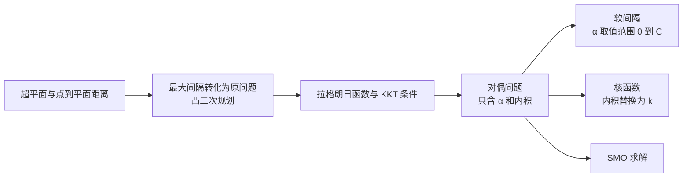

---
Title | ML OML SVM 原理
-- | --
Created @ | `2021-03-29T05:16:05Z`
Updated @| `2026-11-24T05:34:35Z`
Labels | ``
Edit @| [here](https://github.com/junxnone/aiwiki/issues/116)

---
# SVM 原理推导

- 本文推导 [SVM](/0115_ML_OML_SVM) 的数学原理：从超平面出发，得到**原问题**，再用拉格朗日对偶得到**对偶问题**，最后引入软间隔和核函数
- 属于 [传统机器学习](/0367_ML_OML)

下图是整个推导的主线：

图中：

- 先把「分类间隔最大」写成约束优化问题（原问题），再通过拉格朗日对偶转换为只含样本内积的对偶问题
- 对偶问题有两个好处：一是便于引入核函数处理非线性，二是解中只有支持向量的 $\alpha$ 非零；软间隔只是给 $\alpha$ 加上上界 $C$
- 对偶问题的变量很多，实际使用 SMO（序列最小优化）算法求解

##  SVM 推导

### 1. 超平面与分类

- 在 $d$ 维特征空间中，超平面由法向量 $w$ 和偏置 $b$ 确定：

$$
w^\top x + b = 0
$$

其中：

- $x \in \mathbb{R}^d$：特征空间中的点；$w \in \mathbb{R}^d$：超平面的法向量，决定超平面的方向；$b \in \mathbb{R}$：偏置，决定超平面离原点的位置
- 二维空间中超平面就是一条直线，三维空间中是一个平面

- 对于标签 $y_i \in \{-1, +1\}$ 的二分类问题，分类决策函数为 $f(x) = \operatorname{sign}(w^\top x + b)$，**正确分类**等价于：

$$
y_i\,(w^\top x_i + b) > 0, \qquad i = 1, \dots, n
$$

其中：$n$ 为样本数；$x_i$、$y_i$ 分别为第 $i$ 个样本的特征和标签。$y_i$ 与 $w^\top x_i + b$ 同号时样本在超平面的正确一侧，乘积为正。

### 2. 点到超平面的距离

$$
r_i = \frac{\lvert w^\top x_i + b \rvert}{\lVert w \rVert} = \frac{y_i\,(w^\top x_i + b)}{\lVert w \rVert}
$$

其中：

- $r_i$：样本 $x_i$ 到超平面的几何距离（即几何间隔）；$\lVert w \rVert = \sqrt{w^\top w}$ 为 $w$ 的 L2 范数
- 分子 $w^\top x_i + b$ 是点代入超平面方程的值，除以 $\lVert w \rVert$ 把它变成真实距离；分类正确时 $y_i (w^\top x_i + b) = \lvert w^\top x_i + b \rvert$，所以第二个等号成立

### 3. 最大间隔 → 原问题

- 间隔 $\gamma$ 定义为所有样本中最小的几何间隔：

$$
\gamma = \min_i \frac{y_i\,(w^\top x_i + b)}{\lVert w \rVert}
$$

- 目标是最大化 $\gamma$，即：

$$
\max_{w, b}\ \gamma \quad \text{s.t.}\quad \frac{y_i\,(w^\top x_i + b)}{\lVert w \rVert} \ge \gamma,\ \ i = 1, \dots, n
$$

- $(w, b)$ 可以同时缩放而不改变超平面。利用这个自由度，令最小的函数间隔 $\min_i y_i (w^\top x_i + b) = 1$（支持向量上取等号），则 $\gamma = \frac{1}{\lVert w \rVert}$。最大化 $\frac{1}{\lVert w \rVert}$ 等价于最小化 $\frac{1}{2}\lVert w \rVert^2$，得到 **SVM 原问题**：

$$
\min_{w, b}\ \frac{1}{2}\lVert w \rVert^2 \qquad \text{s.t.}\ \ y_i\,(w^\top x_i + b) \ge 1,\ \ i = 1, \dots, n
$$

其中：

- $\gamma$：间隔，越大越好；$\frac{1}{2}$ 是为了求导后系数为 1
- 目标函数是凸的二次函数，约束是线性不等式，因此是**凸二次规划**问题，局部最优即全局最优，且解唯一
- 两侧支持向量所在的边界超平面 $w^\top x + b = \pm 1$ 之间的距离是 $\frac{2}{\lVert w \rVert}$

### 4. 拉格朗日对偶

- 为每个约束引入拉格朗日乘子 $\alpha_i \ge 0$，构造拉格朗日函数：

$$
L(w, b, \alpha) = \frac{1}{2}\lVert w \rVert^2 - \sum_{i=1}^{n}\alpha_i\Big[y_i\,(w^\top x_i + b) - 1\Big]
$$

其中：

- $\alpha = (\alpha_1, \dots, \alpha_n)$：拉格朗日乘子向量，$\alpha_i \ge 0$ 对应第 $i$ 个样本的不等式约束
- 原问题等价于 $\min_{w, b}\max_{\alpha \ge 0} L(w, b, \alpha)$：若某个约束被违反，$\max_\alpha$ 会使 $L \to \infty$，所以最小化时自然满足约束

- 因为原问题是凸的且满足 Slater 条件，**强对偶**成立，可以交换 min 和 max：$\max_{\alpha \ge 0}\min_{w, b} L(w, b, \alpha)$
- 先对 $w, b$ 求偏导并令其为 0：

$$
\frac{\partial L}{\partial w} = w - \sum_{i=1}^{n}\alpha_i y_i x_i = 0 \ \Rightarrow\ w = \sum_{i=1}^{n}\alpha_i y_i x_i, \qquad \frac{\partial L}{\partial b} = -\sum_{i=1}^{n}\alpha_i y_i = 0
$$

其中：第一个式子说明 $w$ 是训练样本的**线性组合**（权重为 $\alpha_i y_i$）；第二个式子是 $\alpha$ 必须满足的等式约束。

- 把它们代回 $L$，消去 $w$ 和 $b$，得到 **对偶问题**：

$$
\max_{\alpha}\ \sum_{i=1}^{n}\alpha_i - \frac{1}{2}\sum_{i=1}^{n}\sum_{j=1}^{n}\alpha_i\alpha_j\,y_i y_j\,x_i^\top x_j \qquad \text{s.t.}\ \ \sum_{i=1}^{n}\alpha_i y_i = 0,\ \ \alpha_i \ge 0
$$

其中：

- 目标函数只出现样本之间的**内积** $x_i^\top x_j$，这是引入核函数的关键
- 变量个数从原问题的 $d+1$（$w, b$）变成了 $n$（每个样本一个 $\alpha_i$），所以样本数大时对偶问题更难求解，但特征维度很高（甚至无穷维）时对偶问题更有优势
- 这仍然是一个凸二次规划问题，通常用 SMO 算法求解

### 5. KKT 条件与支持向量

- 最优解必须满足 KKT 条件，其中的**互补松弛条件**：

$$
\alpha_i\Big[y_i\,(w^\top x_i + b) - 1\Big] = 0, \qquad \alpha_i \ge 0, \qquad y_i\,(w^\top x_i + b) \ge 1
$$

其中：

- 对每个样本，$\alpha_i = 0$ 或者 $y_i (w^\top x_i + b) = 1$ 两者至少成立一个
- 若 $\alpha_i > 0$，则 $y_i (w^\top x_i + b) = 1$，即样本恰好落在间隔边界上，这个样本就是**支持向量**
- 若样本在间隔外（$y_i (w^\top x_i + b) > 1$），则必须 $\alpha_i = 0$，对 $w$ 没有贡献。所以 $w = \sum_{i \in SV}\alpha_i y_i x_i$ 只由支持向量决定，这解释了「超平面只由支持向量决定」
- 求出 $\alpha^*$ 后，$w^* = \sum_i \alpha_i^* y_i x_i$；任取一个支持向量 $(x_s, y_s)$，有 $b^* = y_s - \sum_{i}\alpha_i^* y_i\,x_i^\top x_s$（实际使用所有支持向量求出的 $b$ 取平均，更稳定）

### 6. 软间隔

- 数据近似线性可分时，为每个样本引入松弛变量 $\xi_i \ge 0$，允许少数样本违反间隔：

$$
\min_{w, b, \xi}\ \frac{1}{2}\lVert w \rVert^2 + C\sum_{i=1}^{n}\xi_i \qquad \text{s.t.}\ \ y_i\,(w^\top x_i + b) \ge 1 - \xi_i,\ \ \xi_i \ge 0
$$

- 用同样的方法构造拉格朗日函数并消去 $w, b, \xi$，得到的**对偶问题与硬间隔几乎一样**，只是 $\alpha_i$ 多了上界：

$$
\max_{\alpha}\ \sum_{i=1}^{n}\alpha_i - \frac{1}{2}\sum_{i,j}\alpha_i\alpha_j\,y_i y_j\,x_i^\top x_j \qquad \text{s.t.}\ \ \sum_{i=1}^{n}\alpha_i y_i = 0,\ \ 0 \le \alpha_i \le C
$$

其中：

- $\xi_i$：松弛变量；$C > 0$：惩罚系数；上界 $\alpha_i \le C$ 来自 $\xi_i \ge 0$ 的约束对应的乘子
- 由 KKT 条件，样本分为三种：
  - $\alpha_i = 0$：在间隔外，分类正确，非支持向量
  - $0 < \alpha_i < C$：恰好在间隔边界上（$\xi_i = 0$），是支持向量，可用来计算 $b$
  - $\alpha_i = C$：在间隔内或被误分类（$\xi_i > 0$），也是支持向量，对应「违反间隔的点」

### 7. 核函数

- 把对偶问题和决策函数中的内积 $x_i^\top x_j$ 替换为核函数 $k(x_i, x_j) = \phi(x_i)^\top\phi(x_j)$，即相当于在特征空间 $\phi(x)$ 中做线性 SVM，而不用显式计算 $\phi$：

$$
\max_{\alpha}\ \sum_{i=1}^{n}\alpha_i - \frac{1}{2}\sum_{i,j}\alpha_i\alpha_j\,y_i y_j\,k(x_i, x_j), \qquad f(x) = \operatorname{sign}\Big(\sum_{i \in SV}\alpha_i^* y_i\,k(x_i, x) + b^*\Big)
$$

其中：

- $\phi(\cdot)$：把原始特征映射到高维（甚至无穷维）空间的函数；$k(\cdot, \cdot)$：核函数，要求对应的核矩阵（Gram 矩阵）半正定（Mercer 条件）
- 常见核函数有线性核、多项式核、RBF 核，详见 [SVM](/0115_ML_OML_SVM)
- 例：二维输入 $x=(x_1, x_2)$ 的二次核 $k(x, z) = (x^\top z)^2$，等价于显式映射 $\phi(x) = (x_1^2,\ \sqrt{2}x_1x_2,\ x_2^2)$ 的内积，但只需计算一次内积再平方

### 8. SMO 算法

- **SMO** - `Sequential Minimal Optimization`：对偶问题有 $n$ 个变量和等式约束 $\sum_i \alpha_i y_i = 0$，SMO 每次只选两个变量 $\alpha_i, \alpha_j$ 优化，固定其他变量
- 选两个变量的原因：等式约束使得只改变一个变量会违反约束，改变两个变量时可以用约束消去一个，剩下一元二次函数，有解析解，不需要调用通用的二次规划求解器
- 重复「选择违反 KKT 条件最严重的变量 → 解析求解这两个变量 → 更新」直到所有 $\alpha$ 都满足 KKT 条件（在容差内）；libsvm 采用的就是 SMO 的改进版本

## Reference
- [SVM公式推导](https://zhuanlan.zhihu.com/p/72971967)
- [SVM推导](https://blog.csdn.net/weixin_43804251/article/details/107224506)
- [Support-vector networks - Cortes & Vapnik 1995](https://link.springer.com/article/10.1007/BF00994018)
- [Sequential Minimal Optimization - Platt 1998](https://www.microsoft.com/en-us/research/publication/sequential-minimal-optimization-a-fast-algorithm-for-training-support-vector-machines/)

