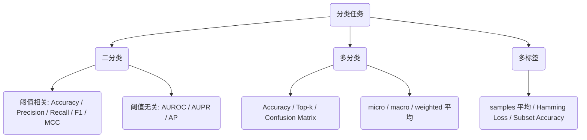

---
Title | ML Metrics Classification
-- | --
Created @ | `2021-11-21T04:55:43Z`
Updated @| `2026-11-24T05:36:59Z`
Labels | ``
Edit @| [here](https://github.com/junxnone/aiwiki/issues/137)

---
# Metrics for Classification

- 图像分类任务中根据二分类/多分类/多标签等有不同的 Metrics
- **Accuracy** `当样本不均衡时，Accuracy 不能很好的区分模型`
- **Precision**
- **Recall**
- F<sub>β</sub>/`F1`
- ROC
- PR
- AUC
- Confusion Matrix
- Error Rate
- MCC / Cohen's Kappa / Log Loss / Calibration

下图给出分类任务指标的选择思路：



图中：

- 二分类既有阈值相关指标（需先定阈值），也有阈值无关指标（对所有阈值积分）
- 多分类把二分类指标按类别平均，平均方式见下文 `micro/macro/weighted/samples` 一节
- 多标签每个样本可有多个正确类别，需要按样本或按标签统计


## TP/TN/FP/FN

👇`Predict Label` | 1 | 0 | 👈`GroundTruth`
-- | -- | -- | --
1 | TP | FP
0 | FN | TN


:bookmark: <kbd>Binary Classification</kbd>

表中行为模型预测的类别，列为真实类别：预测为 1 且真值为 1 是 TP，预测为 1 但真值为 0 是 FP（误检），预测为 0 但真值为 1 是 FN（漏检），预测为 0 且真值为 0 是 TN。

## Accuracy
- 预测正确的占总数的比例
- 当样本不均衡时，Accuracy 不能很好的区分模型

---

$\large Accuracy = \frac{N_{correct}}{N_{Total}} = \frac{TP + TN}{TP + TN + FP + FN}$

---

$\large \texttt{accuracy}(y, \hat{y}) = \frac{1}{n_\text{samples}} \sum_{i=0}^{n_\text{samples}-1} 1(\hat{y}_i = y_i)$

其中：

- $N_{correct}$：预测正确的样本数；$N_{Total}$：样本总数
- $TP, TN, FP, FN$：二分类下的四个计数
- $n_\text{samples}$：样本总数；$y_i$：第 $i$ 个样本的真值；$\hat{y}_i$：第 $i$ 个样本的预测值
- $1(\cdot)$：指示函数，条件成立为 1，否则为 0

### Balanced Accuracy
- 用于 `P/N` 不平衡的情况
- 如果 `P` 较多(990)，`N` 较少(10)，所有**sample**都预测为 `P`,  **Accuracy** 很高(99%)

---

$\large \texttt{balanced-accuracy} = \frac{1}{2}\left( \frac{TP}{TP + FN} + \frac{TN}{TN + FP}\right )$ 

---

$\large \texttt{balanced-accuracy}(y, \hat{y}, w) = \frac{1}{\sum{\hat{w}_i}} \sum_i 1(\hat{y}_i = y_i) \hat{w}_i$

其中：

- $\frac{TP}{TP + FN}$：正类召回率 (TPR)；$\frac{TN}{TN + FP}$：负类召回率 (TNR)，两者取平均，两类同等重要
- $w$：样本权重；$\hat{w}_i = \frac{w_i}{\sum_j 1(y_j = y_i)\, w_j}$，即样本权重除以其所属类别的总权重，使每个类别对结果的贡献相同
- 随机猜测的 Balanced Accuracy 约为 0.5，与类别比例无关

### Top-k Accuracy
- 多分类的情况下，只要预测前 `k` 类别中包含目标类别，则为预测正确，计入 `Top-k Accuracy`
- ImageNet 常报告 Top-1 和 Top-5

---

$\large \texttt{top-k accuracy}(y, \hat{f}) = \frac{1}{n_\text{samples}} \sum_{i=0}^{n_\text{samples}-1} \sum_{j=1}^{k} 1(\hat{f}_{i,j} = y_i)$ 

其中：

- $\hat{f}_{i,j}$：第 $i$ 个样本预测得分排名第 $j$ 的类别
- $k$：取前 $k$ 个预测类别；$k=1$ 时即普通 Accuracy
- $y_i$：第 $i$ 个样本的真实类别


## Precision
-  所有识别为正例的情况中，识别正确的比例
- 异常识别中表示为：值越大，FP 越少，误识别的概率越小

---

$\large  Precision = \frac{TP}{\text{Pred P}} = \frac{TP}{TP + FP}$

其中：$\text{Pred P}$ 为模型预测为正例的样本总数，等于 $TP + FP$；分母为 0（没有预测出任何正例）时通常约定取 0 并给出警告。


## Recall
- 所有实际类别为正例的情况中，识别正确的比例
- 异常识别中表示为: 值越大，FN 越少，漏检的概率越小

---

$\large Recall = \frac{TP}{\text{GT P}} = \frac{TP}{TP+FN}$

其中：$\text{GT P}$ 为真值为正例的样本总数，等于 $TP + FN$。Recall 又称 `Sensitivity` 或 `TPR`。


## AP
- Average precision
- AP 根据 `精确率-召回率曲线` 为在每个`阈值`处实现的精度的加权平均值，权重为前一个阈值的`召回率`的增加

$\large \text{AP} = \sum_n (R_n - R_{n-1}) P_n$

> where $P_n$ and $R_n$ are the precision and recall at the nth threshold

其中：

- $P_n$、$R_n$：第 $n$ 个阈值下的 Precision 和 Recall，阈值从高到低排列
- $R_n - R_{n-1}$：相邻两个阈值之间 Recall 的增量，作为该阈值精度的权重；$R_0 = 0$
- 这是 scikit-learn 的 `average_precision_score` 的定义（阶梯积分，不做线性插值）；检测任务里的 AP 另有 11 点/101 点插值算法，见 [AP & mAP & AR](/0382_ML_Metrics_Detection_APmAPAR)


## F<sub>β</sub>
- F1: 当 β = 1 时的 F<sub>β</sub>
- **综合考量精确率和召回率**：它是精确率和召回率的调和平均数，能够同时反映模型在这两个方面的表现，提供一个较为综合的评估指标。
- **平衡重要性**：对于一些既重视查全又重视查准的任务，F1 score 可以很好地体现模型的整体性能，避免了仅关注其中一个指标而导致的片面性。
- **适用于不平衡数据**：在数据类别不平衡的情况下，F1 score 依然能够较为合理地衡量模型在不同类别上的表现，而不会被数量占优的类别过度影响。
- 注意：F1 不考虑 TN，且受正类定义影响（把哪个类别当作正类结果不同）

---

$\large F_\beta = (1 + \beta^2) \frac{\text{Precision} \times \text{Recall}}{\beta^2 \text{Precision} + \text{Recall}}$ 

其中：

- $\text{Precision}$、$\text{Recall}$：精确率和召回率，取值 $[0, 1]$
- $\beta$：Recall 的重要性是 Precision 的 $\beta$ 倍；$\beta=1$ 为 F1，$\beta=2$ 更重视 Recall（如医疗筛查），$\beta=0.5$ 更重视 Precision
- $F_1 = \frac{2PR}{P+R}$：调和平均数会被较小的一方拉低，因此 P、R 任一接近 0 时 F1 都接近 0


## micro/macro/weighted/samples
- Multiclass and Multilabel Classification
- **micro**: 取全部样例
- **macro**:  按类别取均值
- **weighted**: 对类别按比例给予权重计算
- **samples**: 应用于 multilabel 问题


average | Precision | Recall |F<sub>β</sub>
-- | -- | -- | --
**micro** | $P(y, \hat{y})$ | $R(y, \hat{y})$ | $F_\beta(y, \hat{y})$
**samples** | $\frac{1}{\left\|S\right\|} \sum_{s \in S} P(y_s, \hat{y}_s)$ | $\frac{1}{\left\|S\right\|} \sum_{s \in S} R(y_s, \hat{y}_s)$ | $\frac{1}{\left\|S\right\|} \sum_{s \in S} F_\beta(y_s, \hat{y}_s)$
**macro** | $\frac{1}{\left\|L\right\|} \sum_{l \in L} P(y_l, \hat{y}_l)$ | $\frac{1}{\left\|L\right\|} \sum_{l \in L} R(y_l, \hat{y}_l)$ | $\frac{1}{\left\|L\right\|} \sum_{l \in L} F_\beta(y_l, \hat{y}_l)$
**weighted** | $\frac{1}{\sum_{l \in L} \left\|\hat{y}_l\right\|} \sum_{l \in L} \left\|\hat{y}_l\right\| P(y_l, \hat{y}_l)$ | $\frac{1}{\sum_{l \in L} \left\|\hat{y}_l\right\|} \sum_{l \in L} \left\|\hat{y}_l\right\| R(y_l, \hat{y}_l)$ | $\frac{1}{\sum_{l \in L} \left\|\hat{y}_l\right\|} \sum_{l \in L} \left\|\hat{y}_l\right\| F_\beta(y_l, \hat{y}_l)$

- $P(A, B) := \frac{\left| A \cap B \right|}{\left|A\right|}$
- $R(A, B) := \frac{\left| A \cap B \right|}{\left|B\right|}$
- $F_\beta(A, B) := \left(1 + \beta^2\right) \frac{P(A, B) \times R(A, B)}{\beta^2 P(A, B) + R(A, B)}$

表中每一行是一种平均方式，每一列是对应的指标；其中：

- $S$：样本集合，$s$ 为其中一个样本；$L$：类别（标签）集合，$l$ 为其中一个类别
- $y$、$\hat{y}$：真值和预测的（样本，标签）对集合；$y_s$、$\hat{y}_s$ 为样本 $s$ 的真值/预测标签集合，$y_l$、$\hat{y}_l$ 为类别 $l$ 的真值/预测样本集合
- $\left\|\cdot\right\|$ 为集合大小；weighted 的权重 $\left\|\hat{y}_l\right\|$ 为类别 $l$ 的样本数（sklearn 实现中为真值 support）
- 选择建议：关心整体样本 → `micro`；关心每个类别同等重要（含小类别）→ `macro`；类别不均衡但仍想反映样本分布 → `weighted`
- 单标签多分类下 `micro` Precision = Recall = F1 = Accuracy


## Confusion Matrix
- **Confusion Matrix** - 混淆矩阵 - 误差矩阵
- nxn 矩阵 n 为 类别
- 第 $i$ 行第 $j$ 列表示真值为类别 $i$、被预测为类别 $j$ 的样本数（sklearn 约定，行为真值、列为预测）
- Normalization：按行（真值）归一化后，对角线即各类别 Recall；按列（预测）归一化后，对角线即各类别 Precision
- 通过混淆矩阵可以发现哪些类别容易互相混淆

Confusion matrix without normalization| Confusion matrix with normalization
-- | --
 | 

```
Confusion matrix, without normalization
[[13  0  0]
 [ 0 10  6]
 [ 0  0  9]]
Normalized confusion matrix
[[1.   0.   0.  ]
 [0.   0.62 0.38]
 [0.   0.   1.  ]]
```

图中和输出中：

- 左图/上方矩阵是原始计数，右图/下方矩阵是按行归一化后的比例
- 对角线是预测正确的样本，非对角线是错误；本例第 2 类有 6 个样本（38%）被误判为第 3 类，其余类别全部正确


## MCC
- **MCC** - `Matthews Correlation Coefficient`，马修斯相关系数
- 同时用到 TP/TN/FP/FN 四个值，是预测与真值之间的相关系数，对类别不均衡较稳健
- 取值 $[-1, 1]$：1 为完美预测，0 为随机预测，-1 为完全相反

$\large MCC = \frac{TP \times TN - FP \times FN}{\sqrt{(TP+FP)(TP+FN)(TN+FP)(TN+FN)}}$

其中：

- $TP, TN, FP, FN$：二分类下的四个计数
- 分子衡量「预测正确的乘积」与「预测错误的乘积」之差，分母为归一化因子，使结果落在 $[-1, 1]$
- 分母为 0（某一行或某一列全为 0）时约定 MCC 取 0
- 多分类下有基于混淆矩阵的推广形式（sklearn `matthews_corrcoef` 已支持）


## Cohen's Kappa
- 衡量预测与真值的一致性，并扣除随机一致带来的部分；常用于多人标注一致性评估，也用于不均衡的分类评估

$\large \kappa = \frac{p_o - p_e}{1 - p_e}$

其中：

- $p_o$：实际一致率，即 Accuracy
- $p_e$：随机一致率，由预测和真值各自的类别分布相乘求和得到
- $\kappa = 1$ 完全一致，$\kappa = 0$ 与随机一致程度相同，$\kappa<0$ 比随机还差


## Log Loss
- **Log Loss / Cross Entropy** - 对数损失，衡量预测**概率**的质量，而不仅是类别对错
- 预测概率越接近真实标签越小；自信地预测错误会被重罚

$\large \text{LogLoss} = -\frac{1}{N}\sum_{i=1}^{N}\sum_{c=1}^{C} y_{i,c}\log p_{i,c}$

其中：

- $N$：样本数；$C$：类别数
- $y_{i,c}$：第 $i$ 个样本的 one-hot 真值，属于类别 $c$ 时为 1，否则为 0
- $p_{i,c}$：模型预测第 $i$ 个样本属于类别 $c$ 的概率，$\sum_c p_{i,c} = 1$
- 与训练常用的 Cross Entropy Loss 是同一个量；Accuracy 相同的两个模型 Log Loss 可能差别很大，后者反映概率是否「校准」


## AUC
- **A**rea **U**nder the **C**urve
- AUC常常用来评估二分类模型的性能, 能够综合的表达 `Precision` & `Recall` 性能
- 通过计算曲线下的面积作为评估指标
- 相比于准确率、召回率、F1值等依赖于判决阈值的评估指标，AUC则没有这个问题。
- AUC 的概率解释：随机取一个正样本和一个负样本，正样本得分高于负样本的概率


### PRC & AUPR

- **PRC** - `Precision-Recall Curve`
- **AUPR** - `Area Under the Precision-Recall Curve`
- 相差不大的 AP，但是有可能 `PRC` 有可能有较大区别
  - 如下两图，AP 只相差 2%，但是左图并不能同时在 `Precision` & `Recall` 上达到较好的平衡，图二则可以
- 正样本很少（如异常检测）时，AUPR 比 AUROC 更能反映模型好坏：AUROC 的 FPR 分母是大量负样本，少量 FP 对它影响很小

AnomalyCLIP `@mvtec-bottle` | MuSC `@mvtec-bottle`
-- | --
 | 

图中：

- 横轴为 Recall，纵轴为 Precision，曲线下面积即 AUPR
- 左图曲线在 Recall 升高时 Precision 快速下跌，只能二选一；右图曲线更靠近右上角，可以同时保持较高的 Precision 和 Recall
- 两个模型的 AP 只差 2%，但从曲线形状能看出右图的实用性更好


### AUROC 
- **AUROC** - `Area Under the Receiver Operating Characteristic Curve` - 受试者工作特征曲线
- 通过不断改变分类阈值，计算出一系列的真阳性率（TPR，即召回率）和假阳性率（FPR），将这些点连接起来形成一条曲线，即 ROC 曲线
  - 横坐标为假阳性率 [ $FPR = \frac{FP}{FP + TN}$ ]
  - 纵坐标为真阳性率 [ $TPR = \frac{TP}{TP + FN}$ ]
- 值越接近 1，表示模型的性能越好；值越接近 0.5，则表示模型性能接近随机猜测。
- 不受样本类别不平衡影响，较为综合地反映模型区分不同类别样本的能力

其中：

- $FP + TN$ 为真值负例总数，$TP + FN$ 为真值正例总数
- 左上角 $(0, 1)$ 为理想点，对角线 $TPR = FPR$ 对应随机猜测，AUROC = 0.5


图中：

- 横轴为 FPR，纵轴为 TPR，曲线上每个点对应一个阈值
- 曲线越靠近左上角、曲线下面积越大，模型区分正负样本的能力越强
- 对角虚线是随机分类器的基线


## Calibration
- **校准** - 模型输出的概率是否可信：预测为 0.8 的样本中，是否确实约 80% 为正例
- 深度网络常过度自信（overconfident），Accuracy 不变但概率不准，会影响阈值选择和下游决策
- 常用指标：**ECE** (Expected Calibration Error)、Brier Score；可视化用 Reliability Diagram；常用 Temperature Scaling 校准

$\large ECE = \sum_{m=1}^{M} \frac{|B_m|}{N} \left| \text{acc}(B_m) - \text{conf}(B_m) \right|$

$\large \text{Brier} = \frac{1}{N}\sum_{i=1}^{N}(p_i - y_i)^2$

其中：

- $M$：把预测置信度等分成的区间（bin）数，常取 10 或 15；$B_m$：落入第 $m$ 个区间的样本集合；$N$：样本总数
- $\text{acc}(B_m)$：区间内的实际准确率；$\text{conf}(B_m)$：区间内的平均预测置信度；二者差距越小说明校准越好
- $p_i$：第 $i$ 个样本预测为正例的概率；$y_i \in \{0, 1\}$：真值；Brier Score 越小越好


## Code
```python
from sklearn.metrics import (accuracy_score, balanced_accuracy_score, precision_recall_fscore_support,
                             roc_auc_score, average_precision_score, confusion_matrix,
                             matthews_corrcoef, cohen_kappa_score, log_loss)

# y_true: 真值, y_pred: 预测类别, y_score: 预测为正类的概率
precision, recall, f1, _ = precision_recall_fscore_support(y_true, y_pred, average='macro')
auroc = roc_auc_score(y_true, y_score)
ap = average_precision_score(y_true, y_score)
cm = confusion_matrix(y_true, y_pred, normalize='true')   # 按行(真值)归一化
```


## Reference
- [Metrics and scoring - scikit-learn](https://scikit-learn.org/stable/modules/model_evaluation.html#metrics-and-scoring-quantifying-the-quality-of-predictions)
- [sklearn.metrics.confusion_matrix](https://scikit-learn.org/stable/modules/generated/sklearn.metrics.confusion_matrix.html)
- [The Relationship Between Precision-Recall and ROC Curves](https://www.biostat.wisc.edu/~page/rocpr.pdf)
- [On Calibration of Modern Neural Networks](https://arxiv.org/abs/1706.04599)


