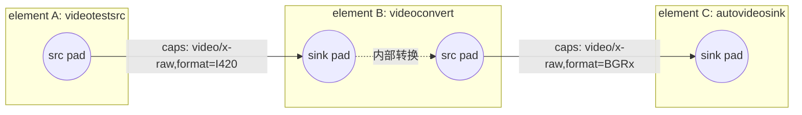

---
Title | Media Tools GStreamer Concepts
-- | --
Created @ | `2021-12-11T04:09:29Z`
Updated @| `2026-11-26T01:26:09Z`
Labels | ``
Edit @| [here](https://github.com/junxnone/aiwiki/issues/144)

---
## Brief
- elements - Gstreamer 结构块
- pad - element 之间的连接口
- bin - 一组 element 的容器
- pipeline - 最顶层的 bin, 管理时钟和状态

### Elements
- source element
- filter elements
- sink elements


### Pad 与 Caps

下图展示两个 element 通过 pad 连接, 并通过 caps 协商出双方都支持的数据格式:



图中：

- 圆形是 pad: `src pad` 向外输出数据, `sink pad` 接收数据; source element 只有 src pad, sink element 只有 sink pad, filter element 两者都有
- 连线上标注的是 caps (capabilities), 描述这条连接上流动的数据格式, 如 `video/x-raw,format=I420`
- 两个 pad 连接前要协商 caps; 协商不出共同格式时 pipeline 会报 `not-negotiated`, 这时通常需要在中间插入 `videoconvert` 之类的转换 element
- 用 [gst-inspect](/0112_Media_Tools_GStreamer_gstinspect) 可以查看某个 element 的 Pad Templates 和支持的 caps

### Bin 与 Pipeline

- `bin`: 把若干 element 打包成一个 element 使用, 例如 `playbin` 内部包含 source/demux/decoder/sink 整条链
- `pipeline`: 顶层 bin, 负责选择全局时钟、分发消息 (Bus) 和切换状态; 状态依次为 `NULL → READY → PAUSED → PLAYING`
- 数据以 buffer 为单位在 pad 间流动, 事件 (event, 如 seek/EOS) 与查询 (query, 如时长/位置) 也经由 pad 传递

### 命令行示例

```
gst-launch-1.0 videotestsrc ! video/x-raw,format=I420,width=640,height=480 ! videoconvert ! autovideosink
```

- 两个 element 之间的 `video/x-raw,...` 是 caps filter, 用来限定这条连接上的数据格式

## Reference
- [GStreamer concepts](https://gstreamer.freedesktop.org/documentation/tutorials/basic/concepts.html)

