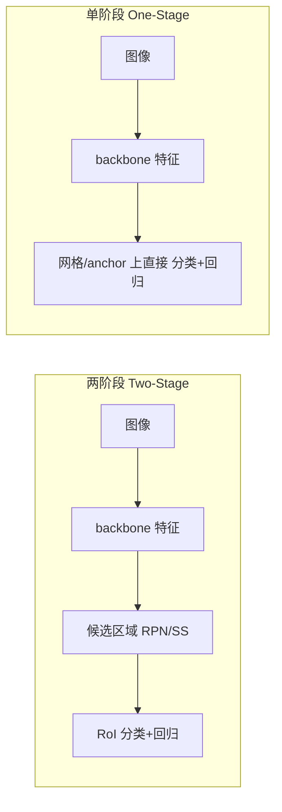

---
Title | ML Tasks Image Detection
-- | --
Created @ | `2018-12-09T09:27:47Z`
Updated @| `2026-11-26T01:26:45Z`
Labels | ``
Edit @| [here](https://github.com/junxnone/aiwiki/issues/152)

---
## Brief
- 通过算法获取待检测物体的 BBox

## Algos

- **传统方法**
  - Cascade + Haar
  - SIFT
  - SVM + HOG
  - DPM
- **Two Stage**
  - [R-CNN](/0057_ML_Tasks_Image_Detection_RCNN)
  - [Fast R-CNN](/0058_ML_Tasks_Image_Detection_FastRCNN)
  - [Faster R-CNN](/0059_ML_Tasks_Image_Detection_FasterRCNN)
  - SPP-net
  - R-FCN
- **One Stage**
  - [YOLO](/0053_ML_Tasks_Image_Detection_YOLO)
    - [YOLO V1](/0054_ML_Tasks_Image_Detection_YOLO_V1)
    - [YOLO V2](/0055_ML_Tasks_Image_Detection_YOLO_V2)
    - [YOLO V3](/0056_ML_Tasks_Image_Detection_YOLO_V3)
    - [YOLO tiny](/0052_ML_Tasks_Image_Detection_YOLO_tiny)
    - [YOLO SPP](https://github.com/junxnone/tech-io/issues/664)
    - [YOLOv4](https://github.com/junxnone/ml/issues/99)
    - [YOLOv5](/0379_ML_Tasks_Image_Detection_YOLO_V5)
  - [SSD](https://github.com/junxnone/tech-io/issues/154)
  - DenseBox
- **+RNN**
  - RRC
  - Deformable CNN

## 优化方向
- backbone - 特征提取
- Loss
- NMS
- Anchor

## History

## 基本概念

检测的输出是若干个 (类别, 置信度, 边界框)。边界框 (BBox) 通常用 $(x,y,w,h)$ 或 $(x_1,y_1,x_2,y_2)$ 表示。

### IoU

$$
\mathrm{IoU}(A,B)=\frac{|A\cap B|}{|A\cup B|}=\frac{|A\cap B|}{|A|+|B|-|A\cap B|}
$$

其中：

- $A,B$：两个边界框所围的区域 (如预测框和真实框)；$|\cdot|$ 表示面积
- $\mathrm{IoU}\in[0,1]$：完全重合为 $1$，不相交为 $0$
- 用途：训练时判断一个候选框是正样本还是负样本 (通常 $\mathrm{IoU}\ge0.5$ 为正)，NMS 去重，评估时判断预测是否正确

### NMS

同一个物体往往被多个框检出，NMS (Non-Maximum Suppression，非极大值抑制) 去掉重复的框：

1. 按类别分别处理，把该类所有框按置信度从高到低排序
2. 取最高分的框放入结果，删除与它 $\mathrm{IoU}>T_{nms}$ 的其他框
3. 对剩余的框重复第 2 步，直到没有框

其中 $T_{nms}$ 是 IoU 阈值，常取 $0.45\sim0.5$；阈值越小去重越狠，但相邻的真实物体可能被误删。YOLO 中的具体流程见 [YOLO V1](/0054_ML_Tasks_Image_Detection_YOLO_V1)。

### 评价指标 mAP

$$
\mathrm{AP}=\int_0^1 p(r)\,dr,\qquad
\mathrm{mAP}=\frac1{C}\sum_{c=1}^{C}\mathrm{AP}_c
$$

其中：

- 检测结果按置信度从高到低排列，逐个累积得到一条精确率-召回率曲线 $p(r)$：$r$ 是召回率，$p$ 是对应的精确率
- $\mathrm{AP}$：一个类别的平均精度，即 PR 曲线下的面积 (实际用插值近似)；$C$：类别数；$\mathrm{mAP}$ 是各类 AP 的平均
- 一个预测算作正确 (TP)，要求类别正确且与某个未匹配的真实框 $\mathrm{IoU}\ge$ 阈值；VOC 使用 $\mathrm{mAP}@0.5$，COCO 使用 $\mathrm{mAP}@[0.5:0.05:0.95]$ (对 10 个 IoU 阈值取平均，要求定位更精确)

### 边框回归

Faster R-CNN 等使用相对于 anchor $(x_a,y_a,w_a,h_a)$ 的偏移作为回归目标：

$$
t_x=\frac{x-x_a}{w_a},\ \ t_y=\frac{y-y_a}{h_a},\ \ t_w=\ln\frac{w}{w_a},\ \ t_h=\ln\frac{h}{h_a}
$$

其中：

- $(x,y,w,h)$：真实框的中心坐标和宽高；$(x_a,y_a,w_a,h_a)$：anchor 的中心坐标和宽高
- $(t_x,t_y,t_w,t_h)$：网络要预测的偏移量；中心偏移除以 anchor 尺寸做尺度归一化，宽高用对数使缩放对称、且预测值无需约束为正
- 回归损失常用 Smooth L1，或直接对框计算 IoU 类损失 (GIoU/DIoU/CIoU)

## 两阶段与单阶段

图中：

- 两阶段先生成候选区域，再对每个候选区域做精细的分类和框回归；单阶段不做候选区域，直接在特征图的每个位置上预测类别和框
- 少了候选区域和逐 RoI 计算，单阶段速度更快，但曾经精度较低，原因之一是正负样本极度不平衡 (绝大多数位置是背景)，RetinaNet 的 Focal Loss 就是为解决此问题

方法 | 代表 | 速度 | 精度 | 特点
-- | -- | -- | -- | --
两阶段 | [R-CNN](/0057_ML_Tasks_Image_Detection_RCNN)、[Fast](/0058_ML_Tasks_Image_Detection_FastRCNN)/[Faster R-CNN](/0059_ML_Tasks_Image_Detection_FasterRCNN) | 慢 | 高 (早期) | 定位精细，小目标好
单阶段 | [YOLO](/0053_ML_Tasks_Image_Detection_YOLO)、SSD、RetinaNet | 快 | 已接近或超过两阶段 | 实时性好，部署简单

表中：`速度`、`精度` 是相对比较，随着 YOLO 系列等的演进，单阶段在精度上已追平两阶段，所以现在工业上以单阶段为主。

## Focal Loss

$$
\mathrm{FL}(p_t)=-\alpha_t(1-p_t)^{\gamma}\log(p_t)
$$

其中：

- $p_t$：模型对真实类别的预测概率 (正样本取 $p$，负样本取 $1-p$)
- $\gamma\ge0$：聚焦参数，论文取 $2$；$(1-p_t)^\gamma$ 使容易分类的样本 ($p_t\to1$) 损失接近 $0$，把训练重点放到难样本上
- $\alpha_t$：类别平衡权重，论文取 $0.25$；$\gamma=0$ 且 $\alpha_t=1$ 时退化为普通交叉熵

## 优化方向

方向 | 说明
-- | --
backbone | 特征提取网络，如 [ResNet](/0051_ML_Tasks_Image_Classification_ResNet)、[MobileNet](/0045_ML_Tasks_Image_Classification_MobileNet)、CSPDarknet
neck | 多尺度特征融合，如 FPN、PAN，处理目标大小差异
Loss | 分类 (交叉熵/Focal)、框回归 (Smooth L1/CIoU)
NMS | NMS、Soft-NMS、DIoU-NMS，或使用不需要 NMS 的端到端检测器
Anchor | anchor-based (需要先验框) 与 anchor-free (直接预测中心点/距离)

表中：这是检测算法改进的几个主要环节；YOLO 各版本的变化基本都落在这几项上，见 [YOLO 系列](/0053_ML_Tasks_Image_Detection_YOLO)。

## 相关

- 分类 backbone 见 [Classification](/0061_ML_Tasks_Image_Classification)，实例分割在检测基础上加掩码，见 [Segmentation](/0159_ML_Tasks_Image_Segmentation)

## Reference

- [目标检测综述](http://www.cnblogs.com/fydeblog/p/10447875.html)
- [A paper list of object detection using deep learning.](https://github.com/hoya012/deep_learning_object_detection)
- [awesome articles about object detection.](https://github.com/amusi/awesome-object-detection)
- [opencv openvino model zoo - object detection - yolov3](https://github.com/opencv/open_model_zoo/blob/2018/demos/python_demos/object_detection_demo_yolov3.py)
- [yoloV1，看过好多篇，这篇感觉讲的最通俗易懂](https://blog.csdn.net/m0_37192554/article/details/81092514)
- [deep_learning_object_detection](https://github.com/hoya012/deep_learning_object_detection)
- [深入理解one-stage目标检测算法（上篇）](https://blog.csdn.net/Enjoy_endless/article/details/88724416)
- [深入理解one-stage目标检测算法（下篇）](https://blog.csdn.net/Enjoy_endless/article/details/88728201)
- [HistoryOfObjectRecognition](https://drive.google.com/file/d/1VLvaj2VWO2XVGeMRgbexWyjZ61i3Dojc/view?usp=sharing)
- [论文学习-深度学习目标检测2014至201901综述-Deep Learning for Generic Object Detection A Survey](https://www.cnblogs.com/shine-lee/p/10376324.html)
- [第二十八节、基于深度学习的目标检测算法的综述](https://www.cnblogs.com/zyly/p/9250195.html)
- [CVPR2019目标检测方法进展综述](https://zhuanlan.zhihu.com/p/59376548)
- 基于深度学习的目标检测算法综述 [一](https://zhuanlan.zhihu.com/p/40047760)  [二](https://zhuanlan.zhihu.com/p/40020809)  [三](https://zhuanlan.zhihu.com/p/40102001)
- [深度学习目标检测方法综述](https://blog.csdn.net/zong596568821xp/article/details/80091784)
- [Diagnosing Error in Object Detectors](http://dhoiem.cs.illinois.edu/projects/detectionAnalysis/)
- Object Detection for Dummies 
  - [Object Detection for Dummies Part 1: Gradient Vector, HOG, and SS](https://lilianweng.github.io/lil-log/2017/10/29/object-recognition-for-dummies-part-1.html)
  - [Object Detection for Dummies Part 2: CNN, DPM and Overfeat](https://lilianweng.github.io/lil-log/2017/12/15/object-recognition-for-dummies-part-2.html)
  - [Object Detection for Dummies Part 3: R-CNN Family](https://lilianweng.github.io/lil-log/2017/12/31/object-recognition-for-dummies-part-3.html)
  - [Object Detection Part 4: Fast Detection Models](https://lilianweng.github.io/lil-log/2018/12/27/object-detection-part-4.html)

