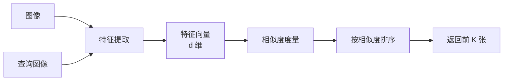

---
Title | ML Tasks Image Retrieval CBIR
-- | --
Created @ | `2019-02-19T10:26:05Z`
Updated @| `2026-11-25T16:52:11Z`
Labels | ``
Edit @| [here](https://github.com/junxnone/aiwiki/issues/155)

---
## Reference

- [image_retrieval - openvino_training_extensions](https://github.com/opencv/openvino_training_extensions/tree/develop/tensorflow_toolkit/image_retrieval)
- [ image search engine based on BoW model](https://github.com/willard-yuan/py-cbir-image-search-engine)
- [cbir blog](http://yongyuan.name/blog/)
- [基于内容的图像检索简介](https://shawya-sxx.github.io/blog/image-retrieval-introduction.html)
- [retrieval papers](https://github.com/deepinsight/deepinsight.github.io/blob/master/_posts/deep_learning/2017-05-08-retrieval.md)
- [DELF: DEep Local Features](https://github.com/tensorflow/models/tree/master/research/delf)
- [基于深度学习的视觉实例搜索研究进展](https://zhuanlan.zhihu.com/p/22265265)
- [awesome-cbir-papers](https://github.com/willard-yuan/awesome-cbir-papers)
- [Content-Based Image Retrieval Syetem](https://github.com/meng1994412/CBIR)
- [基于内容的图片检索CBIR简介](http://www.cvvision.cn/6963.html)
- [基于内容的图像检索技术：从特征到检索](https://zhuanlan.zhihu.com/p/46735159)
- [图像检索重磅综述（2016年之前）](https://blog.csdn.net/TTdreamloong/article/details/80991161)
- [图像检索与降维（一）：VLAD](https://blog.csdn.net/LiGuang923/article/details/85416407)
- [图像检索与降维（二）：NetVLAD](https://blog.csdn.net/LiGuang923/article/details/85470289)
- [基于内容的图像检索- baike](https://baike.baidu.com/item/%E5%9F%BA%E4%BA%8E%E5%86%85%E5%AE%B9%E7%9A%84%E5%9B%BE%E5%83%8F%E6%A3%80%E7%B4%A2/10506348?fr=aladdin)

## Brief
- CBIR - `Content-based image retrieval` - 基于内容的图像检索

## Algos

- [VLAD](/VLAD)
- [Triplet Network](/Triplet_Network)
- [Siamese Network](/Siamese_Network)

## 核心思想

CBIR 不依赖人工标注的文字，而是直接用图像自身的「可视特征」(颜色、纹理、形状或深度特征) 描述图像，再比较特征的相似度。下图是它的基本数据流：

图中：

- 图库里的图像和查询图像都经过同一个特征提取器得到 $d$ 维特征向量，然后用相似度度量 (欧氏距离、余弦相似度) 比较
- 结果按相似度从高到低排序，返回前 $K$ 张；所有流程可以由计算机自动完成，没有人工标注的主观性

## 特征的演进

阶段 | 方法 | 说明
-- | -- | --
传统全局特征 | 颜色直方图、纹理、形状 | 对光照、视角变化敏感，语义信息少
局部特征 + 聚合 | SIFT + [BoW/VLAD/FV](/0154_ML_Tasks_Image_Retrieval_CBIR_VLAD) | 把大量局部描述子聚合成一个固定长度的向量
深度特征 | CNN 的中间层或全局池化特征 | 语义强，是目前的主流
度量学习 | [Siamese](/0153_ML_Tasks_Image_Retrieval_CBIR_SiameseNetwork)、[Triplet](/0156_ML_Tasks_Image_Retrieval_CBIR_TripletNetwork) | 直接训练出距离有意义的特征空间

表中：每一行是一个阶段，从上到下特征越来越抽象、对变化越稳健；整体检索流程、指标和评价见 [Retrieval](/0278_ML_Tasks_Image_Retrieval)。

## Algos 说明

- 局部特征聚合：BoW (词袋)、VLAD、Fisher Vector，先提取 SIFT 等描述子再编码
- 深度度量学习：用孪生网络或三元组网络训练嵌入，使同类图像在特征空间里更近
- 重排序：对初检结果用几何校验 (RANSAC)、局部特征匹配或查询扩展 (QE) 进一步提高精度

## 应用

- 以图搜图、商品检索、人脸/行人重识别、地标识别、版权检测
- 工业场景：缺陷样本检索、异常检测中的最近邻方法 (如 PatchCore 的 memory bank)，见 [Anomaly](/0277_ML_Tasks_Image_Anomaly)

