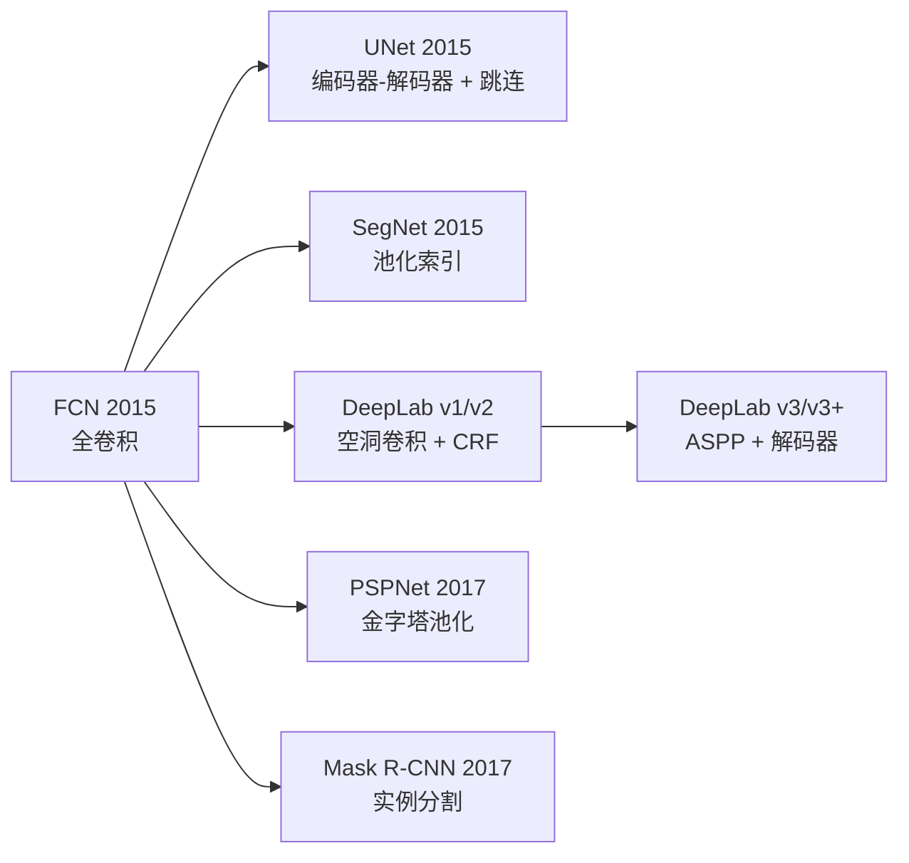

---
Title | ML Tasks Image Segmentation
-- | --
Created @ | `2019-03-28T03:26:31Z`
Updated @| `2026-11-25T16:51:49Z`
Labels | ``
Edit @| [here](https://github.com/junxnone/aiwiki/issues/159)

---
## Reference

- [paper - Panoptic Segmentation](https://arxiv.org/pdf/1801.00868.pdf)
- [论文阅读理解 - Panoptic Segmentation 全景分割](https://blog.csdn.net/zziahgf/article/details/79063398)
- [语义分割和实例分割概念](https://blog.csdn.net/yql_617540298/article/details/83143182)
- [Image Segmentation](https://blog.csdn.net/weixin_38208741/article/details/80474813)
- [深度学习---之全卷积神经网络取代全连接层--用于图像分割](https://blog.csdn.net/zxyhhjs2017/article/details/78603332)
- [SemanticSegmentation_DL](https://github.com/tangzhenyu/SemanticSegmentation_DL)
- [A Beginner's guide to Deep Learning based Semantic Segmentation using Keras](https://divamgupta.com/image-segmentation/2019/06/06/deep-learning-semantic-segmentation-keras.html)
- [从loss处理图像分割中类别极度不均衡的状况---keras](https://blog.csdn.net/m0_37477175/article/details/83004746)
- [图像语义分割准确率度量方法总结](https://zhuanlan.zhihu.com/p/38236530)
- [Segmentation综述](https://www.cnblogs.com/kk17/p/10017224.html)
- [语义分割 | 发展综述](https://zhuanlan.zhihu.com/p/37618829)
- [图像语义分割入门+FCN/U-Net网络解析](https://zhuanlan.zhihu.com/p/31428783)
- [第九章 图像分割 - DeepLearning-500-questions](https://github.com/scutan90/DeepLearning-500-questions/blob/master/ch09_%E5%9B%BE%E5%83%8F%E5%88%86%E5%89%B2/%E7%AC%AC%E4%B9%9D%E7%AB%A0_%E5%9B%BE%E5%83%8F%E5%88%86%E5%89%B2.md)
- [awesome-semantic-segmentation](https://github.com/mrgloom/awesome-semantic-segmentation)
- [A Review on Deep Learning Techniques Applied to Semantic Segmentation](https://arxiv.org/pdf/1704.06857.pdf)
- [Evaluating image segmentation models. - Jeremy Jordan](https://www.jeremyjordan.me/evaluating-image-segmentation-models/)
- [深度学习语义分割理论与实战指南](https://github.com/luwill/Semantic-Segmentation-Guide)

## Brief
- [Traditional Segmentation](/Traditional_Image_Segmentation)
- [Instance Segmentation](/Instance_Segmentation)

## Algos

- [FCN](/FCN)
- [UNet](/UNet)
- [Deeplab](/Deeplab)
- [Mask RCNN](/Mask_RCNN)
- [Mask Scoring R-CNN](/Mask_Scoring_RCNN)
- [DETR](/DETR)

## Tasks

Name | Description | Sample
-- | -- | --
语义分割  Semantic Segmentation  全像素语义分割  Full-Pixel Semantic Segmentation | 将每个像素分类为属于对象类的过程 常用来识别天空、草地、道路等没有固定形状的不可数事物 | 
实例分割  Instance Segmentation | 将每个像素分类为属于对象类以及该类的实体ID  人、动物或工具等可数的、独立的明显物体 | 
全景分割  Panoptic Segmentation | 前景使用 `instance segmentation` 背景使用 `semantic segmentation`   分类为 `Semantic Label` 和 `Instance ID` | 

## DL Net History

时间 |Net | Improve
-- | -- | --
CVPR  2015.06 | FCN  | FC2CONV / FCN-8S-16S-32S
2015 | DeconvNet | 使用了 UnPooling 
MICCAI 2015.09 | UNet | Concat 替换 Add
CVPR 2015 - PAMI 2017 | SegNet | 增加了BN, 去掉了FC
ICLR 2015 | Deeplab V1 |
CVPR 2017 | PSPNet | 金字塔池化模块收集全局 feature
2017 | Mask-RCNN
CVPR 2017 | RefineNet
CVPR 2017 |G-FRNet
TPAMI 2017 | Deeplab V2 | 
-- | Deeplab V3 | 
-- | Deeplab V3+ | 

> 按论文发表时间顺序排列，研究时间及内容等我觉得都是 `long story`

## 任务说明

图像分割把图像划分为若干区域，三类任务的区别在于「要不要区分同类的不同个体」以及「背景怎么处理」：

任务 | 输出 | 区分个体 | 背景
-- | -- | -- | --
语义分割 | 每个像素的类别 | 否 | 作为一个类别 (如天空、道路)
实例分割 | 每个物体实例的像素掩码 | 是 | 忽略
全景分割 | 每个像素的 (类别, 实例 ID) | 对可数物体 (thing) 是 | 对不可数区域 (stuff) 用语义标签

表中：同一张街景里，语义分割只告诉你哪些像素是「人」，实例分割把每个人分开 (人 1、人 2)，全景分割同时给出天空、道路等背景的类别和每个人的实例，是前两者的统一。实例分割的细节见 [Instance](/0167_ML_Tasks_Image_Segmentation_Instance)。

## 评价指标

$$
\mathrm{IoU}_c=\frac{TP_c}{TP_c+FP_c+FN_c},\qquad
\mathrm{mIoU}=\frac1C\sum_{c=1}^{C}\mathrm{IoU}_c,\qquad
\mathrm{Dice}=\frac{2|A\cap B|}{|A|+|B|}
$$

其中：

- $C$：类别数；$TP_c,FP_c,FN_c$：第 $c$ 类的真阳性、假阳性、假阴性像素数
- $\mathrm{IoU}_c$：第 $c$ 类预测区域与真实区域的交并比；$\mathrm{mIoU}$：各类 IoU 的平均，是语义分割最常用的指标
- $A,B$：预测掩码与真实掩码 (像素集合)；$\mathrm{Dice}$ 在医学图像分割里更常用，与 IoU 的关系为 $\mathrm{Dice}=2\,\mathrm{IoU}/(1+\mathrm{IoU})$
- 像素准确率 (Pixel Accuracy) 只统计预测对的像素比例，类别不平衡 (背景占绝大多数) 时会虚高，所以主要看 mIoU
- 实例分割用掩码 AP (用掩码 IoU 代替框 IoU 的 mAP)，全景分割用 PQ (Panoptic Quality)

## 损失函数

$$
L_{CE}=-\frac1{N}\sum_{i=1}^{N}\sum_{c=1}^{C}y_{i,c}\log p_{i,c},\qquad
L_{Dice}=1-\frac{2\sum_ip_iy_i}{\sum_ip_i+\sum_iy_i}
$$

其中：

- $N$：像素总数；$y_{i,c}$：像素 $i$ 属于第 $c$ 类的 one-hot 标签；$p_{i,c}$：模型预测的概率 (逐像素 softmax)
- 逐像素交叉熵 $L_{CE}$ 把分割看作每个像素的分类；类别不平衡时可加类别权重
- $L_{Dice}$：直接优化 Dice 系数，对前景占比很小的目标 (如病灶) 更稳健；$p_i,y_i$ 为前景概率和标签 (二分类)
- 实践中常把二者相加：$L=L_{CE}+L_{Dice}$

## 网络演进

下图是语义分割主要网络的演进脉络：

图中：

- 箭头表示技术上的继承；所有方法都源自把全连接层改成卷积的 [FCN](/0160_ML_Tasks_Image_Segmentation_FCN)
- 三条主线：编码器-解码器与跳连 ([UNet](/0161_ML_Tasks_Image_Segmentation_UNet))；空洞卷积保持分辨率 ([DeepLab](/0162_ML_Tasks_Image_Segmentation_Deeplab))；多尺度上下文 (PSPNet、ASPP)
- 实例分割基于检测，见 [Mask R-CNN](/0163_ML_Tasks_Image_Segmentation_MaskRCNN)、[MS R-CNN](/0164_ML_Tasks_Image_Segmentation_MSRCNN)

## DL Net History 说明

上面的演进表按论文发表时间排列，各列含义：`时间` 为发表会议和日期，`Net` 为网络名，`Improve` 为它相对前代的主要改进。其中 FCN 的 `FC2CONV` 是把全连接改成卷积，`FCN-8S/16S/32S` 是融合不同层级特征的三种变体；UNet 以 Concat 替换 Add 做特征融合；SegNet 去掉全连接并加入 BN；PSPNet 用金字塔池化模块收集全局特征。

## 后续可以扩展的方向

- Transformer 时代：SegFormer、Mask2Former，把分割统一成掩码分类
- 通用分割模型：SAM (Segment Anything)，提示式分割
- 工业应用：缺陷分割，见 [Anomaly](/0277_ML_Tasks_Image_Anomaly)

