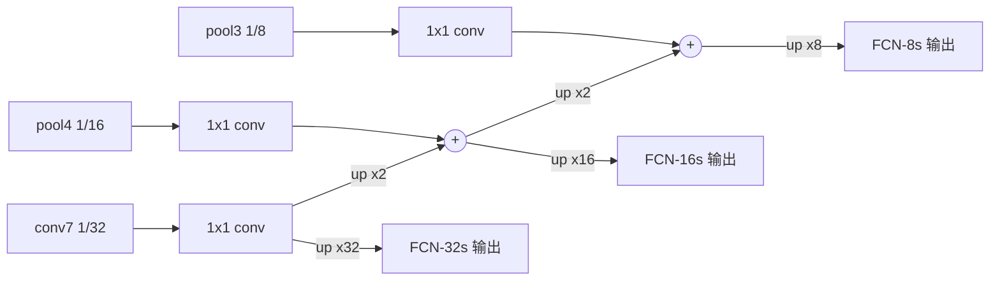

---
Title | ML Tasks Image Segmentation FCN
-- | --
Created @ | `2019-11-27T07:41:13Z`
Updated @| `2026-11-25T16:51:51Z`
Labels | ``
Edit @| [here](https://github.com/junxnone/aiwiki/issues/160)

---
# FCN
- 传统的CNN(AlexNet)结构中，前5层是卷积层，第6/7层是长度为4096的FC(全连接层)，第8层是长度为1000的FC，分别对应1000个类别的概率
- FCN将这3层FC一维向量表示为卷积层，卷积核的大小 ( 通道数，宽，高) 分别为 (4096, 1, 1) -  (4096, 1, 1) -  (1000, 1, 1), 所有的层都是卷积层，故称为全卷积网络
- 从抽象的特征中恢复出每个像素所属的类别

基于CNN网络产生 feature map, FCN 采用反卷积层对最后一个卷积层的 feature map 进行上采样, 使它恢复到输入图像相同的尺寸，从而可以对每个像素都产生了一个预测, 同时保留了原始输入图像中的空间信息, 最后在上采样的特征图上进行逐像素分类

## 传统CNN分割方法
为了对一个像素分类，使用该像素周围的一个图像块作为CNN的输入用于训练和预测。
- **存储开销大:** 若每个像素使用的图像块的大小为15x15，则所需的存储空间为原来图像的225倍
- **计算效率低:** 相邻的像素块存在重复，对每个像素块逐个卷积，存在大量重复计算
- **像素块大小的限制了感知区域的大小:** 像素块的大小比整幅图像的大小小很多，只能提取一些局部的特征，从而导致分类的性能受到限制

### 网络结构
- 对第5层的输出（32倍放大）反卷积到原图大小
- 为了提高精确度，将第4层的输出和第3层的输出也依次反卷积，分别需要16倍和8倍上采样

**FCN-8s 分析**

Steps | Layers | feature map 
-- |-- | -- 
0 | Input | - 
1 | Conv1 + Pooling-1 | 1/2 feature map 
2 | Conv2 + Pooling-2 | 1/4 feature map
3 | Conv3 + Pooling-3 | 1/8 feature map
4 | Conv4 + Pooling-4 | 1/16 feature map
5 | Conv5 + Pooling-5 | 1/32 feature map
6 | Conv6 + Conv7 | 1/32 image size -> heatmap 热图 - 高维特征图
7 | DConv[S6] | 
8 | Dconv[S4] + CropPool | 逐点相加融合特征
9 | Dconv[S3] + CropPool | 逐点相加融合特征

---
**32s - 16s - 8s**

Net | Stream | pixel prediction stride | feature map
-- | -- | -- | --
FCN-32s | Single | 32 | Pool-5
FCN-16s | Two | 16 | Pool-5 + Pool-4
FCN-8s | Three | 8 | Pool-5 + Pool-4 + Pool-3

> 32s/16s/8s : 指UpSample阶段最后一层 DConv 中 stride 的大小

Name | Net
-- | --
FCN-32s | 
FCN-16s | 
FCN-8s | 

---
**UpSampling**

---
**FCN-32S-16S-8S 对比**

---
**优点**
- 可以接受任意大小的输入图像
- 更加高效，避免了由于使用像素块而带来的重复存储和计算卷积的问题
---
**缺点**
- 得到的结果还是不够精细: 8倍上采样比32倍的效果好，但是上采样的结果还是比较模糊和平滑，对图像中的细节不敏感
- 没有考虑空间关系: 对各个像素进行分类，没有充分考虑像素与像素之间的关系，忽略了在通常的基于像素分类的分割方法中使用的空间规整（spatial regularization）步骤，缺乏空间一致性

##  后续 
- DeepLab - Fully Connected CRF - conditional random fields 

## Reference

- [FCN的学习及理解（Fully Convolutional Networks for Semantic Segmentation）](https://blog.csdn.net/qq_36269513/article/details/80420363)
- [paper - Fully Convolutional Networks for Semantic Segmentation](https://www.cv-foundation.org/openaccess/content_cvpr_2015/html/Long_Fully_Convolutional_Networks_2015_CVPR_paper.html)
- [paper - CVPR 2015 - Fully Convolutional Networks for Semantic Segmentation - arxiv](https://arxiv.org/abs/1411.4038)
- [paper - PAMI 2016 - Fully Convolutional Networks for Semantic Segmentation - arxiv](https://arxiv.org/abs/1605.06211)
- [Github repo](https://github.com/shelhamer/fcn.berkeleyvision.org)
- [全卷积网络 FCN 详解](https://zhuanlan.zhihu.com/p/30195134)
- [网络结构 FCN-8S-PASCAL - Netscope](http://ethereon.github.io/netscope/#/preset/fcn-8s-pascal)
- [计算机视觉中upsampling(上采样)的三种方式](https://blog.csdn.net/u014451076/article/details/79156967)

## 全连接转卷积

分类网络的全连接层可以看作覆盖整张特征图的卷积：

$$
\text{fc6}:\ 7\times7\times512\to4096\ \Longleftrightarrow\ \text{Conv}(K=7,\ C_{out}=4096)
$$

其中：

- 以 [VGG](/0146_ML_Tasks_Image_Classification_VGGNet) 为例，pool5 输出 $7\times7\times512$，fc6 有 $25088\times4096$ 个权重，可以重排为一个 $7\times7$、输入 $512$ 通道、输出 $4096$ 通道的卷积核
- fc7、fc8 同理变成 $1\times1$ 卷积
- 转换后网络的权重不变，但输入尺寸不再受限：输入图像更大时，输出不再是 $1\times1\times1000$ 的类别向量，而是一张 $h\times w\times1000$ 的类别得分图 (热图)，每个位置对应原图的一个感受野

## 上采样

$$
\text{输出尺寸}=(W_{in}-1)\cdot S-2P+K
$$

其中：

- 这是转置卷积 (反卷积) 的输出尺寸公式；$W_{in}$：输入边长，$S$：步长，$P$：补零，$K$：卷积核边长
- 例：把 $1/32$ 的特征图放大 $32$ 倍，使用 $K=64$，$S=32$，$P=16$ 的转置卷积：$(W_{in}-1)\cdot32-32+64=32W_{in}$，刚好恢复到原图尺寸
- 转置卷积的权重用双线性插值核初始化，再随训练学习，所以 FCN 的上采样是可学习的

## 跳跃连接 (skip)

$$
\hat y_{8s}=\mathrm{up}_{8}\Bigl(\mathrm{up}_{2}\bigl(\mathrm{up}_{2}(s_{32})+s_{16}\bigr)+s_{8}\Bigr)
$$

其中：

- $s_{32},s_{16},s_8$：分别由 pool5、pool4、pool3 后接 $1\times1$ 卷积得到的类别得分图，分辨率为原图的 $1/32$、$1/16$、$1/8$
- $\mathrm{up}_k$：上采样 $k$ 倍 (转置卷积)；逐点相加的融合方式 (Add)，后来的 [UNet](/0161_ML_Tasks_Image_Segmentation_UNet) 改为通道拼接 (Concat)
- 深层特征语义强但分辨率低，浅层特征分辨率高但语义弱；相加把两者的优点结合起来，所以 FCN-8s 的边缘比 FCN-32s 更精细

下图展示三个变体的融合方式：

图中：

- 三个输出分别对应三种变体：FCN-32s 只用最深层，一次放大 $32$ 倍；FCN-16s 融合 pool4，放大 $16$ 倍；FCN-8s 再融合 pool3，放大 $8$ 倍
- 圆圈里的 `+` 是逐点相加，箭头上的 `up x2` 表示放大 $2$ 倍
- 融合的层级越浅，输出越精细

## 损失与结果

- 损失：逐像素的 softmax 交叉熵并对所有像素求和 (见 [Segmentation](/0159_ML_Tasks_Image_Segmentation) 中的 $L_{CE}$)
- 结果：PASCAL VOC 上 FCN-8s 的 mean IU 约 $62.2\%$ (VOC 2012 test)，比之前最好的 SDS 方法高约 $20\%$，且速度快很多 `[待核实]`

变体 | 融合层 | 步长 | mean IU (VOC 2011 val) `[待核实]`
-- | -- | -- | --
FCN-32s | pool5 | 32 | 59.4
FCN-16s | pool5 + pool4 | 16 | 62.4
FCN-8s | pool5 + pool4 + pool3 | 8 | 62.7

表中：融合的层越多，精度越高，但从 16s 到 8s 提升已经很小；这说明单靠 Add 融合浅层特征，对细节的恢复有限，也是后续网络增加解码器的原因。

## 后续

- 缺点中提到的「缺乏空间一致性」由 DeepLab 的 CRF 后处理缓解，见 [DeepLab](/0162_ML_Tasks_Image_Segmentation_Deeplab)
- 编码器-解码器与 Concat 融合，见 [UNet](/0161_ML_Tasks_Image_Segmentation_UNet)

