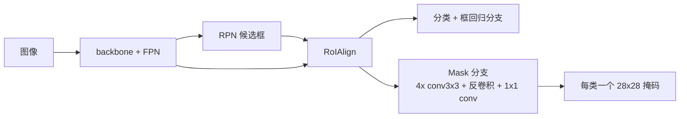

---
Title | ML Tasks Image Segmentation MaskRCNN
-- | --
Created @ | `2019-06-22T08:06:11Z`
Updated @| `2026-11-25T16:51:57Z`
Labels | ``
Edit @| [here](https://github.com/junxnone/aiwiki/issues/163)

---
## Reference

- [paper - Mask R-CNN](https://arxiv.org/abs/1703.06870)
- [paper - R-CNN](https://arxiv.org/abs/1311.2524)
- [paper - Fast R-CNN](https://arxiv.org/abs/1504.08083)
- [paper - Faster R-CNN](https://arxiv.org/abs/1506.01497)
- [基于 OpenCV 的 Mask RCNN 实现](https://www.aiuai.cn/aifarm1178.html)
- [基于 Keras 的 Mask R-CNN 实现](https://www.aiuai.cn/aifarm1180.html)
- [Mask R-CNN for object detection and instance segmentation on Keras and TensorFlow](https://github.com/matterport/Mask_RCNN)
- [~~Detectron - Caffe2 - facebookresearch~~](https://github.com/facebookresearch/Detectron)
- [Detectron2 - pytorch - facebookresearch](https://github.com/facebookresearch/detectron2)
- [some other implementation](https://detectron2.readthedocs.io/notes/benchmarks.html)

## Brief
- 基于 Faster R-CNN 结构构建
- 使用 ROIAlign 模块替换 ROIPooling 模块
- 在ROI Align 模块的输出端新增一个分支. 该分支的输入为 ROI Align 的输出，该分支的输出送入到两个 Conv 层. Conv 层的输出即为 mask.

 |  
-- | --

Mask R-CNN 可以自动对图片中每个目标的进行分割，并构建像素级的 masks.

## vs Faster RCNN

Backbones | Head Architecture
-- | --
ResNet | 
FPN | 

## ROIAlign
- 不四舍五入取整, 减少量化时的损失
- 使用 `bilinear interpolation` 方法取值

---

---
### Test Result - ROIPool vs ROIAlign

## 结构与损失

图中：

- 前半部分与 [Faster R-CNN](/0059_ML_Tasks_Image_Detection_FasterRCNN) 相同：backbone 提取特征，RPN 产生候选框
- RoIAlign 取代 RoIPool，为每个候选框取出对齐的特征；之后分成两个并行分支：原有的分类/框回归分支，以及新增的 Mask 分支
- Mask 分支是一个小的全卷积网络，对每个候选框预测 $K$ 个类别各一张 $28\times28$ 的二值掩码；最后按框的位置和大小把掩码缩放贴回原图

$$
L=L_{cls}+L_{box}+L_{mask}
$$

其中：

- $L_{cls},L_{box}$：与 Faster R-CNN 相同的分类损失和框回归损失，见 [Fast R-CNN](/0058_ML_Tasks_Image_Detection_FastRCNN)
- $L_{mask}$：平均的二元交叉熵，只对该 RoI 的真实类别 $k$ 所对应的那张掩码计算，其他 $K-1$ 个类别的掩码不参与
- 每个类别用独立的 sigmoid，不同类别的掩码之间没有竞争；类别由分类分支决定，把「分类」与「掩码」解耦，比用像素级 softmax 的 FCN 方式精度更高

## RoIAlign 的作用

- RoIPool 要对 RoI 的坐标做两次取整 (RoI 边界到整数、RoI 内划分的格子到整数)，这对分类影响不大，但对像素级的掩码会造成明显错位
- RoIAlign 取消取整，在每个格子里取 $4$ 个规则采样点，用双线性插值计算值，再平均或最大池化，公式见 [Fast R-CNN](/0058_ML_Tasks_Image_Detection_FastRCNN)
- 论文消融：RoIAlign 相比 RoIPool 使掩码 AP 提高约 $3$ 个点，在高 IoU 阈值 ($\mathrm{AP}_{75}$) 上提高更多 `[待核实]`

## 与 Faster R-CNN 的区别

维度 | Faster R-CNN | Mask R-CNN
-- | -- | --
任务 | 目标检测 | 实例分割 (同时输出框)
特征对齐 | RoIPool | RoIAlign
分支 | 分类 + 框回归 | 分类 + 框回归 + 掩码
损失 | $L_{cls}+L_{box}$ | $L_{cls}+L_{box}+L_{mask}$
Head 结构 | 全连接 (ResNet 用 C5 作 head) | 掩码分支为全卷积；FPN 版本更轻量

表中：新增的 Mask 分支只增加了少量计算 (论文中速度约 $5$ fps)，却能同时完成检测和分割；FPN 版本在 backbone 之外加入多尺度融合，对小物体更好。

## 小结

- 优点：结构简洁，易扩展 (同一框架还可做人体关键点)，精度高，是实例分割的标准基线
- 缺点：先检测再分割，速度不快；掩码分辨率只有 $28\times28$，细长或复杂边界的物体不够精细；掩码质量与分类得分不一定相关，见 [MS R-CNN](/0164_ML_Tasks_Image_Segmentation_MSRCNN)

