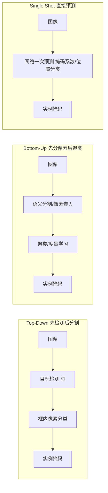

---
Title | ML Tasks Image Segmentation Instance
-- | --
Created @ | `2019-01-24T22:01:24Z`
Updated @| `2026-11-26T01:27:18Z`
Labels | ``
Edit @| [here](https://github.com/junxnone/aiwiki/issues/167)

---
# Instance Segmentation 实例分割

## Brief

## 分类

Name | Description | example
-- | -- | --
Top-Down |  `目标检测` -> `BBox` -> `语义分割` -> `Instance Seg` | Mask R-CNN
Bottom-Up | `语义分割` -> `聚类&度量学习` -> `Instance Seg` |  [Discriminative Loss Function](https://arxiv.org/abs/1708.02551)
Single Shot  | |YOLACT SOLO PolarMask AdaptIS BlendMask   

## History

Date | Name /paper
-- | -- 
2016.3 | InstanceFCN  - Instance-sensitive Fully Convolutional Networks
2016.11 | FCIS - Fully Convolutional Instance-aware Semantic Segmentation
2019.4 | YOLACT/YOLACT++ - You Only Look At CoefficienTs
2019.11 | CenterMask : Real-Time Anchor-Free Instance Segmentation
2019.12 | SOLO: Segmenting Objects by Locations
2020 | BlendMask - Top-Down Meets Bottom-Up for Instance Segmentation

## Metrics

## 三类方法的流程对比

图中：

- Top-Down：依赖检测器，先找到每个物体的框，再在框内分割，代表是 [Mask R-CNN](/0163_ML_Tasks_Image_Segmentation_MaskRCNN)；精度高但速度受检测器限制，且同一物体的重叠会受框的影响
- Bottom-Up：先得到每个像素的语义或嵌入向量，再通过聚类把像素分成不同实例；不依赖框，但聚类后处理较慢
- Single Shot：一次前向直接输出实例掩码，速度快，代表有 YOLACT、SOLO 等

方法 | 代表 | 优点 | 缺点
-- | -- | -- | --
Top-Down | Mask R-CNN、MS R-CNN | 精度高 | 速度较慢，依赖检测框
Bottom-Up | Discriminative Loss | 不依赖框，可处理不规则形状 | 聚类后处理，难处理实例数量变化
Single Shot | YOLACT、SOLO、BlendMask | 速度快，可实时 | 小目标与重叠物体的精度较弱 (早期)

表中：三类方法在速度和精度上互有取舍，近年的方法 (如 Mask2Former) 把各路线统一到掩码分类的框架中。

## 代表公式

### YOLACT：原型掩码与系数

$$
M=\sigma\bigl(P\,C^\top\bigr)
$$

其中：

- $P\in\mathbb R^{h\times w\times k}$：由 protonet 生成的 $k$ 张原型掩码 (整幅图共享)
- $C\in\mathbb R^{n\times k}$：检测头为 $n$ 个检测到的实例各预测的 $k$ 个系数；$\sigma$ 为 sigmoid
- $M$：每个实例的掩码，是原型掩码的线性组合；先裁剪到检测框再阈值化
- 好处：不需要对每个实例做 RoI 池化，速度可达实时 (约 $30$ fps)

### SOLO：按位置分类

- 把图像划分为 $S\times S$ 个网格，物体中心所在的网格负责预测该物体的掩码
- 输出 $S^2$ 个通道的掩码图，第 $k=iS+j$ 个通道对应第 $(i,j)$ 网格；即「按位置给不同实例分配通道」，从而不依赖框，也不需要聚类

## 评价指标

$$
\mathrm{AP}^{mask}=\frac1{10}\sum_{t\in\{0.50,0.55,\dots,0.95\}}\mathrm{AP}_t,\qquad
\mathrm{IoU}^{mask}=\frac{|M_{pred}\cap M_{gt}|}{|M_{pred}\cup M_{gt}|}
$$

其中：

- $\mathrm{IoU}^{mask}$：预测实例掩码与真实掩码的交并比，用来判定匹配是否成立 (阈值 $t$)；与检测里的框 IoU 相比，掩码 IoU 对边界更敏感
- $\mathrm{AP}_t$：以 $t$ 为 IoU 阈值时的平均精度；COCO 取 $t=0.50,0.55,\dots,0.95$ 共 $10$ 个阈值的平均作为最终的掩码 AP
- 同时常报告 $\mathrm{AP}_{50}$、$\mathrm{AP}_{75}$ 以及按物体大小划分的 $\mathrm{AP}_S/\mathrm{AP}_M/\mathrm{AP}_L$

## 相关

- 语义分割见 [Segmentation](/0159_ML_Tasks_Image_Segmentation)；检测基础概念 (IoU/NMS/AP) 见 [Detection](/0152_ML_Tasks_Image_Detection)
- 掩码质量的改进见 [MS R-CNN](/0164_ML_Tasks_Image_Segmentation_MSRCNN)

## Reference
- [Instance Segmentation入门总结](https://www.cnblogs.com/Xiaoyan-Li/p/10156463.html)
- [进展综述 - 单阶段实例分割（Single Shot Instance Segmentation）](https://zhuanlan.zhihu.com/p/102231853)
- Training Oxford-IIIT Pets Dataset with tensorflow/models junxnone/tech-io#253
- [Tensorflow/models - Run an Instance Segmentation Model](https://github.com/tensorflow/models/blob/master/research/object_detection/g3doc/instance_segmentation.md)
- [instance_segmentation - opencv/openvino_training_extensions](https://github.com/opencv/openvino_training_extensions/tree/develop/pytorch_toolkit/instance_segmentation)
- [PaddleDetection](https://github.com/PaddlePaddle/PaddleDetection)
- [detectron2 - facebookresearch](https://github.com/facebookresearch/detectron2) 
  - [Tutorial.ipynb - colab](https://colab.research.google.com/drive/16jcaJoc6bCFAQ96jDe2HwtXj7BMD_-m5#scrollTo=hBXeH8UXFcqU)

