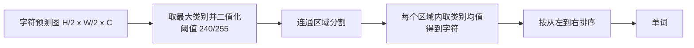

---
Title | ML Tasks Image OCR CAFCN
-- | --
Created @ | `2020-05-07T06:08:32Z`
Updated @| `2026-11-25T16:56:07Z`
Labels | ``
Edit @| [here](https://github.com/junxnone/aiwiki/issues/186)

---
# CA-FCN
## Reference

- [paper - 2018 - Scene Text Recognition from Two-Dimensional Perspective](https://arxiv.org/pdf/1809.06508.pdf)
- [CVPR2019-Scene Text Spotting汇总](https://zhuanlan.zhihu.com/p/66719257)
- [STR from Two-Dimensional Perspective](https://zhuanlan.zhihu.com/p/56998973)
- [【text recognition算法】Scene Text Recognition from Two-Dimensional Perspective](https://blog.csdn.net/xuningli84019582/article/details/90478601)
- [一作blog](https://mhliao.github.io/)

## Brief
- CA-FCN - `Character Attention Fully Convolutional Network` - 基于 FCN
- 一维 --> 二维空间问题
- 字符注意力机制 - character attention FCN - CA-FCN
- 金字塔的结构处理字符的尺度变化
- Deformable convolution 处理字符的形变
- 词信息模块 - word formation module
- **特点**
  - 任意形状场景文本识别
  - 尺度变化
  - 字符形变

## 一维空间 vs  二维空间
-  [paper - 2016 -Robust scene text recognition with automatic rectification] 使用了 `STN` 方法，但是收效不大

##  Arch
- FCN
  - Backbone - VGG-16
- FPN 结构
- Attention module
- Output - `H/2xW/2xC`  [C = 36 clasess]

###  character attention module

- Fo - Output feature map
- Fi - Input feature map
- ⊗ - elementwise multiplication
- A - Attention map
  - 2 convolutional layers 产生
  - 0 表示背景
  - 1 表示characters
  - shape 同 Fi 用于 `elementwise multiplication`

---
Attention modules | Description
-- | --
low-level attention modules | appearance  - edge  - color  - texture
high-level attention  modules | semantic information

## Word formation module

- prediction map --> binary map [threshold==240/255]
- 计算区域均值获取类别，即 `character`
- 从左到右排序区域获取 `word`

## image preprocessing

- 原始 label 会存在重叠的情况
- 通过缩小 `label BBox` 来获取新的 label 用于 training

> r=0.5 or 0.25

Name | Value
-- | -- 
Xg-min | `Xmin + w(1-r)/2`
Yg-min | `Ymin + h(1-r)/2`
Xg-max | `Xmax - w(1-r)/2`
Yg-max | `Ymax - h(1-r)/2`

## Training - Testing 细节
### Training
- multi-scale
  - 32x128
  - 48x192
  - 64x256
- augmentation
  - random rotation [-15, 15]
  - hue
  - brightnes
  - contrast
  - blur
- Adam
- init lr 10^-4
- 5 epochs 
  - epoch 3 - lr=10^-5
  - epoch 4 - lr=10^-6
- `38 classes- character` = `26 alphabet` + `10 digitals`

### Testing
- H = 64
- W =？
  - W = Wo*H/64 (if Wo/Ho>4)
  - W = 256
> Wo/Ho 为图片原始尺寸

### Loss
- character prediction loss - `Lp`
- character attention loss - `La`

Name | Loss
-- | --
L | 
Lp | 
La | 
> s - stages
> α = 1.0

## Performance
- 45 FPS
  - CA-FCN - `0.018 sec`
  - Word formation module - `0.004 sec`
  - Titan Xp GPU

## 公式

### 字符注意力

$$
F_o=F_i\otimes A,\qquad A\in[0,1]^{H\times W\times1}
$$

其中：

- $F_i\in\mathbb R^{H\times W\times C}$：输入特征图；$F_o$：加权后的输出特征图，形状不变
- $A$：注意力图，由两层卷积 (最后用 sigmoid) 预测，$1$ 表示字符区域，$0$ 表示背景；在通道维上广播后与 $F_i$ 逐元素相乘 ($\otimes$)
- 作用：抑制背景和不相关区域的特征，让后续层专注于字符；注意力图本身也有监督信号 (字符的缩小框，见下)，所以是「有监督的注意力」

### 标签收缩

原始的字符框相邻时会重叠，用收缩后的框作为训练标签：

$$
\begin{aligned}
x^g_{min}&=x_{min}+\tfrac{w(1-r)}{2}, & y^g_{min}&=y_{min}+\tfrac{h(1-r)}{2}\\
x^g_{max}&=x_{max}-\tfrac{w(1-r)}{2}, & y^g_{max}&=y_{max}-\tfrac{h(1-r)}{2}
\end{aligned}
$$

其中：

- $(x_{min},y_{min},x_{max},y_{max})$：原始字符框；$w=x_{max}-x_{min}$，$h=y_{max}-y_{min}$：框的宽、高
- $r\in(0,1]$：收缩比例，论文取 $0.5$ 或 $0.25$ (即保留中间一半或四分之一的宽高)；$(x^g,y^g)$：收缩后的框
- 收缩后相邻字符的标签不再重叠，粘连的字符也能被分开，便于后面用连通区域划分

### 损失

$$
L=L_p+\alpha\sum_{s}L_a^{(s)}
$$

其中：

- $L_p$：字符预测损失，对输出的每个像素做 $C$ 类 softmax 交叉熵；$L_a^{(s)}$：第 $s$ 个阶段 (金字塔的各个注意力模块) 的注意力损失，对注意力图做像素级的二分类交叉熵
- $\alpha=1.0$：两项的权重
- 具体的逐像素表达式在原文以图片形式给出，上述写法是按文字描述整理的 `[待核实]`

## 词信息模块

图中：

- 先对预测图二值化得到字符区域 (前景)，再用连通区域把它们分成一个个字符
- 对每个区域内的像素类别概率求平均，取最大的类别作为这个字符的识别结果
- 把区域按横坐标从左到右排序，拼成最后的单词；整个后处理只需 $0.004$ s

## 细节说明

- 类别数：文中写 `H/2×W/2×C` 且 $C=36$，又写 `38 classes = 26 + 10`，两个数字不一致；字母 $26$ + 数字 $10$ 共 $36$ 个字符，加上背景是 $37$ 类，具体的 $C$ 请以论文为准 `[待核实]`
- 推理速度：$0.018+0.004=0.022$ s，约 $45$ FPS，与上文的 $45$ FPS 一致
- 与基于 CTC/注意力解码的方法的区别：它把识别看作像素级分割，不需要序列解码，可以处理任意形状、弯曲的文字，但需要字符级的标注 (通常用合成数据预训练)；对比见 [TextScanner](/0192_ML_Tasks_Image_OCR_TextScanner)、[CRNN](/0196_ML_Tasks_Image_OCR_CRNN)
- 总览见 [OCR](/0200_ML_Tasks_Image_OCR)

