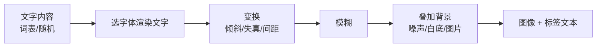

---
Title | ML Tasks Image OCR Tools TextRecognitionDataGenerator
-- | --
Created @ | `2020-05-08T05:53:53Z`
Updated @| `2026-11-26T01:27:36Z`
Labels | ``
Edit @| [here](https://github.com/junxnone/aiwiki/issues/187)

---
## Brief
- `Now supporting non-latin text! @20200508`
- handwritten 
- Chinese
  - Traditional
  - Simplified
- Background - 定义背景
- Text blurring - 模糊
- Text distortion - 失真
- Text skewing - 歪斜

## Install
```
pip3 install trdg
```

## Generate samples

```
python3 trdg/run.py -xxx ....
```
Args | Description
-- | --
-c | 创建 samples 数量
-rs | 类型<br>`-let` - letters<br>`-num` - numbers<br>`-sym` - symbols
-id | background image
-w | word/image
-r | random
-f | height - 横向<br>width - 纵向
-k | 倾斜角度 `α`
-rk | 随机角度 `[-α,α]` 
-b | background: <br>0: `Gaussian Noise`<br>1: `Plain white`<br>2: `Quasicrystal`<br>3: `Image`
-m | 边距
-fi | crop text
-cs | 字符间距 [pixels]
-om | return mask


## UseCase

Description | Commands
-- | --
从指定文件生成 | `python3 run.py -c 305 -i input.txt`


## 作用与用法

TextRecognitionDataGenerator (TRDG) 用来合成带文字的图像，主要给 [CRNN](/0196_ML_Tasks_Image_OCR_CRNN) 一类的文字识别模型生成训练数据：真实标注的数据贵，合成数据可以无限量、带标签、覆盖不同字体、背景和形变。下图是一张合成样本的生成过程：



图中：

- 从词表或随机字符得到文字内容，用字体渲染成文字图像，再依次加上倾斜、失真、模糊等变换
- 最后叠加到选定的背景 (高斯噪声、纯白、准晶体纹理、自定义图片) 上，输出图像以及对应的标签文本 (用于训练)
- 每一步都有对应的参数控制，可以随机，也可以固定

## 常用参数说明

参数 | 含义 | 示例
-- | -- | --
`-c` | 生成样本数量 | `-c 1000`
`-l` | 语言 (决定使用的词表和字体)，`cn` 中文 `en` 英文 | `-l cn`
`-w` | 每张图的单词数 | `-w 5`
`-r` | 随机选字符串 | `-r`
`-k` / `-rk` | 倾斜角度 / 随机角度范围 $[-\alpha,\alpha]$ | `-k 5 -rk`
`-b` | 背景：`0` 高斯噪声，`1` 纯白，`2` 准晶体，`3` 图片 | `-b 3 -id bg/`
`-bl` / `-rbl` | 高斯模糊半径 / 随机模糊 | `-bl 2 -rbl`
`-d` / `-do` | 失真类型 (`0` 无、`1` 正弦、`2` 余弦、`3` 随机) / 失真方向 | `-d 3`
`-fd` | 自定义字体目录 | `-fd fonts/`
`-om` | 同时输出文字掩码 | `-om 1`
`-obb` | 输出文字框 | `-obb 1`

表中：这是在上面的参数表基础上补充的常用选项，原表里的 `-rs`/`-f`/`-m`/`-cs` 等见上；具体的取值含义以所用版本的 `python3 trdg/run.py --help` 为准 `[待核实]`。

## Python 接口

```python
from trdg.generators import GeneratorFromStrings
gen = GeneratorFromStrings(["hello", "world"], blur=2, random_blur=True, size=32)
for img, label in gen:          # img 是 PIL.Image, label 是字符串
    ...
```

- 在训练脚本里直接迭代生成器，就不需要先把图片存盘
- 常用的混合策略：合成数据做预训练，再用少量真实数据微调；合成数据的字体、背景应尽量贴近目标场景，否则会有域差异

## 注意

- 合成数据与真实数据存在差异：真实图像有复杂的光照、反光、污渍，纯合成训练的模型泛化有限
- 中文生成需要提供包含对应字符的字体文件，否则会出现方块
- 与更复杂的场景文字合成 (SynthText 等) 相比，TRDG 只生成单行文字的裁剪图，适合识别模型，不适合检测模型的训练

## Reference
- [TextRecognitionDataGenerator Github](https://github.com/Belval/TextRecognitionDataGenerator/)
- [Docs](https://textrecognitiondatagenerator.readthedocs.io/en/latest/index.html)

