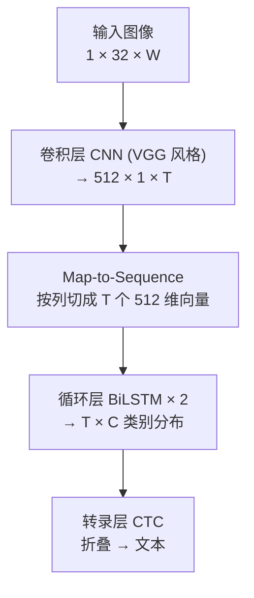

---
Title | ML Tasks Image OCR CRNN
-- | --
Created @ | `2020-05-28T05:56:49Z`
Updated @| `2026-11-25T16:16:59Z`
Labels | ``
Edit @| [here](https://github.com/junxnone/aiwiki/issues/196)

---
# CRNN

CRNN（Convolutional Recurrent Neural Network，2015）把文字识别做成"CNN 提取特征 + RNN 建模序列 + [CTC](0189_ML_Tasks_Image_OCR_CTC) 转录"三段式的端到端网络。它只需要整行/整词的文本标注，不需要字符级切分和标注，可处理任意长度文本，参数量小、速度快，至今仍是识别阶段最常用的基线，PaddleOCR 等工具链的识别模块也由它演化而来。

## 结构

下图展示 CRNN 自下而上的三层结构以及每层的输入输出形状：

图中：

- **输入图像**：灰度图，高度缩放到固定的 32，宽度 $W$ 按比例缩放（论文实验里统一为 100）。
- **卷积层**：约 7 层卷积，后几个池化层用 $1 \times 2$ 的矩形窗口（只压缩高度、尽量保留宽度），最终高度压成 1，输出 $512 \times 1 \times T$ 的特征图，$T$ 约为 $W/4$（$W=100$ 时 $T=26$）。
- **Map-to-Sequence**：把特征图沿宽度方向逐列切开，每一列是一个 512 维特征向量，得到长度为 $T$ 的序列；每个向量对应原图上一个从左到右排列的矩形感受野。
- **循环层**：两层双向 LSTM（BiLSTM）给每个时间步补充左右上下文，输出 $T \times C$ 的概率分布，$C$ 为字符集大小加一个空白符。
- **转录层**：训练时用 CTC 损失；推理时做贪心或束搜索解码，再折叠重复字符和空白符得到最终文本。
- 关键结论：宽度方向的列特征天然对应文本的书写顺序，所以不需要先切分字符。

## 要点

- **为什么用 BiLSTM**：卷积感受野有限，相邻字符形状相近时单看一列容易误判，BiLSTM 能利用前后文帮助区分，也能缓解卷积特征不连续的问题。
- **为什么能不定长**：$T$ 随图像宽度变化，CTC 又支持输出长度 $\le T$ 的任意序列。
- **Lexicon**：论文也支持带词典的转录（在词典里找概率最大的词），见 [OCR Lexicon](0198_ML_Tasks_Image_OCR_Lexicon)。
- **局限**：弯曲、竖排、极端形变文本效果差（需配合矫正模块或改用 Attention 方案）；CTC 的条件独立假设使其缺乏显式语言建模；之后 SVTR 等工作用 Transformer 替换了 BiLSTM 以提升速度和精度。

## 原图

上面两张图是原文档保留的 CRNN 结构示意图，内容与上文的结构图对应（CNN → BiLSTM → 转录）。

## Reference

- [paper - 2015 - An End-to-End Trainable Neural Network for Image-based Sequence Recognition and Its Application to Scene Text Recognition](https://arxiv.org/pdf/1507.05717)
- [Extremely simple implement for CRNN by Tensorflow](https://github.com/bai-shang/crnn_ctc_ocr_tf)
- [一文读懂CRNN+CTC文字识别](https://zhuanlan.zhihu.com/p/43534801)
- [CRNN算法详解](https://blog.csdn.net/liuxiaoheng1992/article/details/88826043)
- [端到端不定长文本识别CRNN代码实现](https://www.cnblogs.com/skyfsm/p/10345305.html)
- [crnn - pytorch](https://github.com/meijieru/crnn.pytorch)

