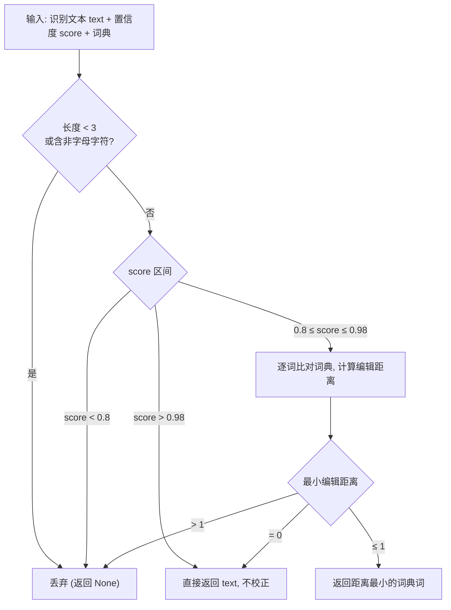

---
Title | ML Tasks Image OCR Lexicon
-- | --
Created @ | `2020-05-28T06:42:45Z`
Updated @| `2026-11-25T16:38:03Z`
Labels | ``
Edit @| [here](https://github.com/junxnone/aiwiki/issues/198)

---
# Lexicon

Lexicon（词典）在 OCR 里的作用是**校正识别结果**：识别模型输出的文字串可能有个别字符错误（如把 `l` 认成 `1`），如果已知"正确答案一定在某个词表里"，就可以把识别串**映射到词表里最接近的词**。这是一种后处理，不改变模型本身。相关的基础概念见 [OCR](0200_ML_Tasks_Image_OCR)，度量编辑距离的方法见 [OCR Metrics](0190_ML_Tasks_Image_OCR_Metrics)。

## 词典类型

场景文本识别和端到端（Text Spotting）基准会按"给模型多大的先验"分成几种设置：

Name | Description
-- | --
Lexicon-Free | 不使用词典，模型的原始输出就是结果，最难，也最能反映模型本身的能力
Strong Lexicon | 每张图给一个很小的词表（如 ICDAR 2015 端到端为每张图约 100 个词，包含图中真实出现的词；识别基准里的 50 词表也属此类）
Weak Lexicon | 词表是整个测试集出现过的所有词，没有针对每张图缩小
Generic Lexicon | 一个通用的大词表（如 ICDAR 2015 端到端用的约 9 万词），不依赖具体图像

表中第一列是设置名称，第二列说明词表的来源和大小；词表越小越"强"（先验信息越多），所以 Strong 设置下的指标最高、Lexicon-Free 最低。读论文对比指标时，必须确认它们用的是同一类词表，否则没有可比性。

在识别基准里还常见写法：IIIT5K 的 "50" 和 "1k" 表示每张测试图配 50 个或 1000 个候选词，"Full" 表示整个测试集的词表，"None" 表示不用词典（SCAN 论文的结果表就是这样标注的）。

## 编辑距离校正

词典校正的核心是求识别串 $s$ 与词典中每个词 $w$ 的编辑距离（Levenshtein 距离），取最近的：

$$
\hat{w} = \arg\min_{w \in \mathcal{D}} \mathrm{ed}(s, w)
$$

其中：

- $s$：模型识别出的文字串
- $\mathcal{D}$：词典（词表）
- $\mathrm{ed}(s,w)$：$s$ 与 $w$ 的编辑距离，即把一个串变成另一个串所需的最少替换、插入、删除次数，递推公式见 [OCR Metrics](0190_ML_Tasks_Image_OCR_Metrics)
- $\hat{w}$：校正后的结果；如果存在 $\mathrm{ed}=0$ 的词，说明识别串本来就在词典里，直接返回

实现上还会用概率信息：如果模型本身置信度很高，就不应该被词典"改错"，所以通常再加上置信度阈值，下面的 CharNet 流程就是一个例子。束搜索的前 $K$ 个候选也可以逐个与词典比对（SCAN 的做法，取距离最短者）。

## CharNet 中的校正流程

CharNet 的后处理会根据识别置信度决定"改不改、改成什么"，流程如下：

图中：

- 方框是处理步骤，菱形是判断；从上到下依次是：先过滤太短或含非字母字符的串；再按置信度分三档处理。
- **置信度很低（小于 0.8）**：识别本身不可靠，直接丢弃。
- **置信度很高（大于 0.98）**：相信模型，不用词典改。
- **中间区间（0.8 到 0.98）**：才用词典校正：词典里有完全一致的词就保留；否则取编辑距离最小的词，但**只接受距离不超过 1** 的修正，距离更大说明词典里没有合适的词，也丢弃。
- 关键结论：词典校正是一把双刃剑，阈值的目的是只在"模型不太确定、且词典里恰好有一个很接近的词"时才介入，避免把本来正确的新词、品牌名"改错"。

阈值取值（0.8、0.98、编辑距离 1、最短长度 3）是该实现里的经验设定，用到别的数据集需要重新调。对应的源码见 Reference 里的 CharNet 链接。

## 局限

- 词典外的词（人名、品牌、编号）会被强行校正成词典词，或被直接丢弃；
- 词典越大，误校正的风险越高；
- 中文没有天然的"词"边界，通常用语言模型或 n-gram 而不是词典来做校正。

## Reference

- [CharNet 中根据 Lexicon 校正得到最近编辑距离的word](https://github.com/MalongTech/research-charnet/blob/da7416dc5aadb51224445381b305ad53b8c13489/charnet/modeling/postprocessing.py#L157-L198)
- [International Conference on Document Analysis and Recognition - ICDAR](http://icdar2019.org/)

