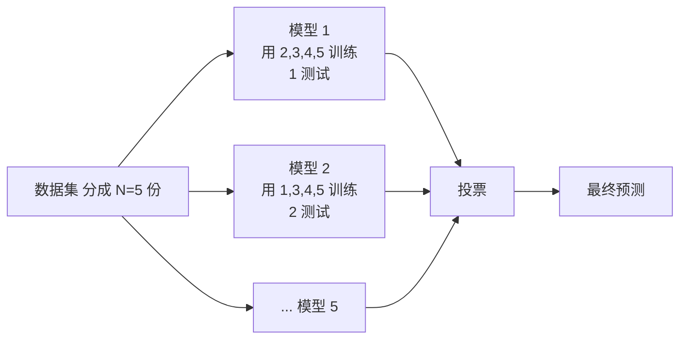

---
Title | ML Tasks Image OCR Calamari
-- | --
Created @ | `2020-06-01T09:43:32Z`
Updated @| `2026-11-26T01:27:42Z`
Labels | ``
Edit @| [here](https://github.com/junxnone/aiwiki/issues/201)

---
## Brief

## Calamari-OCR Voting
- [code analysis](/Calamari_Voting)
- character level
- textline
   - voting length

---
- Single - 取单个 Confidence 最大值 频率最大的
- Adding - 取多个 Confidence 和最大的

- 每行代表一个 `voter` 对字符 `x`  predict 为 `[l/Ⅰ/L]` 的 `Confidence`
  - Single - 有两个 `voter` predict 为 `Ⅰ`
  - Adding - 三个 `voter` 相同字符的 Confidence (列)相加后 `l` Confidence 最大

### Model Cross Fold Training
- data 分为 N 份
- 1-N 每次选择一份作为 Testing，其他作为 Training，训练 N 个 Model
> N = 5

### Code Analysis
- sequence_voter
- confidence_voter_default_ctc
- confidence_voter_fuzzy_ctc
> fuzzy_ctc 没用到 是什么？

## 投票公式

设有 $V$ 个模型 (voter)，第 $v$ 个模型对某个字符位置给出各候选字符 $c$ 的置信度 $p_v(c)$：

$$
\hat c_{single}=\arg\max_c\ \sum_{v=1}^{V}\mathbb 1\Bigl[\arg\max_{c'}p_v(c')=c\Bigr],\qquad
\hat c_{adding}=\arg\max_c\ \sum_{v=1}^{V}p_v(c)
$$

其中：

- $V$：参与投票的模型数 (论文设置为 $5$)；$p_v(c)$：第 $v$ 个模型对候选字符 $c$ 的置信度
- Single：每个模型只投自己置信度最高的那一个字符，得票多者胜 (多数表决)，不看置信度大小
- Adding：把各模型对同一字符的置信度直接相加，总和最大者胜，让置信度参与决策
- $\mathbb 1[\cdot]$：条件成立为 $1$，否则为 $0$

## 示例

假设三个 voter 对同一个位置的候选 `l`、`Ⅰ` (大写 i) 给出如下置信度 (示意数字)：

voter | `l` | `Ⅰ`
-- | -- | --
1 | 0.40 | 0.60
2 | 0.45 | 0.55
3 | 0.90 | 0.10
Single (票数) | 1 | 2
Adding (置信度和) | 1.75 | 1.25

表中：前三行是每个 voter 的置信度；`Single` 统计每个 voter 的最高项，`Ⅰ` 得 $2$ 票，所以选 `Ⅰ`；`Adding` 求和，`l` 的总置信度更高，所以选 `l`。两种规则结果可能不同：voter 3 对 `l` 非常有把握，Adding 利用了这个信息，而 Single 把它当作一票。

## 交叉训练

图中：

- 数据被分成 $N=5$ 份，依次把其中一份留作测试，其余四份用于训练，共得到 $5$ 个模型，每个模型看到的数据略有不同，因此它们的错误有一定独立性，投票才有意义
- 5 个模型的预测通过 voter 合并，通常比任何单个模型的错误率低，这与交叉验证 (cross fold) 和集成学习 (ensemble) 的思路相同
- 同时留出的那一份测试集可以用来评估单个模型

## 代码说明

- `sequence_voter`：对整行文本做投票的入口
- `confidence_voter_default_ctc`：默认的置信度投票，处理 CTC 输出，对应上文的 Adding 规则 (逐位置累加置信度)
- `confidence_voter_fuzzy_ctc`：模糊版本的 CTC 置信度投票，用于对齐不完全相同的预测序列；默认没有使用，具体行为请阅读源码 `[待核实]`
- 更详细的投票长度 (voting length) 与对齐方式见 [Calamari Voting](/0202_ML_Tasks_Image_OCR_Calamari_Voting)

## Reference

- [paper - 2018 Calamari A High-Performance Tensorflow-based Deep Learning Package for Optical Character Recognition](https://arxiv.org/ftp/arxiv/papers/1807/1807.02004.pdf)
- [paper - 2018 - State of the Art Optical Character Recognition of 19th Century Fraktur Scripts using Open Source Engines](https://arxiv.org/ftp/arxiv/papers/1810/1810.03436.pdf)
- [paper - 2017 - Improving OCR Accuracy on Early Printed Books by utilizing Cross Fold Training and Voting](https://arxiv.org/pdf/1711.09670.pdf)
- [Github - Calamari-OCR/calamari](https://github.com/Calamari-OCR/calamari)
- [字符识别引擎Calamari总结](https://blog.csdn.net/qq_14845119/article/details/81103207)
- [ocreval](https://github.com/eddieantonio/ocreval)
- [The ISRI analytic tools for OCR evaluation.pdf](https://github.com/junxnone/tech-io/files/4744176/The.ISRI.analytic.tools.for.OCR.evaluation.pdf)
- [OCR-Workshop - CIS OCR Group](https://github.com/cisocrgroup/OCR-Workshop)
- [Calamari-OCR Voting](https://github.com/Calamari-OCR/calamari/tree/master/calamari_ocr/ocr/voting)

