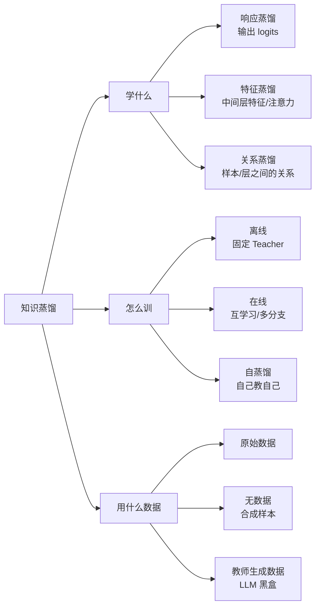

---
Title | MO KD
-- | --
Created @ | `2021-04-12T02:03:32Z`
Updated @| `2026-11-23T09:23:38Z`
Labels | ``
Edit @| [here](https://github.com/junxnone/aiwiki/issues/207)

---
# 知识蒸馏

知识蒸馏（Knowledge Distillation，KD）用一个已经训练好的大模型（**Teacher**）去指导一个小模型（**Student**）的训练，让小模型学到的不只是"标准答案"，还有大模型对各类别、各样本之间关系的判断，从而在体量小得多的前提下获得更好的泛化能力。它是模型压缩的三大手段之一（另两种是 [量化](0312_MO_Quantization) 和剪枝，总览见 [模型性能优化技术](0471_MO)），近几年也成为大语言模型（LLM）把能力传给小模型的主要方式。

**一句话概括：蒸馏就是"让学生学老师的输出（或中间特征、样本关系）"；要回答的问题只有三个——学什么（知识的形式）、怎么学（老师和学生怎么训练）、用什么数据学。**

> 本文是蒸馏系列的**综述**：先讲清基本概念与核心损失，再给出方法的分类体系、效果、风险和选型建议；每一类方法的公式与细节在对应的系列文章里展开（见第 18 节导航）。标注：`[解读]` 是对论文的理解，`[经验]` 是一般经验，`[待核实]` 是未能确认的内容。

- Teacher/Student Model
  - Teacher Model 的输出 作为 Soft Target Training  Student Model
  - Student 学习 Teacher 泛化能力
- 用途
  - 模型压缩(小模型学习大模型的泛化能力)
- [History](0336_MO_KD_History)
- [Distilling the Knowledge in a Neural Network](0208_MO_KD_s)

---

## 1. 为什么需要蒸馏

- 大模型（或多个模型的集成）精度高，但推理慢、占内存、耗电，难以部署到手机、边缘设备或对延迟敏感的服务；
- 直接训练小模型，精度往往不如"从大模型学"得到的小模型——小模型的表示能力并不一定差，只是更难训练到好的解（DML 论文的论点）；
- one-hot 硬标签只告诉模型"正确答案是哪一类"，**丢失了类别之间的相似性信息**（例如"猫"比"汽车"更像"狗"）；Teacher 输出的概率分布里保留了这些信息，Hinton 称之为"暗知识（dark knowledge）"。

三种压缩技术的位置如下：

| 技术 | 压缩的是什么 | 是否需要训练 | 与蒸馏的关系 |
|---|---|---|---|
| 蒸馏 Distillation | 模型架构（换成更小的学生网络） | 需要 | 本文主题 |
| 量化 Quantization | 数值精度（FP32→INT8/INT4） | PTQ 不需要，QAT 需要 | 可叠加：QAT 时加蒸馏损失（见 [量化感知训练](/0703_MO_Quantization_QAT)） |
| 剪枝 Pruning/Sparsity | 参数数量 | 通常要微调 | 可叠加：剪枝后用蒸馏恢复精度 |

表中：第一列是技术，第二列是它压缩的对象，第三列是否需要训练，第四列是与蒸馏的关系；三者作用于不同维度，可以组合使用（详见 [模型性能优化技术](0471_MO)）。

## 2. 基本框架

下图是知识蒸馏的整体示意。


图中：

- 左侧虚线框"Teacher Model"：较大、较深的网络（图中的节点层数与宽度更多）；
- 右侧虚线框"Student Model"：较小的网络（节点更少）；
- 中间"Knowledge Transfer"：从 Teacher 中"蒸馏（Distill）"出知识，再"迁移（Transfer）"给 Student——知识的形式可以是输出的软目标、中间特征，或样本之间的关系；
- 下方"Data"：同一份数据同时送给 Teacher 和 Student（无数据蒸馏则没有这份数据，见 [无数据蒸馏](/0694_MO_KD_DataFree)）。

## 3. 核心损失

### 3.1 带温度的 softmax

Teacher 训练充分后，对目标类的概率往往接近 1，其他类的概率小到几乎被忽略。引入**温度** $T$ 把分布"拉平"，让这些小概率显现出来：

$$
p_i(T)=\frac{\exp(z_i/T)}{\sum_{j=1}^{K}\exp(z_j/T)}
$$

其中：

- $z_i$：模型对第 $i$ 类输出的 logit（softmax 之前的值）；$K$：类别数；
- $T>0$：温度。$T=1$ 就是普通 softmax；$T>1$ 时分布更平缓，小概率类被"抬起来"；$T\to\infty$ 时趋向均匀分布。

### 3.2 蒸馏损失

Student 的总损失是**硬标签交叉熵**与**对 Teacher 软目标的 KL 散度**的加权和：

$$
\mathcal L=\alpha\,\mathrm{CE}\big(y,\,p^{s}(1)\big)+(1-\alpha)\,T^{2}\,\mathrm{KL}\big(p^{t}(T)\,\|\,p^{s}(T)\big)
$$

其中：

- $y$：真实的 one-hot 标签；$p^s(1)$：Student 在 $T=1$ 下的输出，$p^s(T)$、$p^t(T)$：Student、Teacher 在温度 $T$ 下的输出（后者就是"软目标"）；
- $\mathrm{CE}$：交叉熵，$\mathrm{KL}(P\|Q)=\sum_iP_i\log\frac{P_i}{Q_i}$：KL 散度；
- $\alpha\in[0,1]$：硬标签项的权重（原论文发现给硬标签项更低的权重通常更好）；
- $T^2$：补偿系数——软目标产生的梯度幅度按 $1/T^2$ 缩小，乘回 $T^2$ 使软、硬两项的相对贡献在改变温度时大致不变；
- 蒸馏训练时师生用同一温度 $T$，训练完成后 Student 推理时用 $T=1$。

这个损失就是 **响应蒸馏**（匹配输出层）的基础，其他类别的蒸馏通常是在它之上再加特征、关系或数据层面的项。详见 [响应蒸馏](/0689_MO_KD_Response) 与 Hinton 原文笔记 [0208](0208_MO_KD_s)。

### 3.3 常见蒸馏损失速查

不同类别的蒸馏，差别主要在"拿什么度量师生的差异"：

| 损失 | 度量的对象 | 典型用法 | 出现在 |
|---|---|---|---|
| 交叉熵 / KL（前向 $\mathrm{KL}(p\|q)$） | 输出分布 | 响应蒸馏的基础；覆盖 Teacher 分布的全部区域 | Hinton KD、DKD、Seq-KD |
| 反向 KL（$\mathrm{KL}(q\|p)$） | 输出分布 | 寻模式（mode-seeking），适合容量小的生成式学生 | MiniLLM |
| JSD、skew KL | 输出分布 | 前向/反向之间插值；skew KL 梯度更稳定 | GKD、DistiLLM |
| logit 的均方误差 | logits | 高温极限下与 KD 等价 | Hinton KD 的推导、Codistillation 的可选项 |
| 特征的 $L_2$ / MSE | 中间层特征 | 对齐隐层，常需要回归器 | FitNets、TinyBERT、BYOT |
| 注意力图的 $L_p$ | 归一化的空间注意力 | 轻量，不需要通道对齐 | Attention Transfer、FGD |
| Huber / 关系势差 | 样本间距离、夹角 | 匹配结构而非绝对值 | RKD |
| 相似度矩阵的 Frobenius 范数 | 批内两两相似度 | 与通道数无关 | SP |
| InfoNCE / 对比目标 | 表示的互信息下界 | 让同一输入的师生表示靠近 | CRD |
| 余弦嵌入损失 | 隐状态方向 | 对齐师生隐向量的方向 | DistilBERT |
| 逐通道 softmax 后的 KL | 每个通道的空间分布 | 稠密预测，聚焦显著区域 | CWD |
| 监督 SFT 交叉熵 | 教师生成的序列 | 黑盒蒸馏，没有 logits 时 | 数据蒸馏、DeepSeek-R1 蒸馏 |

表中：

- 第一列是损失的名称，第二列是它度量师生差异的对象，第三列是典型用法，第四列是代表性出现位置；
- 同一个方法常常把多项损失加在一起（如 DistilBERT 用交叉熵 + MLM + 余弦），各项的公式见对应的系列文章。

## 4. 分类体系

蒸馏方法可以从三个互相独立的维度来分：

| 维度 | 回答的问题 | 类别 |
|---|---|---|
| 学什么（知识的形式） | Student 去匹配 Teacher 的什么 | 响应（输出）、特征（中间层）、关系（样本/层之间） |
| 怎么训（师生的训练方式） | Teacher 是不是预先训练好、是不是另一个模型 | 离线、在线（互学习）、自蒸馏 |
| 用什么数据 | 训练 Student 的数据从哪来 | 原始训练数据、无数据（合成）、教师生成的数据（LLM 黑盒） |

表中：第一列是分类维度，第二列是该维度回答的问题，第三列是其中的类别；一个具体方法在三个维度上各有一个位置，例如 DKD 是"响应 + 离线 + 原始数据"，DeepSeek-R1 蒸馏是"响应（序列）+ 离线 + 教师生成的数据"。

下图把三个维度画成一张分类图。



图中：

- 根节点"知识蒸馏"向下分成三个维度（学什么、怎么训、用什么数据），每个维度下的叶子是该维度的具体类别；
- 三个维度彼此独立，选一个方法时在每个维度上各选一项；
- 叶子节点的文字注明了该类的核心特征。

## 5. 各类方法概览

### 5.1 学什么

- **Response-based（响应蒸馏）**：Student 匹配 Teacher 最终输出的软化 logits——Hinton 2015 的原始做法。简单、通用，不要求师生结构相近；代表工作还有 DKD（把 KD 损失拆成目标类 TCKD 与非目标类 NCKD 分别加权）。详见 [响应蒸馏](/0689_MO_KD_Response)。
- **Feature-based（特征蒸馏）**：Student 匹配 Teacher 的中间层激活/特征图，而不只是最终输出，监督信号更密。代表工作 FitNets（用 Teacher 隐藏层的"提示"训练更瘦更深的学生网络）、Attention Transfer（匹配空间注意力图）、CRD（对比学习）、ReviewKD（跨层回顾）。需要处理师生通道数/分辨率不一致的问题。详见 [特征蒸馏](/0690_MO_KD_Feature)。
- **Relation-based（关系蒸馏）**：Student 匹配的是样本之间/层之间的**相对关系**（距离、夹角、Gram 矩阵），而不是每个样本的绝对输出值，对师生维度不一致最宽容，代表工作 RKD（距离/角度损失）、SP、PKT、CC。详见 [关系蒸馏](/0691_MO_KD_Relation)。

### 5.2 怎么训

- **Offline（离线/传统蒸馏）**：Teacher 先预训练好并冻结，Student 之后单独对着固定的 Teacher 输出训练——Hinton 2015、FitNets、TinyBERT 等默认都是这个模式；流程是两阶段，但最稳定、最常用。
- **Online（在线/互学习）**：Teacher 和 Student（或多个对等的 Student）同时训练、互相指导，不需要预训练好的固定 Teacher，代表工作 Deep Mutual Learning（一组 Student 网络互相蒸馏）、ONE、Codistillation（适合分布式训练）。详见 [在线蒸馏](/0692_MO_KD_Online)。
- **Self-distillation（自蒸馏）**：模型自己同时充当 Teacher 和 Student——用自己更早的训练代、更深的层指导更浅的层/更晚的代，代表工作 Born-Again Networks（同架构的 Student 一代一代地向上一代学习，且 Student 经常能超过 Teacher）、BYOT、CS-KD、Tf-KD。它同时说明软目标的**正则化作用**与类间相似性同样重要。详见 [自蒸馏](/0693_MO_KD_Self)。

### 5.3 用什么数据

- **无数据蒸馏**：拿不到原始训练数据（隐私、版权、体积）时，从 Teacher 本身合成训练样本：DAFL（生成器 + Teacher 当判别器）、DeepInversion（反演输入并匹配 BN 统计量）、ZSKT（对抗式）。注意区别：数据集蒸馏压缩的是数据，无数据蒸馏压缩的是模型。详见 [无数据蒸馏](/0694_MO_KD_DataFree)。
- **教师生成的数据（LLM 黑盒）**：只能拿到闭源大模型的生成文本，就让它生成指令、答案和推理过程，再用 SFT 训练小模型：Self-Instruct/Alpaca、Distilling Step-by-Step、DeepSeek-R1 蒸馏。详见 [LLM 黑盒蒸馏](/0697_MO_KD_LLM_BlackBox)。

### 5.4 对比汇总

| 类别 | 匹配对象 | 对师生结构的要求 | 额外开销 | 典型代表 |
|---|---|---|---|---|
| 响应蒸馏 | 输出 logits / 软概率 | 无（只要输出空间一致） | 低 | Hinton KD、DKD |
| 特征蒸馏 | 中间层特征 / 注意力 | 需要适配层对齐通道、分辨率 | 中 | FitNets、AT、ReviewKD |
| 关系蒸馏 | 样本间距离/角度/相似度 | 几乎无要求 | 中（批内两两计算） | RKD、SP、PKT |
| 在线蒸馏 | 同伴/集成的软输出 | 对等网络或同一网络的多分支 | 训练时多个模型 | DML、ONE |
| 自蒸馏 | 自己的另一版本/深层/同类样本 | 同一网络 | 低到中 | BAN、BYOT、CS-KD |
| 无数据蒸馏 | 合成样本上的输出 | 无 | 高（生成/反演） | DAFL、DeepInversion |

表中：

- 第一列是类别，第二列是 Student 匹配的对象，第三列是对师生结构的要求，第四列是相对基线 KD 的额外开销，第五列是代表工作；
- 开销一栏是定性的比较 `[解读]`；各类方法并不互斥，实践中常把响应蒸馏与特征/关系蒸馏叠加使用。

### 5.5 Teacher 与 Student 怎么选

| 角色 | 常见选择 | 说明与例子 |
|---|---|---|
| Teacher | 单个大模型 | 最常见；训练好后冻结 |
| Teacher | 多个模型的集成 | Hinton 的实验：把 10 个模型的集成蒸馏进一个单模型，效果接近集成 |
| Teacher | 助教（中等规模） | 师生差距过大时，先蒸馏出助教再教学生（TAKD） |
| Teacher | 对等的同伴 | DML 中互为老师；ONE 里是同一网络的多个分支的门控集成 |
| Teacher | 自己 | BAN 的上一代、BYOT 的最深分类器、CS-KD 对同类其他样本的预测；Tf-KD 甚至用人工构造的"虚拟 Teacher" |
| Student | 同构缩小版 | DistilBERT 层数减半、参数少 40%，并用 Teacher 每隔一层的权重初始化 |
| Student | 更瘦更深 | FitNets 用比 Teacher 更窄更深的网络 |
| Student | 同容量/异构 | BAN 用相同结构的学生超过老师；也能用 DenseNet 教 ResNet |
| Student | 不同模态/任务头 | PKT 展示了从文本模态到视觉模态的迁移 |

表中：

- 第一列是师生角色，第二列是常见选择，第三列是说明及代表工作；
- 选择的核心原则：Teacher **不一定越大越好**，要和 Student 的容量匹配（能力差距，见第 9 节）；Student 的初始化也很重要（DistilBERT 从 Teacher 取一半的层；TinyBERT 先做通用蒸馏再做任务蒸馏）。

## 6. 不同场景的蒸馏

| 场景 | 难点 | 常用做法 | 系列文章 |
|---|---|---|---|
| 图像分类 | 压缩 CNN | 响应蒸馏（KD、DKD），必要时加特征蒸馏 | [响应](/0689_MO_KD_Response)、[特征](/0690_MO_KD_Feature) |
| 目标检测/分割 | 前景背景不均衡；定位知识；逐像素关系 | FGD、LD、CWD | [检测/分割/ViT 蒸馏](/0695_MO_KD_CV) |
| 视觉 Transformer | 数据效率 | DeiT 的 distillation token，用卷积网络当 Teacher | [检测/分割/ViT 蒸馏](/0695_MO_KD_CV) |
| NLP 编码器（BERT） | 逐层结构 | DistilBERT、TinyBERT、MiniLM | [LLM 白盒蒸馏](/0696_MO_KD_LLM_WhiteBox) |
| 生成式大模型（白盒） | 自回归的训练-推理分布不一致 | on-policy 蒸馏：MiniLLM、GKD、DistiLLM | [LLM 白盒蒸馏](/0696_MO_KD_LLM_WhiteBox) |
| 生成式大模型（黑盒） | 只有文本，没有 logits | 数据蒸馏、推理（CoT）蒸馏 | [LLM 黑盒蒸馏](/0697_MO_KD_LLM_BlackBox) |
| 拿不到原始数据 | 隐私/版权 | 无数据蒸馏 | [无数据蒸馏](/0694_MO_KD_DataFree) |

表中：

- 第一列是应用场景，第二列是该场景的主要难点，第三列是常用的蒸馏做法，第四列是对应的系列文章；
- 趋势：从分类（输出层）走向检测分割（区域与关系）、再走向 LLM（序列级、on-policy、推理链）。

## 7. 蒸馏与相关概念

| 相关概念 | 与蒸馏的区别与联系 |
|---|---|
| 微调 / 迁移学习 | 微调用**真实标签**继续训练同一个（预训练）模型；蒸馏用**Teacher 的输出**训练另一个（通常更小的）模型，二者常结合（如先微调 Teacher，再蒸馏） |
| 伪标签 / 自训练 | 伪标签用模型自己对无标签数据的预测当标签；Tf-KD 的 self 版本就是用预训练好的自己当 Teacher，是"自蒸馏"的一种；黑盒蒸馏用强模型的生成文本当伪标签 |
| 标签平滑 | 标签平滑用均匀分布平滑硬标签，是人工设计的软目标；KD 是**学出来的**标签平滑（Yuan 等的分析）；但用标签平滑训练的 Teacher 蒸馏效果会变差 |
| 模型集成 | 集成靠多个模型的平均预测，推理成本随模型数增长；蒸馏把集成的收益压进单个模型（Hinton 的实验） |
| 数据集蒸馏 | 压缩的是**数据集**（合成少量样本替代全量数据）；知识蒸馏压缩的是**模型**；无数据蒸馏则是在没有数据时合成样本用于蒸馏 |
| 量化、剪枝 | 压缩不同维度，可叠加；蒸馏常用于恢复量化/剪枝后的精度 |
| RLHF / 强化学习 | on-policy 蒸馏（MiniLLM、GKD）与 RLHF 在流程上很像，GKD 还能与 RLHF/RLAIF 结合；DeepSeek-R1 论文发现对小模型，蒸馏优于直接强化学习 |

表中：

- 第一列是相关概念，第二列是它与蒸馏的区别与联系；
- 一个简单的判断：**监督信号来自另一个模型的输出**，就是蒸馏的范畴；监督信号仍是真实标签，就是普通训练。

## 8. LLM 时代的新趋势

- 蒸馏的对象从 logits 扩展到**生成的完整序列**（Sequence-Level Knowledge Distillation，2016），是后续大模型蒸馏方法的先声；
- **GKD（Generalized/On-Policy Distillation，Google DeepMind，2023）**：让 Student 在自己生成的 rollout 上接受 Teacher 打分训练，而不是只在 Teacher 生成的固定数据上训练，缓解了"Student 推理时遇到的分布和训练时不一致"的问题，是目前 LLM 蒸馏的主流思路之一； 详见 [LLM 白盒蒸馏](/0696_MO_KD_LLM_WhiteBox)。
- **DeepSeek-R1 蒸馏（2025-01）**：把 R1 的推理能力通过 SFT 直接蒸馏进 Qwen2.5/Llama3 系列的稠密小模型（1.5B-70B），论文发现"直接蒸馏"效果优于"对小模型直接做强化学习"——是目前关注度最高的一次知识蒸馏实践案例； 详见 [LLM 黑盒蒸馏](/0697_MO_KD_LLM_BlackBox)。
- **蒸馏的 Scaling Law（Apple，2025-02）**：研究蒸馏效果如何随 Teacher/Student 的训练算力分配变化，发现存在"能力差距"现象——Teacher 太强反而可能让 Student 学得更差，蒸馏不是"Teacher 越大越好"。 详见 [理论与实践](/0698_MO_KD_Theory)。

## 9. 为什么有效、Teacher 怎么选

对"为什么有效"目前没有统一答案，更稳妥的做法是把软目标的收益看成几条路径的叠加：

- **暗知识**：错误类别的输出分布携带类别相似性信息；
- **重要性加权**：KD 的梯度可分解为"暗知识项"和"按 Teacher 对正确类置信度加权的真实标签项"；
- **正则化**：KD 是学出来的标签平滑，软目标有正则化作用；人工设计的"虚拟 Teacher"也能提升；
- **更容易优化**：软目标让小网络更容易找到好的解，互相匹配还能找到更平坦的极小值。

关于 Teacher：**不是越大越好**。Teacher 过强时，Student 容量不足以模仿，软目标又变得过于"尖锐"，效果反而下降（能力差距）。常见补救是用中等规模的助教模型（TAKD），或换一个更小的 Teacher；蒸馏缩放律进一步表明，Teacher 的作用只通过其交叉熵体现，并且在已有现成 Teacher 或要蒸馏很多 Student 时蒸馏才比监督训练划算。详见 [理论与实践](/0698_MO_KD_Theory)。

## 10. 效果速览

下表汇总系列文章里各论文报告的代表性结果，帮助建立"蒸馏能带来多少"的直观印象：

| 方法 / 论文 | 设置 | 报告的结果 |
|---|---|---|
| Hinton KD | 语音识别声学模型 | 蒸馏出的单个模型帧准确率 60.8%，接近 10 个模型集成的 61.1%（基线 58.9%）；只用 3% 训练数据时，软目标把测试帧准确率从 44.5% 提升到 57.0% |
| DistilBERT | 通用预训练蒸馏 | 参数少 40%、推理快 60%，在 GLUE 上保留 BERT 约 97% 的性能 |
| TinyBERT$_4$ | BERT$_{BASE}$ → 4 层 | GLUE 上达到教师 96.8% 以上，参数小 7.5 倍、推理快 9.4 倍 |
| BYOT | CIFAR-100 自蒸馏 | ResNet-18 从 77.09% 到 78.64%，ResNet-50 从 77.68% 到 80.56%；五类网络平均 +2.65% |
| ONE | CIFAR-100 在线蒸馏 | ResNet-32 错误率 31.18% → 26.61%，ResNet-110 25.33% → 21.62% |
| DKD | CIFAR-100，ResNet8×4 | 只用 NCKD 提升 1.76%，经典 KD 提升 1.13% |
| LD | COCO 检测（R101 → R50） | AP 从基线 40.1 到 41.1（LD），加 VLR 后 41.8 |
| CWD | COCO / Cityscapes | RetinaNet（R50）+3.4% mAP；PSPNet（R18）+5.81% mIoU |
| DeepSeek-R1 蒸馏 | Qwen2.5-32B | 蒸馏版 AIME 2024 pass@1 为 72.6%，同一基座直接大规模 RL 为 47.0% |
| LSQ + KD | ImageNet，3 bit | 配合同结构蒸馏，3 bit 网络追平全精度基线 |

表中：

- 第一列是方法或论文，第二列是实验设置，第三列是论文报告的结果；
- 数字都取自对应论文，来自不同任务、不同模型、不同基线，**不能横向比较**，只用于说明蒸馏在各场景下的量级；具体设置见各系列文章。

## 11. 局限与风险

- **Teacher 的错误会被学走**：Student 模仿 Teacher，Teacher 的偏差与错误同样会传下去；黑盒蒸馏的上限也受 Teacher 限制，DeepSeek-R1 论文指出要超越 Teacher 的能力边界，仍需要更强的基础模型与更大规模的 RL；
- **能力差距**：Teacher 太强、Student 太小时效果下降（TAKD、蒸馏缩放律）；
- **Teacher 的训练方式会影响蒸馏**：用标签平滑训练的 Teacher，类内表示被压成紧簇，类间信息丢失，蒸馏效果变差；
- **超参数敏感**：温度 $T$、$\alpha$、DKD 的 $\beta$（随 Teacher 不同需要调整）、蒸馏层的选择都需要试验；
- **on-policy 蒸馏的训练风险**：MiniLLM 指出策略梯度方差大、容易奖励投机（生成重复退化的文本）、偏爱短句（甚至输出空回复），因此需要单步分解、教师混合采样、长度归一化等技巧；
- **无数据蒸馏依赖 Teacher 的内部信息**：DeepInversion 依赖 BN 层里保存的训练统计量，没有 BN 的结构需要其他方式估计；合成数据的多样性与真实度仍不及真实数据；
- **合规风险（黑盒蒸馏）**：用闭源模型的输出生成训练数据，可能受 API 使用条款、许可证的限制 `[经验]`，使用前需要核对；
- **推理链蒸馏的局限**：学生学到的是 Teacher 的推理格式与风格，未必获得同等的推理能力；DeepSeek-R1 论文中的蒸馏模型也只做了 SFT，没有 RL 阶段。

## 12. 如何评估蒸馏

- **精度保留率**：Student 相对 Teacher 的指标比例（如 DistilBERT 的"保留 97%"）；同时要与"同样大小、不蒸馏、从头训练"的基线比较——蒸馏的价值是这两者之差；
- **压缩比与实测速度**：参数量、FLOPs 只是代理，**要报告真实延迟/吞吐**（DistilBERT 报告了 CPU 上的推理时间与手机端速度；TinyBERT 报告了参数与推理倍数）；
- **与 Teacher 的一致性**：预测一致率、输出分布差异（KL）、校准度——标签平滑会改善校准，但对蒸馏有副作用；
- **任务指标**：分类用 top-1/top-5，检测用 mAP，分割用 mIoU，生成任务用 ROUGE/BLEU/困惑度（GKD 用 ROUGE-2 与 BLEU，并用 Self-BLEU 衡量多样性）；
- **稳定性**：多次随机种子的均值与标准差（ONE、DistilBERT 报告多次运行的结果）；对 LLM 要同时看不同温度/解码方式（GKD 发现寻模式的散度在温度采样下更好）；
- **公平对比**：同样的训练预算、同样的数据；做复现研究时，应同时报告原论文数字与自己复现的数字，便于判断复现是否可靠。

## 13. 实践指南 [经验]

### 13.1 选型流程

下图是一个从目标出发的选型流程。

```
有没有原始训练数据？
 ├─ 没有 ─────────────► 无数据蒸馏（DeepInversion / DAFL）
 └─ 有
     │ 要压缩的是什么模型？
     ├─ 分类 CNN ─────► 先用响应蒸馏（KD/DKD）；精度不够再叠加特征/关系蒸馏
     ├─ 检测/分割 ────► FGD / LD / CWD（先选前景/定位/通道关系）
     ├─ BERT 类编码器 ─► DistilBERT（预训练阶段）/ TinyBERT（逐层）
     └─ 生成式 LLM
          ├─ 能拿到 Teacher 的 logits ─► on-policy 白盒蒸馏（GKD / MiniLLM / DistiLLM）
          └─ 只有文本（闭源 API）────► 黑盒蒸馏：高质量数据 + SFT（含推理链）
没有合适的大 Teacher？ ─► 在线蒸馏（DML/ONE）或自蒸馏（BYOT/Tf-KD）
Teacher 与 Student 差距太大？ ─► 助教（TAKD）或更小的 Teacher
```

图中：

- 从上到下依次判断：有没有数据 → 压缩什么模型 → 有没有现成 Teacher → 师生差距是否太大；每个叶子给出推荐的方法；
- 各分支并不互斥，例如检测里可以同时用特征蒸馏与响应蒸馏；
- 具体超参数（温度 2–4、$\alpha$、蒸馏层的选择）见 [理论与实践](/0698_MO_KD_Theory) 里的检查清单。

### 13.2 实操五步

1. **定目标**：要压到多大（参数/延迟/显存），可接受的精度损失是多少，先训练一个"不蒸馏的同尺寸基线"作为对照；
2. **选 Teacher 和 Student**：Teacher 不一定越大越好，与 Student 的容量差距不要过大（第 5.5、9 节）；Student 尽量用 Teacher 的部分权重初始化或先做预训练；
3. **选知识形式与损失**：先用响应蒸馏（第 3.2 节的 KD 损失），不够再叠加特征/关系蒸馏（第 3.3 节速查表）；LLM 场景先判断是白盒还是黑盒；
4. **调超参**：温度 $T$（2–4 起步）、$\alpha$、蒸馏层、学习率；常用做法是把损失里蒸馏项做 warmup；
5. **评估与部署**：按第 12 节评估；蒸馏后还可以接量化（见 [量化](0312_MO_Quantization)）。

## 14. 开源工具

下面只列出官方 README/文档里能确认的信息（拉取时间：2026-11）：

| 工具 | 说明 | 适合 |
|---|---|---|
| torchdistill | 模块化、**配置驱动**的 KD 框架，只需编辑 yaml 配置文件即可设计实验，实现了多种 KD 方法（如 Hinton KD、FitNets、RKD 等）；示例覆盖图像分类、目标检测、语义分割与 GLUE 等 | 在 PyTorch 里复现、比较各种经典蒸馏方法 |
| mdistiller | 提供主流 CV 基准上经典蒸馏算法的 PyTorch 库，同时是 DKD（CVPR 2022）与 DOT（ICCV 2023）的官方实现 | CV 分类蒸馏的基线与论文复现 |
| TRL 的 `GKDTrainer` | Hugging Face TRL 中的 GKD 实现（位于 `trl.experimental.gkd`），是 `SFTTrainer` 的封装，需要传入 Teacher 模型；通过 `GKDConfig` 的 `lmbda`（学生数据占比）、`seq_kd`（是否序列级 KD）、`beta`（广义 JSD 的插值，0 近似前向 KL，1 近似反向 KL）控制 | LLM 的 on-policy 白盒蒸馏 |
| Hugging Face Transformers | DistilBERT 论文说明其权重与训练代码已放入 Transformers 库 | 直接使用已蒸馏好的 BERT 类模型 |

表中：

- 第一列是工具，第二列是它的功能（均出自官方 README/文档），第三列是适用场景；
- `GKDTrainer` 目前位于 `experimental` 命名空间，接口可能变化，使用前请查官方文档；
- 量化相关的工具见 [量化工具对比](/0709_MO_Quantization_Tools)；NNCF 的训练时知识蒸馏算法已随旧版 API 被移除（见 [OpenVINO NNCF](0451_Tools_OV_NNCF)）。

## 15. 本系列未展开的方向

系列文章按"类别 + 代表方法"组织，下面这些方向在读到的论文中被提到，但没有展开成独立文章：

- **多教师蒸馏**：用多个 Teacher 联合指导一个 Student（DistilBERT 论文的相关工作里提到 Multi-Task Knowledge Distillation）；
- **跨模态蒸馏**：PKT 展示了从文本模态到视觉模态的知识迁移，CRD 也包含跨模态迁移实验；
- **任务特定 vs 任务无关蒸馏**：DistilBERT 在预训练阶段做通用蒸馏，TinyBERT 采用"通用蒸馏 + 任务蒸馏"两阶段；
- **蒸馏用于剪枝与持续学习**：DeepInversion 展示了无数据剪枝与无数据持续学习；
- **扩散模型蒸馏、推荐/检索中的蒸馏等**：本系列未读原文，尚未整理 `[待核实]`。

## 16. 入门阅读顺序

1. 本文：了解全貌与分类；
2. [Hinton 原文笔记](0208_MO_KD_s) 和 [响应蒸馏](/0689_MO_KD_Response)：掌握温度、KD 损失与 DKD；
3. [特征蒸馏](/0690_MO_KD_Feature)、[关系蒸馏](/0691_MO_KD_Relation)：了解更丰富的知识形式；
4. 按需要选读：[检测/分割/ViT](/0695_MO_KD_CV)、[LLM 白盒](/0696_MO_KD_LLM_WhiteBox)、[LLM 黑盒](/0697_MO_KD_LLM_BlackBox)、[无数据](/0694_MO_KD_DataFree)；
5. [理论与实践](/0698_MO_KD_Theory)：理解为什么有效、怎么选 Teacher、怎么和量化剪枝组合。

## 17. 发展脉络

- 2006：Model Compression（用大模型/集成标注的数据训练小模型）；
- 2014–2015：FitNets 提出特征蒸馏，Hinton 提出带温度的软目标蒸馏；
- 2016–2019：序列级蒸馏、注意力迁移、在线互学习、自蒸馏、关系蒸馏、对比表示蒸馏；
- 2019–2020：BERT 系列蒸馏（DistilBERT、TinyBERT、MiniLM）、无数据蒸馏、DeiT；
- 2021–2022：检测蒸馏（FGD、LD）、DKD；
- 2023–2025：LLM 蒸馏（MiniLLM、GKD、DistiLLM）、推理蒸馏（DeepSeek-R1）、蒸馏缩放律。

完整的时间线（含各篇论文的具体日期和出处）见 [History](0336_MO_KD_History)。

## 18. 系列文章

蒸馏相关的技术按下表整理成系列文章，依次展开各类方法的公式与对比。

| 文章 | 覆盖内容 |
|---|---|
| [响应蒸馏](/0689_MO_KD_Response) | Hinton KD、温度与 $T^2$ 系数、hard/soft 蒸馏、DKD、标签平滑关系 |
| [特征蒸馏](/0690_MO_KD_Feature) | FitNets、Attention Transfer、FSP、CRD、ReviewKD |
| [关系蒸馏](/0691_MO_KD_Relation) | RKD、SP、PKT、CC |
| [在线蒸馏](/0692_MO_KD_Online) | DML、ONE、Codistillation |
| [自蒸馏](/0693_MO_KD_Self) | BAN、BYOT、CS-KD、Tf-KD |
| [无数据蒸馏](/0694_MO_KD_DataFree) | DAFL、DeepInversion、ZSKT、数据集蒸馏的区别 |
| [检测/分割/ViT 蒸馏](/0695_MO_KD_CV) | FGD、LD、CWD、DeiT 的 distillation token |
| [LLM 白盒蒸馏](/0696_MO_KD_LLM_WhiteBox) | Seq-KD、DistilBERT、TinyBERT、MiniLM、MiniLLM、GKD、DistiLLM |
| [LLM 黑盒蒸馏](/0697_MO_KD_LLM_BlackBox) | Self-Instruct/Alpaca、Distilling Step-by-Step、DeepSeek-R1 蒸馏 |
| [理论与实践](/0698_MO_KD_Theory) | 暗知识与正则化、能力差距与 TAKD、蒸馏缩放律、与量化/剪枝组合 |
| [发展历史](0336_MO_KD_History) | 蒸馏发展时间线（timelinemd 格式） |

表中：

- 第一列是系列中的文章，点击进入；第二列是该文章覆盖的代表方法或主题；
- 阅读顺序建议见第 16 节。

## 19. 术语表

| 术语 | 含义 |
|---|---|
| Teacher / Student | 教师模型（大、已训练好）/ 学生模型（小、待训练） |
| Soft target / 软目标 | Teacher 在温度 $T>1$ 下的 softmax 输出，比 one-hot 更平滑 |
| Hard label / 硬标签 | 真实的 one-hot 标签 |
| Dark knowledge / 暗知识 | 软目标中错误类别的相对大小，反映类间相似性 |
| Temperature / 温度 $T$ | softmax 的缩放系数，越大分布越平 |
| Logit | softmax 之前的原始输出 |
| Hint / 提示层 | FitNets 中被学生模仿的 Teacher 中间层 |
| Teacher Assistant（TA） | 介于 Teacher 与 Student 之间的中等规模模型 |
| Capacity gap / 能力差距 | Teacher 比 Student 强得太多时蒸馏效果反而下降的现象 |
| Offline / Online / Self | 离线（固定 Teacher）/ 在线（同时训练）/ 自蒸馏（自己教自己） |
| White-box / Black-box | 白盒（能拿到 logits、中间层）/ 黑盒（只有生成文本） |
| On-policy | 训练数据来自 Student 自己生成的序列 |
| Rationale / CoT | 推理过程 / 思维链，常作为额外的监督信号 |
| Forward / Reverse KL | $\mathrm{KL}(p\|q)$ 与 $\mathrm{KL}(q\|p)$，前者覆盖模式、后者寻找模式 |
| TCKD / NCKD | DKD 中的目标类蒸馏 / 非目标类蒸馏 |

表中：第一列是术语，第二列是其含义；这些术语在系列文章里反复出现，第一次出现时的详细解释见对应文章。

## Reference
- 2020-6 Knowledge Distillation: A Survey [[Paper](https://arxiv.org/pdf/2006.05525.pdf)]
- Distilling the Knowledge in a Neural Network [[Paper](https://arxiv.org/abs/1503.02531)]
- FitNets: Hints for Thin Deep Nets [[Paper](https://arxiv.org/abs/1412.6550)]
- Deep Mutual Learning [[Paper](https://arxiv.org/abs/1706.00384)]
- Born-Again Neural Networks [[Paper](https://arxiv.org/abs/1805.04770)]
- Relational Knowledge Distillation [[Paper](https://arxiv.org/abs/1904.05068)]
- Decoupled Knowledge Distillation [[Paper](https://arxiv.org/abs/2203.08679)]
- On-Policy Distillation of Language Models (GKD) [[Paper](https://arxiv.org/abs/2306.13649)]
- DeepSeek-R1 [[Paper](https://arxiv.org/abs/2501.12948)]
- Distillation Scaling Laws [[Paper](https://arxiv.org/abs/2502.08606)]
- 开源工具：[torchdistill](https://github.com/yoshitomo-matsubara/torchdistill)、[mdistiller](https://github.com/megvii-research/mdistiller)、[TRL GKDTrainer](https://huggingface.co/docs/trl/gkd_trainer)
- **Awesome list**
  - **[Awesome Knowledge Distillation](https://github.com/dkozlov/awesome-knowledge-distillation)**
  - [Awesome Knowledge-Distillation](https://github.com/FLHonker/Awesome-Knowledge-Distillation)

