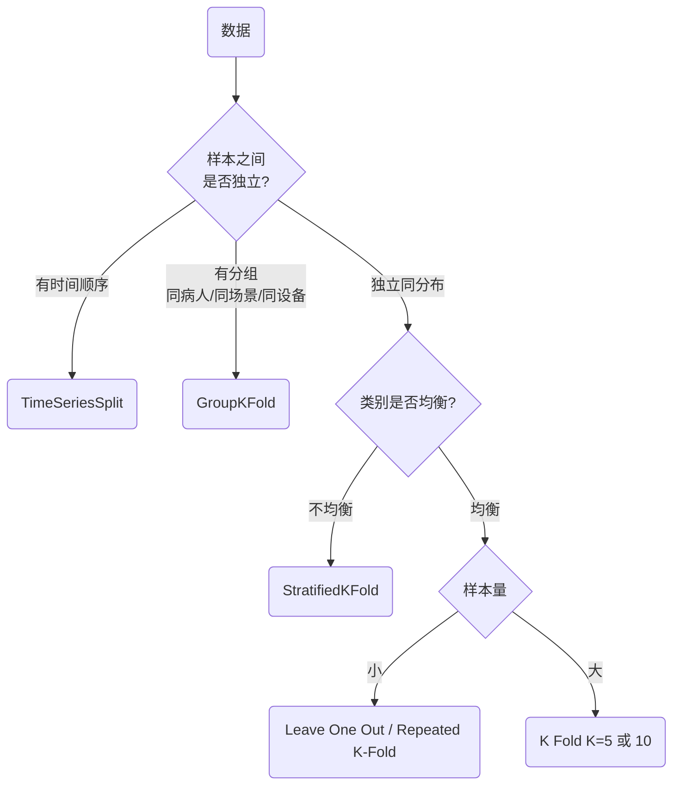

---
Title | ML Metrics CrossValidation
-- | --
Created @ | `2020-06-11T05:02:59Z`
Updated @| `2026-11-24T02:49:47Z`
Labels | ``
Edit @| [here](https://github.com/junxnone/aiwiki/issues/249)

---
# Cross Validation 交叉验证

- Cross Validation - `交叉验证`：把数据多次划分为训练集和验证集，用多次评估结果的均值估计模型的泛化性能
- 目的：
  - 小数据集上，单次划分的结果方差大，交叉验证给出更稳定的估计
  - 用于**模型选择和超参数调优**（见 AutoML HPO），最终报告仍应在**从未参与调参的独立测试集**上评估
- 它是一种评估方法，评价指标本身见 [Metrics](/0138_ML_Metrics)

## Brief

Num | Cross Validation | Description | sklearn
-- | -- | -- | --
1 | K Fold  | 数据分成 K 份，轮流取 1 份验证，其余 K-1 份训练 | `KFold`
2 | Repeated K-Fold | 重复 n 次 K-Fold，每次重新随机划分，降低划分的随机性 | `RepeatedKFold`
3 | Leave One Out (LOO) | K = N，每次只留 1 个样本验证，适用于小样本，计算量大 | `LeaveOneOut`
4 | Leave P Out (LPO) | 每次留 P 个样本验证，遍历所有组合，组合数 $C_N^P$ 增长极快 | `LeavePOut`
5 | Shuffle & Split | 随机打乱后按比例划分，重复多次，验证集之间可以重叠 | `ShuffleSplit`
6 | Stratified `@12345` | 每一折保持类别比例，用于分类/不均衡数据 | `StratifiedKFold`
7 | Group  `@12345` | 同一个 Group 的样本只能同在训练或同在验证，防止泄漏 | `GroupKFold`
8 | Time Series Split | 按时间顺序划分，只用过去预测未来 | `TimeSeriesSplit`

表中 `@12345` 表示该策略可以与第 1~5 种策略组合使用，例如 StratifiedKFold = K Fold + 分层，StratifiedShuffleSplit = Shuffle & Split + 分层。

下图展示选择交叉验证方式的思路：



图中：

- 首先判断样本是否独立：时间序列和同源分组的数据如果随机划分会造成信息泄漏，验证分数虚高
- 独立数据再看类别是否均衡，不均衡时要分层，保证每折都有足够的少数类样本
- 样本量小时用留一法或重复 K 折提高估计稳定性，样本量大时 5 折或 10 折即可

## Standard Cross Validation - K Fold Cross Validation
- data split `K` part
- `x` ∈ [1, K] part 作为 Test, 剩下的 `K-1` part 作为 training
> K = 5 / 10


图中：整个数据集被切成 K 份，每一轮用其中 1 份（高亮）作验证，其余 K-1 份训练；K 轮之后每个样本恰好验证一次。

最终的 CV 分数是 K 次验证结果的均值，通常同时报告标准差：

$$
CV = \frac{1}{K}\sum_{i=1}^{K} Metric_i
$$

其中：

- $K$：折数，常取 5 或 10；K 越大，训练集越接近全量数据（偏差小），但计算量大、各折训练集重叠多（方差大）
- $Metric_i$：第 $i$ 折在验证集上的指标值（如 Accuracy、mIoU）

## Stratified k-fold cross validation - 分层交叉验证
- 每一折中都保持着原始数据中各个类别的比例关系
- 分类任务（尤其类别不均衡）默认应使用分层


图中：不同颜色代表不同类别，每一折内各颜色的占比都与整体数据一致，避免出现某一折验证集中缺少少数类的情况。


## Leave-one-out Cross-validation 留一法
- 样本容量为n，则k=n，进行n折交叉验证，每次留下一个样本验证
- 主要针对小样本数据
- 优点：训练集几乎是全量数据，估计偏差小，结果无随机性；缺点：要训练 n 次，且各折结果高度相关，估计方差大

## Repeated K-Fold
- 重复 `n_repeats` 次 K-Fold，每次使用不同的随机划分，共训练 $K \times n\_repeats$ 次
- 比单次 K-Fold 更稳定，常见设置 `5 x 2` 或 `10 x 3`

## Shuffle-split cross-validation
- 每次随机打乱后按 `train_size/test_size` 划分，重复 `n_splits` 次
- 与 K-Fold 不同，样本可能在多次验证中重复出现，也可能一次都没出现


图中：每一行是一次划分，不同颜色分别表示训练、验证（和未使用）样本，可以看到各次划分的验证集可以互相重叠，且不要求覆盖所有样本。

## Group K-Fold
- 同一个 Group（同一个病人、同一块晶圆、同一个场景、同一台设备）的样本强相关，随机划分会让「几乎相同」的样本同时出现在训练集和验证集，验证分数虚高
- `GroupKFold` 保证同一个 Group 只出现在训练集或验证集之一

## Time Series Split
- 时间序列数据必须保证**训练集在验证集之前**，不能用未来数据训练
- 每一折的训练集是前一折训练集加上新增的时间段（expanding window）

## Nested Cross Validation 嵌套交叉验证
- 同时需要调参和估计泛化性能时，用**内层** CV 选超参数，**外层** CV 评估泛化性能
- 如果用同一个 CV 既调参又报告分数，结果会乐观偏高（对验证集过拟合）

## 常见误区
1. **数据泄漏**：归一化、特征选择、数据增强、过采样必须**在每一折的训练集内**拟合，再应用到验证集；先对全量数据做完再 CV 会泄漏信息
2. **对重复/相似样本随机划分**：视频帧、同一产品的多张图片应按 Group 划分
3. **深度学习很少做完整 K 折**：训练成本高，通常用固定的 train/val/test；小数据集或需要集成时才使用 K 折
4. **K 折模型集成**：K 个模型可以平均预测作为最终模型，也可以在全量数据上重新训练一次

## Code
```python
from sklearn.model_selection import StratifiedKFold, GroupKFold, cross_val_score
from sklearn.pipeline import make_pipeline
from sklearn.preprocessing import StandardScaler
from sklearn.linear_model import LogisticRegression

# 预处理放进 Pipeline，保证每折内部单独拟合，避免泄漏
model = make_pipeline(StandardScaler(), LogisticRegression())
cv = StratifiedKFold(n_splits=5, shuffle=True, random_state=0)
scores = cross_val_score(model, X, y, cv=cv, scoring='f1_macro')
print(scores.mean(), scores.std())
```


## Reference

- [几种交叉验证（cross validation）方式的比较](https://www.cnblogs.com/ysugyl/p/8707887.html)
- [sklearn - cross validation](https://scikit-learn.org/stable/modules/cross_validation.html#cross-validation)
- [sklearn.model_selection 介绍](https://www.cnblogs.com/XD00/p/12290528.html)


