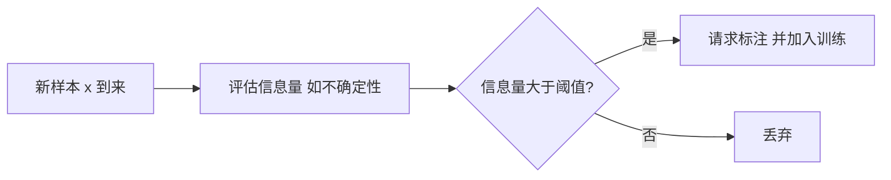

---
Title | ML AL QS StreamBasedSelectiveSampling
-- | --
Created @ | `2020-10-23T02:23:33Z`
Updated @| `2026-11-26T10:09:25Z`
Labels | ``
Edit @| [here](https://github.com/junxnone/aiwiki/issues/273)

---
# Stream-based Selective Sampling

**Stream-based/Sequential active learning**

主动学习中的一种查询场景：未标注样本像**数据流**一样一个一个到来，对每个样本**立刻决定**是否请求标注（要还是不要），不会回头。

## Brief
-  更接近真实分布
- Mobile Device

## 与 Pool-based 对比

| 对比项 | Stream-based | Pool-based |
| --- | --- | --- |
| 样本来源 | 逐个到来的数据流 | 一个固定的未标注样本池 |
| 决策方式 | 对当前样本即时决定是否查询 | 对整个池排序后选最有价值的 |
| 存储需求 | 不需要保存全部样本 | 需要存放整个池 |
| 适用 | 内存和算力受限的设备、在线数据 | 离线、数据已全部可得 |

表中：

- **查询**：向标注者（oracle）请求样本标签
- 对比结论：数据是流式到来或设备资源受限（如手机等 Mobile Device）时选 Stream-based；数据全部在手时 Pool-based 往往选得更准

## 决策方式

图中：每个样本到来后先用当前模型评估它的信息量，超过阈值才请求标注，否则直接丢弃。

常用的不确定性判据：

$$
\text{query}(x)=\begin{cases}1 & \max_{y}P_\theta(y\mid x)<\tau\ 0 & \text{否则}\end{cases}
$$

其中：

- $x$：到来的样本；$P_\theta(y\mid x)$：当前模型对类别 $y$ 的预测概率
- $\max_y P_\theta(y\mid x)$：模型最有把握的类别的概率，越小说明模型越不确定
- $\tau$：置信度阈值；低于它就请求标注（$1$ 表示查询，$0$ 表示不查询）
- 也可以用委员会分歧等判据，见 [QBC](https://github.com/junxnone/aiwiki/issues/272)

## History
- 1992 - [Query by committee]()
- 1994 - [`informativeness measure` - Improving generalization with active learning]()
- 1995 - [`region of uncertainty` - Committee-based sampling for training probabilistic classifiers]()
- 1998 - [SVM selective sampling for ranking with application to data retrieval]()
- 2002 - [Algorithms for optimal scheduling and management of hidden markov model sensors]()
-  2005 - [SVM selective sampling for ranking with application to data retrieval]()
- 2008 - [A general agnostic active learning algorithm]()

