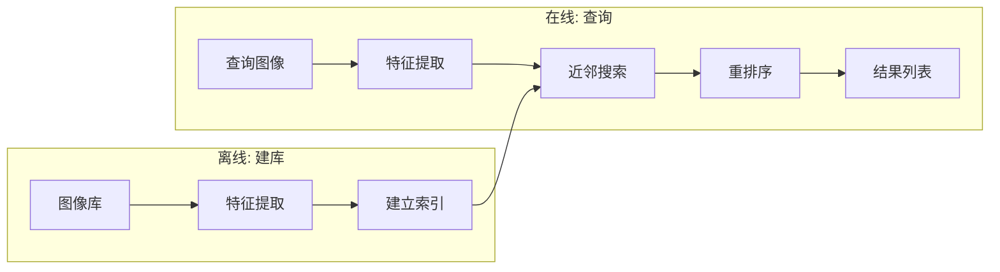

---
Title | ML Tasks Image Retrieval
-- | --
Created @ | `2022-01-21T09:08:26Z`
Updated @| `2026-11-25T16:52:03Z`
Labels | ``
Edit @| [here](https://github.com/junxnone/aiwiki/issues/278)

---

# Image Retrieval

- 图像检索有基于文本的检索和基于内容的检索
  - **基于文本的检索**: 在检索之前需要对海量的图片进行语义属性的标注，这种标注有主观性偏差，时间成本很高，而且语义属性也不能完全表达图像中的包含的丰富的信息，检索效果是有限的。
  - [CBIR](/0155_ML_Tasks_Image_Retrieval_CBIR) **基于内容的检索**: 允许用户输入一张图片，以查找具有相同或相似内容的其他图片。CBIR的核心是使用图像的可视特征对图像进行检索。本质上讲，它是一种近似匹配技术，融合了计算机视觉、图像处理、图像理解和数据库等多个领域的技术成果，其中的特征提取和索引的建立可由计算机自动完成，避免了人工描述的主观性。

## Reference
- [ image search engine based on BoW model](https://github.com/willard-yuan/py-cbir-image-search-engine)
- [retrieval papers](https://github.com/deepinsight/deepinsight.github.io/blob/master/_posts/deep_learning/2017-05-08-retrieval.md)
- [图像检索重磅综述（2016年之前）](https://blog.csdn.net/TTdreamloong/article/details/80991161)
- [图像检索与降维（一）：VLAD](https://blog.csdn.net/LiGuang923/article/details/85416407)
- [图像检索与降维（二）：NetVLAD](https://blog.csdn.net/LiGuang923/article/details/85470289)

## 检索流程

下图是基于内容的图像检索系统的典型流程，分成离线建库和在线查询两部分：

图中：

- 离线阶段：对图像库里每张图提取特征向量，并建立索引 (如倒排、图索引、乘积量化)，便于后面快速搜索
- 在线阶段：对查询图像提取同样的特征，在索引中找到最近邻，得到候选结果，再用更精细的方法 (几何校验、局部特征匹配、扩展查询) 重排序
- 离线和在线必须使用同一个特征提取器，否则特征不在同一空间，距离没有意义

## 特征与距离

$$
d_{L2}(\mathbf q,\mathbf x)=\|\mathbf q-\mathbf x\|_2,\qquad
\mathrm{sim}_{cos}(\mathbf q,\mathbf x)=\frac{\mathbf q^\top\mathbf x}{\|\mathbf q\|\,\|\mathbf x\|}
$$

其中：

- $\mathbf q$：查询图像的特征向量；$\mathbf x$：库中某张图像的特征向量
- $d_{L2}$：欧氏距离，越小越相似；$\mathrm{sim}_{cos}$：余弦相似度，越大越相似
- 特征做 L2 归一化后 $\|\mathbf q\|=\|\mathbf x\|=1$，此时 $d_{L2}^2=2-2\,\mathrm{sim}_{cos}$，两种度量等价，所以检索系统通常先归一化再用内积搜索

特征类型 | 例子 | 特点
-- | -- | --
全局手工特征 | 颜色直方图、纹理 (LBP/Gabor) | 简单，语义弱
局部特征聚合 | SIFT + BoW/VLAD/Fisher Vector | 对尺度、旋转稳健，见 [VLAD](/0154_ML_Tasks_Image_Retrieval_CBIR_VLAD)
深度全局特征 | CNN + 池化 (GeM)、度量学习训练 | 语义强，当前主流
深度局部特征 | DELF、SuperPoint | 用于重排序和几何校验

表中：从上到下语义能力逐渐增强；深度特征通常通过度量学习训练 (见下)，使同类样本在特征空间里靠得近。

## 度量学习

目标是学习一个映射 $f$，使同类样本的距离小、异类样本的距离大：

方法 | 输入 | 损失 | 文章
-- | -- | -- | --
Contrastive | 一对样本 | 同类拉近，异类推到间隔 $m$ 之外 | [Siamese](/0153_ML_Tasks_Image_Retrieval_CBIR_SiameseNetwork)
Triplet | 三元组 (锚、正、负) | 使 $d(a,p)+\alpha<d(a,n)$ | [Triplet](/0156_ML_Tasks_Image_Retrieval_CBIR_TripletNetwork)
分类型 (ArcFace/CosFace) | 单个样本 + 类别 | 在角度上加间隔的 softmax | 本站暂无

表中：前两类是基于样本对/三元组的损失，需要挖掘有效的样本对；分类型损失把每个类当作一个代理，训练更稳定，是人脸识别和商品检索的常用方法。

## 评价指标

$$
\mathrm{Recall@K}=\frac1{N}\sum_{i=1}^{N}\mathbb 1\bigl[\text{前 }K\text{ 个结果中至少有 1 个正确}\bigr],\qquad
\mathrm{AP}=\frac1{R}\sum_{k=1}^{n}P(k)\,\mathrm{rel}(k),\quad \mathrm{mAP}=\frac1{N}\sum_{i=1}^{N}\mathrm{AP}_i
$$

其中：

- $N$：查询图像数；$\mathbb 1[\cdot]$：条件成立为 $1$，否则为 $0$；Recall@K 是前 $K$ 个结果里至少有一个相关结果的查询所占比例
- $R$：库中与该查询相关的图像总数；$n$：返回结果数；$P(k)$：前 $k$ 个结果的精确率；$\mathrm{rel}(k)\in\{0,1\}$：第 $k$ 个结果是否相关
- AP 是单个查询的平均精度，mAP 是所有查询 AP 的平均；它同时考虑了相关结果的数量和排名位置，是地标检索 (Oxford/Paris) 常用指标

## 大规模近似搜索

- 精确搜索是 $O(N)$，库有上亿张图时太慢，通常用近似最近邻 (ANN)：IVF (倒排)、PQ (乘积量化压缩向量)、HNSW (图索引)
- 工具：Faiss、ScaNN、Milvus 等；这些方法用少量召回换来数量级的速度提升
- 向量压缩与量化思路和模型量化类似，见 [Quantization](/0312_MO_Quantization)

## 可以扩展的方向

- 度量学习损失 (ArcFace、Circle Loss)、难例挖掘
- 全局池化 (GeM、NetVLAD)、局部特征与重排序 (DELF、几何校验)
- 以图搜图的工程：向量数据库、Faiss
- 多模态检索：CLIP 等图文对比学习，文本搜图

