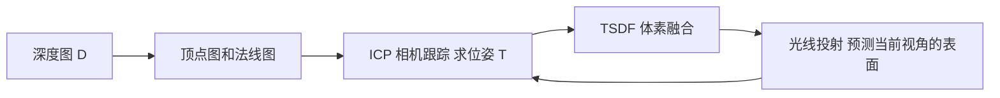

---
Title | 3D Algos Reconstruction KinectFusion
-- | --
Created @ | `2022-04-05T03:11:35Z`
Updated @| `2026-11-26T09:16:36Z`
Labels | ``
Edit @| [here](https://github.com/junxnone/aiwiki/issues/306)

---
# KinectFusion 

- 通过低成本深度摄像机获取的深度图进行三维重建
- 实时：每帧把深度图融合进一个全局的体素模型，同时估计相机位姿

## Pipeline

Pipeline | Description
-- | --
Depth Map Conversion (**Measurement**) | 深度图转点云
Camera Tracking (**Pose Estimation**) | ICP 配准求相对位姿
Volumetric Integration (**Update Reconstruction**) | 重建物体表面
Raycasting (**Surface Prediction**) | 渲染

图中：

- 每帧深度图先转成顶点图和法线图，再与上一帧由模型预测出的表面做 ICP，得到当前相机位姿
- 用位姿把当前帧融合进体素模型（TSDF）
- 光线投射从模型中渲染出当前视角的表面，作为下一帧跟踪的参考
- 关键结论：跟踪是「帧对模型」而不是「帧对帧」，所以误差累积小

x | 两篇 paper 中的 pipeline
-- | --
1 | 
2 | 

表中：两个图分别为两篇 paper 里的 pipeline 示意图，与上面的四个步骤对应。

## 深度图转点云

$$
V(u,v)=D(u,v)\,K^{-1}\begin{bmatrix}u\v\1\end{bmatrix},\qquad
N(u,v)=\frac{\big(V(u{+}1,v)-V(u,v)\big)\times\big(V(u,v{+}1)-V(u,v)\big)}{\left\lVert\cdots\right\rVert}
$$

其中：

- $(u,v)$：像素坐标；$D(u,v)$：该像素的深度；$K$：相机内参矩阵，$K^{-1}$ 把像素反投影到相机坐标系
- $V(u,v)$：顶点图，对应的 3D 点；$N(u,v)$：法线，由相邻顶点的差向量叉乘并归一化得到

## ICP 相机跟踪

$$
\hat{T}=\arg\min_{T}\sum_{i}\Big(\big(T\,p_i-q_i\big)\cdot n_i\Big)^{2}
$$

其中：

- $T$：要估计的当前帧到模型的刚体变换（位姿）；$p_i$：当前帧的点
- $q_i$、$n_i$：模型预测表面上对应点及其法线
- 括号内为点到平面的距离（沿法线方向的偏差），使位姿让当前点贴合模型表面

## 体素融合（TSDF）

$$
F_k=\frac{W_{k-1}F_{k-1}+w_kF_k^{new}}{W_{k-1}+w_k},\qquad W_k=\min\big(W_{k-1}+w_k,\ W_{max}\big)
$$

其中：

- $F$：TSDF，每个体素存「到最近表面的带符号截断距离」；$F_{k-1}$：已有值，$F_k^{new}$：当前帧测得的值
- $W$：体素的累计权重，$w_k$：当前观测的权重（常取 1）；$W_{max}$：权重上限，使模型能适应变化
- 即对每个体素做加权平均，噪声随帧数增加被抑制

## 局限

- 体素体积固定，难以覆盖大场景（后续如 Kintinuous 等扩展，见 [3D 重建](https://github.com/junxnone/aiwiki/issues/305)）
- 依赖 GPU 实时运行；对几何特征少的场景（平坦墙面）跟踪容易漂移

## Reference
- 2011 **KinectFusion** KinectFusion: Real-time 3D Reconstruction and Interaction Using a Moving Depth Camera [[paper](http://citeseerx.ist.psu.edu/viewdoc/summary?doi=10.1.1.229.2346)] [[code](https://github.com/Nerei/kinfu_remake)]
- 2011 [KinectFusion: Real-Time Dense Surface Mapping and Tracking](https://www.microsoft.com/en-us/research/wp-content/uploads/2016/02/ismar2011.pdf)
- [啥是KinectFusion](https://zhuanlan.zhihu.com/p/39021659)

