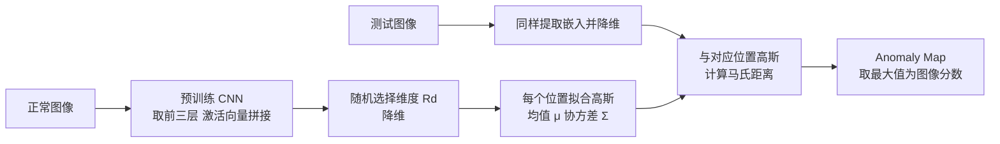

---
Title | paper PaDiM
-- | --
Created @ | `2022-12-05T01:58:43Z`
Updated @| `2026-11-24T09:20:41Z`
Labels | ``
Edit @| [here](https://github.com/junxnone/aiwiki/issues/322)

---
# PaDiM 补丁分布建模
- PaDiM - `Patch Distribution Modeling`
- 核心流程围绕 “特征提取 - 分布建模 - 异常评分” 展开，结合预训练 CNN 与概率统计方法实现异常检测与定位。
- 使用预训练的 CNN 网络提取中间层feature 组成嵌入向量
- 使用随机选择来降低维数，去除冗余信息
- **仅正常类的学习** => `构建正常类特征`
- 对训练集中正常图片相应的 `patch` 建模高斯分布, 作为正常特征
- 计算 `Anomaly Map` - 待测试图片与正常类特征计算相似度
  - 对待测试图片计算特征向量，根据 `Mahalanobis Distance` 马氏距离计算`相应patch`的异常分数


## Arch


```
训练阶段：
正常图像 → 分块 → 预训练CNN提取多層特征 → 拼接特征 → 随机降维（可选）→ 计算各位置高斯分布参数(μ, Σ)

测试阶段：
测试图像 → 分块 → 提取特征并降维 → 对每个补丁计算马氏距离 → 生成异常热图 → 全局异常评分
```

### 训练阶段：构建正常模式的概率模型
#### 1. 图像分块与特征提取
- **输入**：仅使用正常类图像（单类学习设定）。
- **分块**：将图像划分为多个重叠或非重叠的补丁（patch），每个补丁对应原始图像的局部区域。
- **特征提取**：通过预训练CNN（如ResNet、EfficientNet）提取不同层的激活值，例如：
  - 对ResNet18，提取前3层（Layer1-Layer3）的特征，融合低层级（边缘、纹理）和高层级（语义结构）信息。
  - 对EfficientNet-B5，提取第7、20、26层的特征，平衡分辨率与语义信息。
- **特征融合**：将不同层的特征拼接，形成每个补丁的高维嵌入向量（如ResNet18拼接后为448维）。

#### 2. 降维优化（可选）
- **问题**：高维特征可能包含冗余信息，增加计算复杂度。
- **方法**：采用**随机特征选择（Rd）** 而非PCA，随机选取部分维度（如100维），实验证明此方法更高效且性能损失极小。

#### 3. 高斯分布建模
- 对每个补丁位置  $(i,j)$ （对应CNN特征图的空间坐标），收集所有训练图像中该位置的嵌入向量集合  $X_{ij}$ 。
- 假设  $X_{ij}$  服从多元高斯分布  $\mathcal{N}(\mu_{ij}, \Sigma_{ij})$ ，计算：
  - 均值  $\mu_{ij}$ ：该位置所有训练特征的平均值。
  - 协方差矩阵  $\Sigma_{ij}$ ：考虑特征间的相关性，并添加正则项  $\epsilon I$  保证矩阵可逆。
- **输出**：每个位置的高斯分布参数  $(\mu_{ij}, \Sigma_{ij})$ ，构成“正常模式”的概率模型。

### 测试阶段：生成异常热图与评分
#### 1. 测试图像特征提取
- 对测试图像同样分块，通过相同预训练CNN提取特征，拼接后得到各补丁的嵌入向量  $x_{ij}$ 。
- 若训练阶段使用降维，测试时对特征进行相同的随机维度选择。

#### 2. 马氏距离计算异常分数
- 对每个补丁  $x_{ij}$ ，计算其与对应高斯分布的**马氏距离**：  
  
  $$M(x_{ij}) = \sqrt{(x_{ij} - \mu_{ij})^T \Sigma_{ij}^{-1} (x_{ij} - \mu_{ij})}$$
  
  - 距离越大，说明该补丁偏离正常模式的程度越高，异常可能性越大。

#### 3. 生成异常热图与全局评分
- **异常热图**：将所有补丁的马氏距离映射为图像像素的颜色值（如黄色表示高分异常，蓝色表示正常），直观显示异常位置。
- **图像级异常分数**：取热图中的最大值作为整幅图像的异常分数，用于判断图像是否存在异常。


## 动机

- 论文：[PaDiM: a Patch Distribution Modeling Framework for Anomaly Detection and Localization](https://arxiv.org/abs/2011.08785)（Defard 等）。异常检测只给图像一个异常分数；**异常定位**更难，给每个像素或每个像素块一个异常分数，输出异常图，结果更精确、更可解释
- 同期结合检测与定位的单类方法有两个问题：要么需要**训练深度网络**（麻烦），要么在测试时对**整个训练集做 K-NN**（如 SPADE 等），K-NN 的线性复杂度使时间和空间复杂度随训练集增大而增长，这两个可扩展性问题阻碍了工业部署
- PaDiM 的两个性质：①用预训练 CNN 做嵌入提取，**不需要训练深度网络**；②对每个 Patch 位置用**多元高斯分布**建模，并利用 CNN **不同语义层级之间的相关性**；测试时**没有 K-NN 的可扩展性问题**，复杂度低，空间复杂度与训练集大小无关，只取决于图像分辨率

## 流程图

下图概括了 PaDiM 训练与测试的两条流水线：



图中：

- 上半部分是训练阶段：只用正常图像，提取多层特征并降维后，对每个空间位置分别拟合一个高斯分布
- 下半部分是测试阶段：测试图像经过同样的特征提取，与对应位置的高斯分布比较，得到每个位置的异常分数，组成 Anomaly Map；图像级分数是 Anomaly Map 的最大值
- 两条流水线共用同一个特征提取器，且 CNN 全程不训练，所以训练过程只是统计均值和协方差，不需要反向传播

## 公式

嵌入提取（论文 III-A）：训练时，正常图像的每个 Patch 与预训练 CNN 激活图中**空间上对应**的激活向量关联；把不同层的激活向量**拼接**起来，得到携带不同语义层级和分辨率信息的嵌入向量，从而编码细粒度和全局上下文。由于激活图分辨率低于输入图像，许多像素有相同的嵌入，在原图上形成不重叠的像素块，所以输入图像可以划分成一个 $(i, j) \in [1, W] \times [1, H]$ 的网格，$W \times H$ 是所用最大激活图的分辨率。

$$
\Sigma_{ij} = \frac{1}{N-1}\sum_{k=1}^{N}\big(x_{ij}^{k} - \mu_{ij}\big)\big(x_{ij}^{k} - \mu_{ij}\big)^\top + \varepsilon I, \qquad \mu_{ij} = \frac{1}{N}\sum_{k=1}^{N}x_{ij}^{k}
$$

$$
M(x_{ij}) = \sqrt{(x_{ij} - \mu_{ij})^\top \Sigma_{ij}^{-1} (x_{ij} - \mu_{ij})}
$$

其中：

- $(i, j)$：特征图上的空间位置；$k$：训练图像编号，$N$：训练图像总数；$x_{ij}^{k} \in \mathbb{R}^{d}$：第 $k$ 张图在位置 $(i,j)$ 的嵌入向量（多层特征拼接并降维后，$d$ 为维度）；$X_{ij} = \{x_{ij}^k\}$ 是该位置所有训练嵌入的集合，假设它由多元高斯分布 $\mathcal{N}(\mu_{ij}, \Sigma_{ij})$ 生成
- $\mu_{ij}$：位置 $(i,j)$ 的样本均值向量；$\Sigma_{ij}$：协方差矩阵，描述特征各维之间的相关性，**包含不同语义层级之间的相关性**
- $\varepsilon I$：加在对角线上的正则项（论文默认 $\varepsilon = 0.01$，$I$ 为单位矩阵），保证 $\Sigma_{ij}$ **满秩可逆**
- $x_{ij}$：测试图像在位置 $(i,j)$ 的嵌入；$M(x_{ij})$：马氏距离，考虑了特征的方差和相关性，比欧氏距离更适合描述「偏离正常分布多远」；全部位置的马氏距离组成的矩阵 $M = (M(x_{ij}))$ 就是 Anomaly Map，高分区域为异常
- 图像级分数为 $\max_{ij} M(x_{ij})$，即 Anomaly Map 的最大值

## 论文方法细节与结果

**实验设置**（IV）：用三种骨干（都在 ImageNet 预训练）：ResNet18 (R18)、Wide ResNet-50-2 (WR50)、EfficientNet-B5。与 SPADE 一样，ResNet 骨干取**前三层**的 Patch 嵌入向量（结合不同语义层级，同时保持足够的分辨率用于定位）；EfficientNet-B5 取第 7（level 2）、20（level 4）、26（level 5）层。模型名称表示骨干与降维方式，如 **PaDiM-R18-Rd100** 表示 ResNet18 骨干，**随机选取 100 个维度**。图像缩放到 256×256 后中心裁剪 224×224，异常图用 $\sigma = 4$ 的高斯滤波。

**评估指标**：定位使用两个与阈值无关的指标：**AUROC**（像素级）和 **PRO 分数**。AUROC 偏向大面积异常，PRO 对每个连通区域同等对待，PRO 高说明大小异常都被很好地定位（见 [Anomaly Detection Metrics](/0711_ML_Metrics_Anomaly)）。

**消融**（V-A）：

Name | 结论
-- | --
层间相关性 | 论文在 MVTec AD 上用 ResNet18 比较「只用单层（Layer 1/2/3）」「三个单层模型分数相加（Layers 1+2+3，**不**考虑层间相关）」和「PaDiM-R18（一个位置一个高斯，**建模**前三层的层间相关）」：Layer 3 的 AUROC 最好（语义层级高，更好刻画正常性），但 PRO 略低于 Layer 2（分辨率更低影响定位精度）；聚合多层缓解了「高语义」与「高分辨率」的权衡；PaDiM-R18 比 Layers 1+2+3 在 AUROC 上高 **1.1 个百分点**、PRO 高 **1.8 个百分点**，证明**建模语义层级之间的相关性有用**
降维 | 论文发现**随机选择少数维度**比经典的 PCA 更有效；这种简单的随机降维显著降低训练和测试复杂度，同时保持 SOTA 性能

表中是论文的两个主要消融结论：层间相关性带来精度提升，随机降维带来效率提升而几乎不损精度。

**与 SOTA 的比较**（V-B）：

- **MVTec AD 定位**（AUROC 和 PRO）：论文为公平对比，使用 SPADE 同款的 WR50；同时用更小的 R18。随机把嵌入维度降到 550（WR50）和 100（R18）。**PaDiM-WR50-Rd550 在所有类别的平均 PRO 和 AUROC 上超过所有其他方法**；很轻量的 PaDiM-R18-Rd100 在 MVTec AD 的平均 AUROC 上也至少高出 0.2 个百分点。物体类上差距较小（PaDiM-WR50-Rd550 仅 AUROC 最好 +0.2，PRO 上 SPADE 最好 +1.8），但**纹理类上 PaDiM 特别准确**：PaDiM-WR50-Rd550 比第二名 SPADE 在纹理类的平均 PRO 和 AUROC 上分别高 4.8 和 4.0 个百分点
- **STC（监控）定位 AUROC**：最好结果来自最简单的 PaDiM-R18-Rd100，为 **91.2**，高于 SPADE 的 89.9 和 CAVGA-RU 的 85（高 2.1 个百分点）；STC 里行人位置变化大，也说明 PaDiM 在不对齐数据上表现好
- **MVTec AD 图像级检测**（AUROC，论文 Table V，所有类别平均）：GANomaly 76.2，PaDiM-WR50-Rd550 为 **95.3**，PaDiM-EfficientNet-B5 为 **97.9**；论文指出只有 MahalanobisAD（用其最好的骨干 EfficientNet-B4）可以超过 PaDiM-WR50-Rd550，而 PaDiM-EfficientNet-B5 优于它

**对未对齐数据的鲁棒性**（V-C）：论文构造了 **Rd-MVTec AD**（对训练集和测试集都做 $(-10°, +10°)$ 随机旋转和从 256×256 到 224×224 的随机裁剪），模拟物体不总是居中和对齐的真实场景。结果（AUROC%, PRO%）：

Model | 全部纹理类 | 全部物体类 | 全部类别
-- | -- | -- | --
VAE (R18) | (54.7, 23.1) | (65.8, 30.2) | (62.1, 27.8)
SPADE (WR50) | (84.6, 75.6) | (88.2, 65.8) | (87.2, 69.0)
**PaDiM-WR50-Rd550** | **(92.4, 77.9)** | **(92.1, 70.8)** | **(92.2, 73.1)**

表中 PaDiM-WR50-Rd550 在纹理类和物体类上都优于对手。相比原始 MVTec AD，AUROC 下降幅度：PaDiM-WR50-Rd550 只降 **5.3** 个百分点，而 VAE 降 12.2、SPADE 降 8.8，说明 PaDiM 对不对齐图像更鲁棒。

**可扩展性**（V-D）：在 MVTec AD 上用 CPU（Intel i7-4710HQ）的平均推理时间（秒，串行实现）：

Model | SPADE (WR50) | VAE (R18) | PaDiM-R18-Rd100 | PaDiM-WR50-Rd550
-- | -- | -- | -- | --
推理时间 (s) | 7.10 | 0.21 | 0.23 | 0.95

表中 SPADE 因为昂贵的最近邻搜索，比等价骨干的 PaDiM **慢约 7 倍**；PaDiM-R18-Rd100 与重构类方法 VAE 在同一量级，但精度远高于 VAE。训练方面：PaDiM 训练时间复杂度随数据集大小线性增长（高斯参数用整个训练集估计），但不需要训练深度网络，在 MVTec AD 这样的小数据集上很快（最复杂的 PaDiM-WR50-Rd550 在 CPU 上串行实现平均约 150 秒）。内存方面：与 SPADE、Patch SVDD 不同，PaDiM 的**空间复杂度与训练集大小无关**，只依赖图像分辨率，因为只需要保存预训练 CNN 和每个 Patch 位置的高斯参数。

## 特点

Name | 说明
-- | --
为什么用马氏距离 | 正常特征的各维方差和相关性不同，马氏距离会把方差大的维度权重降低，更准确
为什么随机选维度 | 论文发现随机选择维度与 PCA 相比更高效，且性能损失极小，也不改变原始特征的空间对应
位置相关 | 每个位置有自己的高斯分布，所以要求训练和测试图像对齐良好；但论文的 Rd-MVTec AD 实验表明在一定程度的不对齐下仍然稳健
存储代价 | 每个位置要存 $\mu$（$d$ 维）和 $\Sigma$（$d \times d$），位置数多、维度高时占内存，模型大小与训练图像数无关
推理速度 | 无需迭代和近邻搜索，推理时只需特征提取和马氏距离计算

表中是 PaDiM 的设计取舍：它把「全部正常图像」压缩成每个位置的一个高斯分布，所以推理快、模型大小固定；代价是对物体位置变化较敏感，且假设每个位置的正常特征服从单一高斯。

## 优缺点

- **优点**
  - 训练无需反向传播，只做统计，训练快
  - 同时输出图像级分数和像素级异常图，纹理类上尤其准
  - 推理比 K-NN 类方法（如 SPADE）快得多；空间复杂度与训练集大小无关
- **缺点**
  - 对对齐敏感，物体位置、姿态变化大时效果下降（Rd-MVTec AD 的结果说明这种下降比对手小，但仍存在）
  - 需要存储每个位置的协方差矩阵，高分辨率或高维时占用大
  - 假设每个位置的正常特征服从单一高斯，对多模态的正常情况建模不足

## anomalib 评估结果

以下结果来自 anomalib README（MVTec AD 全部 15 类平均，seed 42）：

Backbone | Image AUROC | Pixel AUROC | Image F1
-- | -- | -- | --
ResNet-18 | 0.891 | 0.968 | 0.916
Wide ResNet-50 | 0.950 | 0.979 | 0.951

表中分别是图像级 AUROC、像素级 AUROC 和图像级 F1，骨干更强（Wide ResNet-50）时三项都更好；anomalib 的 Wide ResNet-50 图像级 AUROC（0.950）与论文中 PaDiM-WR50-Rd550 的 95.3% 接近。PaDiM 的像素级 AUROC 很高，但 Pixel AUROC 受背景像素主导，不能单独说明定位的好坏。


## Reference

- [PaDiM: a Patch Distribution Modeling Framework for Anomaly Detection and Localization](https://arxiv.org/pdf/2011.08785.pdf) 


