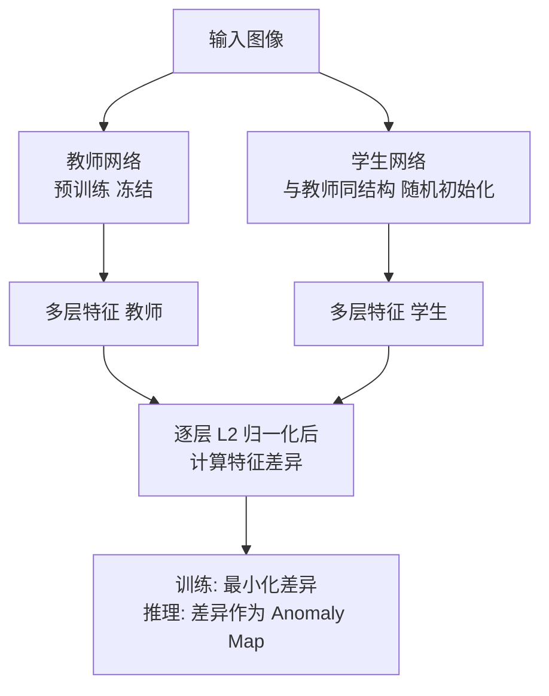

---
Title | paper STFPM
-- | --
Created @ | `2022-12-09T03:33:27Z`
Updated @| `2026-11-24T08:15:28Z`
Labels | ``
Edit @| [here](https://github.com/junxnone/aiwiki/issues/324)

---
# STFPM 师生特征金字塔匹配


- 通过比较教师网络和学生网络的特征金字塔。差异越大，异常发生的概率越高
- **师生网络架构**：用一个在图像分类任务上预训练好的强大模型（教师网络，如 ResNet-18），去指导一个结构相同的学生网络学习正常图像的特征分布。学生网络通过匹配教师网络的特征来学习 “正常” 的模式，两者特征差异越大，越可能是异常。
- **多尺度特征匹配**：教师和学生网络都会提取不同层级的特征（形成特征金字塔），底层特征关注纹理、边缘等细节，高层特征关注整体结构。通过对比这些多尺度特征的差异，能检测出不同大小的异常区域。
具体方法


## Arch


- **训练过程**：仅用正常图像训练学生网络，让它尽可能模仿教师网络的特征输出。通过计算两者特征向量的距离（L2 距离）作为损失函数，优化学生网络的参数。
- **测试过程**：对于测试图像，分别通过师生网络得到特征金字塔，计算各层特征差异并生成异常分数图，再将多尺度的分数图融合，最终得到每个像素的异常概率。

## 流程图

下图是 STFPM 的训练与推理过程：



图中：

- 教师网络是预训练且参数冻结的分类网络，学生网络结构相同但随机初始化，只有学生网络被训练
- 两个网络在若干个层（特征金字塔）上输出特征图，逐层计算两者的差异
- 训练时只用正常图像，最小化差异，使学生学会「在正常图像上模仿教师」；推理时，对异常图像学生模仿不好，差异大的位置就是异常

## 公式

$$
\mathcal{L}_{l}(I) = \frac{1}{2\,h_l w_l}\sum_{i=1}^{h_l}\sum_{j=1}^{w_l}\Big\lVert \hat{F}_{T}^{l}(i,j) - \hat{F}_{S}^{l}(i,j) \Big\rVert_2^2, \qquad \mathcal{L}(I) = \sum_{l}\mathcal{L}_{l}(I)
$$

$$
A^{l}(i,j) = \frac{1}{2}\Big\lVert \hat{F}_{T}^{l}(i,j) - \hat{F}_{S}^{l}(i,j) \Big\rVert_2^2, \qquad A = \prod_{l}\text{Upsample}\big(A^{l}\big) \ \text{或}\ \sum_{l}\text{Upsample}\big(A^{l}\big)
$$

其中：

- $l$：特征金字塔的第 $l$ 层（不同层对应不同的感受野和语义层级）；$h_l, w_l$：该层特征图的高和宽；$(i, j)$：空间位置
- $\hat{F}_{T}^{l}(i,j)$、$\hat{F}_{S}^{l}(i,j)$：教师、学生网络在第 $l$ 层位置 $(i,j)$ 的特征向量，经**沿通道维 L2 归一化**后的结果，使距离只与方向有关，不受特征幅值影响
- $\mathcal{L}_l$：第 $l$ 层的特征匹配损失，$\mathcal{L}$：所有层的损失之和（训练目标）
- $A^{l}(i,j)$：第 $l$ 层在位置 $(i,j)$ 的异常分数；$\text{Upsample}$：把各层的异常图上采样到输入图像大小，再相乘或相加得到最终的 Anomaly Map $A$（anomalib 实现中是上采样后融合）

## 特点

Name | 说明
-- | --
多尺度匹配 | 浅层关注纹理等小缺陷，深层关注结构等大缺陷，金字塔让不同大小的异常都能检出
训练速度 | 只训练学生网络，不需要记忆库，推理也只需前向两次，速度快
推理无 kNN | 区别于 [PatchCore](/0535_paper_PatchCore)，不需要保存和搜索大量特征
依赖教师质量 | 教师在 ImageNet 上预训练，特征的通用性决定了匹配的效果
学生泛化风险 | 如果学生网络过强，会在异常图像上也模仿得很好，导致异常漏检，这是后续 [Reverse Distillation](/0749_paper_ReverseDistillation) 和 [EfficientAD](/0748_paper_EfficientAD) 重点改进的问题

表中是 STFPM 的主要特点：它把「异常检测」转化为「学生能否模仿教师」，计算简单。表格最后一行说明了它的本质局限：模仿能力的泛化是不可控的，后续师生类方法的改进都围绕这一点。

## 优缺点

- **优点**
  - 结构简单、训练和推理速度快、无需记忆库
  - 多尺度特征匹配，能检测不同大小的缺陷
  - 同时输出图像级分数和像素级异常图
- **缺点**
  - 学生网络可能在异常区域也能很好模仿教师，造成漏检
  - 对教师网络的特征质量依赖较大；骨干换为更大的网络不一定更好（见下表 Wide ResNet-50 反而不如 ResNet-18）
  - 不同类别的结果波动较大，如某些类别（如 Toothbrush）在 Wide ResNet-50 上不稳定

## 使用与评估

```bash
anomalib train --model Stfpm --data MVTecAD --data.category <category>
```

以下结果来自 anomalib README（MVTec AD 15 类平均，seed 42）：

Backbone | Image AUROC | Pixel AUROC | Image F1
-- | -- | -- | --
ResNet-18 | 0.893 | 0.951 | 0.932
Wide ResNet-50 | 0.876 | 0.903 | 0.926

表中可以看到 STFPM 在 anomalib 里用 ResNet-18 的效果更好，Wide ResNet-50 反而下降，这与「骨干越大越好」的直觉不同；Wide ResNet-50 的 Pixel AUROC 平均值偏低，主要受个别类别拖累，README 中该设置下 Toothbrush 类像素级 AUROC 只有 0.178。

## Reference

- [2021.3 **STFPM** Student-Teacher Feature Pyramid Matching for Anomaly Detection](https://arxiv.org/pdf/2103.04257.pdf) 
- [code](https://github.com/gdwang08/STFPM)


