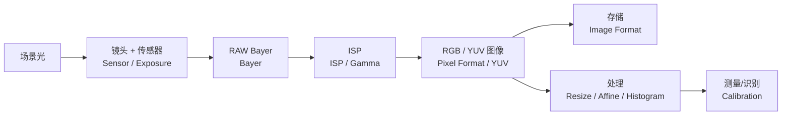

---
Title | Media Image
-- | --
Created @ | `2022-12-12T03:17:29Z`
Updated @| `2026-11-25T16:30:52Z`
Labels | ``
Edit @| [here](https://github.com/junxnone/aiwiki/issues/325)

---
# Image 图像

- 生物界的视觉系统发展有的倾向于更广的视野，有的倾向于双目立体
- 相较于人类的视觉系统而言,目前基于二维图像的AI更像是受限于硬件设备的基础研究
- 就发展瓶颈上来说, 感觉成像设备的发展更有利于图像AI的发展
- 在二维图像上添加深度信息，可以极快的提升 AI 对物体边界，物体整体的判断

## 从成像到处理

下图展示一幅数字图像从光到可处理数据所经过的环节，及对应的文章：

图中：

- 左半部分是成像侧：光经过镜头和传感器变成 RAW 数据，再经 ISP 变成人能看的图像；曝光参数决定亮度和模糊
- 右半部分是使用侧：图像可以保存为文件，也可以做几何变换、直方图等处理，最后用于测量或识别；标定把像素和真实尺寸联系起来
- 框内文字是对应的文章名，下表给出链接

## 文章导航

主题 | 文章
-- | --
成像 | [Sensor](/0788_Media_Image_Camera_Sensor)、[Exposure](/0789_Media_Image_Camera_Exposure)、[Camera](/0107_Media_Image_Camera)
数据格式 | [2D 图像](/0035_Media_Image_2DImage)、[像素格式](/0119_Media_Image_Camera_PixelFormat)、[Image Format](/0782_Media_Image_Format)、[Bayer](/0784_Media_Image_Bayer)
色彩 | [Color](/0126_Media_Image_Color)、[YUV](/0121_Media_Image_Color_Model_YUV)、[Gamma](/0783_Media_Image_Color_Gamma)
相机处理 | [ISP](/0785_Media_Image_ISP)
几何 | [Resize](/0347_Media_Image_Resize)、[Affine](/0786_Media_Image_Affine)、[透视变换](/0345_Media_Image_PT)、[Calibration](/0787_Media_Image_Camera_Calibration)
统计 | [Histogram](/0342_Media_Image_Histogram)
3D | [3D 图像](/0039_Media_Image_3DImage)

表中：左列是主题分类，右列是对应的文章；整个多媒体系列的入口见 [Media](/0417_Media)。

