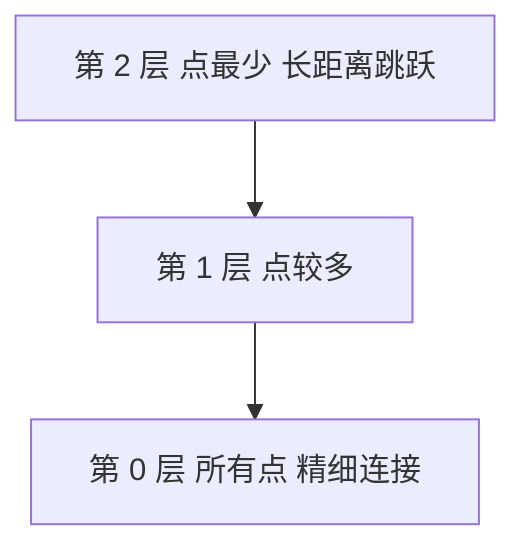

---
Title | ML NNS ANN HNSW
-- | --
Created @ | `2021-08-18T03:22:52Z`
Updated @| `2026-11-26T09:28:15Z`
Labels | ``
Edit @| [here](https://github.com/junxnone/aiwiki/issues/334)

---
# Hierarchical Navigable Small World

HNSW 是基于**图**的近似最近邻搜索算法：把向量建成一个分层的「近邻图」，查询时从顶层粗搜、逐层下降精搜，在高维、大规模数据上有很高的召回率和查询速度。

- 基于图存储
- Delaunay graph
- 粗/细 搜索

## Pipeline
- D-dim Vector 构建图
- 基于图搜索 K 近邻


图中：该图为原文档附带的 HNSW 分层图示意图，对应下面的「分层 + 贪心搜索」。

## 结构：分层的小世界图



图中：

- 越高的层点越少、边越「长」，用于快速跨越大范围，类似跳表（skip list）里的高层索引
- 第 0 层包含所有点，边连接近邻，用于精细搜索
- 搜索从最高层入口开始，每层贪心地向查询点靠近，到下一层后以上一层的结果为起点继续

## 构建

新点插入时随机决定它出现的最高层：

$$
l=\left\lfloor -\ln(u)\cdot m_L\right\rfloor,\qquad u\sim U(0,1),\qquad m_L=\frac{1}{\ln M}
$$

其中：

- $l$：该点的最高层编号；$u$：$(0,1)$ 上的均匀随机数
- $M$：每个点在非 0 层连接的最大邻居数（第 0 层通常为 $2M$）
- $m_L$：层数的归一化因子，使高层点的数量按指数递减，约每升一层点数减少为 $1/M$

## 搜索

1. 从最高层的入口点出发，在该层贪心地移动到距离查询点更近的邻居，直到无法更近
2. 下降一层，以当前点为起点重复
3. 到第 0 层时，用大小为 $ef$ 的候选队列做更宽的搜索，返回最近的 $K$ 个

复杂度大约为 $O(\log N)$，其中 $N$ 为数据点数。

## 关键参数

| 参数 | 作用 | 取值影响 |
| --- | --- | --- |
| `M` | 每个点的最大连接数 | 越大召回越高，内存越大，构建越慢 |
| `efConstruction` | 构建时的候选队列大小 | 越大图质量越高，构建越慢 |
| `ef`（搜索时） | 搜索时的候选队列大小 | 越大召回越高，查询越慢 |

表中：对比结论：`M` 和 `efConstruction` 决定索引质量与大小，`ef` 在查询时调节精度和速度。

## 使用

```python
import hnswlib, numpy as np

dim, n = 128, 10000
data = np.float32(np.random.random((n, dim)))
index = hnswlib.Index(space='l2', dim=dim)               # 距离：l2 / ip / cosine
index.init_index(max_elements=n, ef_construction=200, M=16)
index.add_items(data, np.arange(n))
index.set_ef(50)                                          # 查询时的 ef
labels, distances = index.knn_query(data[:5], k=3)
```

## 对比

| 方法 | 特点 |
| --- | --- |
| HNSW | 召回高、查询快，内存占用较大，支持增量插入 |
| [Annoy](https://github.com/junxnone/aiwiki/issues/333) | 内存映射，索引只读，轻量 |
| KD 树 | 低维高效，高维下退化，见 [FLANN](https://github.com/junxnone/aiwiki/issues/122) |

## Reference
- 2016.03 **[HNSW]** Efficient and robust approximate nearest neighbor search using Hierarchical Navigable Small World graphs [[Paper](https://arxiv.org/abs/1603.09320)] [[Code](https://github.com/nmslib/hnswlib)]
- [一文看懂HNSW算法理论的来龙去脉](https://blog.csdn.net/u011233351/article/details/85116719)

