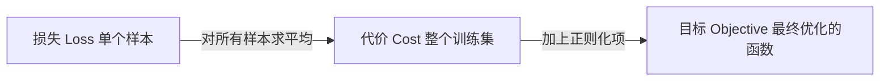

---
Title | ML Arch Func
-- | --
Created @ | `2023-02-06T01:58:21Z`
Updated @| `2026-11-26T08:33:43Z`
Labels | ``
Edit @| [here](https://github.com/junxnone/aiwiki/issues/378)

---
# Loss/Cost/ Object Function - 损失代价目标函数

- 损失函数（Loss Function ）是定义在单个样本上的，算的是一个样本的误差。
- 代价函数（Cost Function ）是定义在整个训练集上的，是所有样本误差的平均，也就是损失函数的平均。
- 目标函数（Object Function）定义为：最终需要优化的函数。等于经验风险+结构风险（也就是代价函数 + 正则化项）。代价函数最小化，降低经验风险，正则化项最小化降低结构风险

## 三者的关系

图中：

- 从左到右是由局部到整体：先在单个样本上算误差，再对训练集平均，最后加上正则化得到真正优化的目标
- 关键结论：训练时实际最小化的是目标函数，而不仅仅是损失

用公式表示：

$$
J(\theta)=\frac{1}{N}\sum_{i=1}^{N}\ell\big(y_i,\ f(x_i;\theta)\big),\qquad
\mathcal{O}(\theta)=J(\theta)+\lambda\,\Omega(\theta)
$$

其中：

- $\ell(y,\hat{y})$：损失函数，度量单个样本的真值 $y$ 与预测 $\hat{y}=f(x;\theta)$ 的差距
- $N$：训练样本数；$J(\theta)$：代价函数，即损失的平均（经验风险）
- $\theta$：模型参数；$f(x;\theta)$：模型的预测
- $\Omega(\theta)$：正则化项（如 $\lVert\theta\rVert_2^2$），对应结构风险，控制模型复杂度
- $\lambda\ge0$：正则化强度；$\mathcal{O}(\theta)$：目标函数

## 常见损失函数

| 任务 | 损失 | 公式（单样本） |
| --- | --- | --- |
| 回归 | 均方误差 MSE | $(y-\hat{y})^2$ |
| 回归 | 平均绝对误差 MAE | $\lvert y-\hat{y}\rvert$ |
| 二分类 | 二元交叉熵 | $-\big[y\log\hat{y}+(1-y)\log(1-\hat{y})\big]$ |
| 多分类 | 交叉熵 | $-\sum_{c}y_c\log\hat{y}_c$ |
| 难样本 / 类别不平衡 | Focal Loss（见 [FocalLoss](https://github.com/junxnone/aiwiki/issues/284)） | 在交叉熵上乘调制因子 |
| 分割 | Dice Loss（见 [DiceLoss](https://github.com/junxnone/aiwiki/issues/283)） | 基于预测与真值的重叠度 |

表中：

- $y$：真值；$\hat{y}$：模型预测值或概率；$y_c$、$\hat{y}_c$：类别 $c$ 的真值（one-hot）与预测概率
- 对比结论：回归常用 MSE / MAE，分类常用交叉熵，样本不平衡或分割任务用专用损失

更多见 [Cost Function 代价函数](https://github.com/junxnone/aiwiki/issues/282)。

