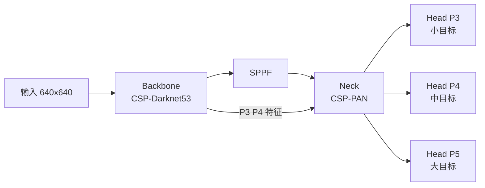

---
Title | ML Tasks Image Detection YOLO V5
-- | --
Created @ | `2023-02-14T13:27:32Z`
Updated @| `2026-11-25T16:51:39Z`
Labels | ``
Edit @| [here](https://github.com/junxnone/aiwiki/issues/379)

---
# YOLO V5

## Arch

- **Backbone**: New CSP-Darknet53
- **Neck**: SPPF, New CSP-PAN
- **Head**: YOLOv3 Head

## Preprocess

### Augmentation

- Mosaic
- Copy-Paste
- Mixup
- Random horizontal flip
- ...

## Training

- Multi-scale training(0.5~1.5x)
- AutoAnchor(For training custom data)
- Warmup and Cosine LR scheduler
- EMA(Exponential Moving Average)
- Mixed precision
- Evolve hyper-parameters

## Reference

- [YOLOv5 (6.0/6.1) brief summary](https://github.com/ultralytics/yolov5/issues/6998)
- [Github Code](https://github.com/ultralytics/yolov5)
- [Docs Wiki](https://github.com/ultralytics/yolov5/wiki)
- **Ultralytics 提供了个 [ 数据集管理模型管理的工具 - hub](https://hub.ultralytics.com/)**  [[Trained Model Preview](https://hub.ultralytics.com/models/7lyorIyBxUuJ6xjOSSlt)]

## 结构细节

下图是 YOLOv5 的整体结构：

图中：

- Backbone 用 CSP (Cross Stage Partial) 结构提取特征，把通道分成两部分，一部分直接传递、一部分经过残差块，再拼接，减少重复梯度、降低计算量
- SPPF 在最深特征上做串联的 $5\times5$ 最大池化并把原始特征与三次池化的结果拼接，等价于 SPP 的 $5/9/13$ 池化核，但速度更快
- Neck 用 PAN (自顶向下融合语义，再自底向上融合定位细节)，把 P3、P4、P5 三个尺度的特征充分融合
- Head 沿用 [YOLOv3](/0056_ML_Tasks_Image_Detection_YOLO_V3) 的 anchor-based 检测头，$3$ 个尺度各 $3$ 个 anchor

## 预测框解码

$$
b_{xy}=2\sigma(t_{xy})-0.5+c_{xy},\qquad
b_{wh}=p_{wh}\,\bigl(2\sigma(t_{wh})\bigr)^2
$$

其中：

- $t_{xy},t_{wh}$：网络对中心偏移和宽高的输出；$c_{xy}$：格子左上角坐标；$p_{wh}$：anchor 的宽高；$\sigma$：sigmoid
- 中心偏移范围扩大到 $(-0.5,1.5)$，使中心靠近格子边界的物体也能被相邻格子预测，提高正样本数量
- 宽高缩放系数范围限制在 $(0,4)$ 倍，比 [YOLOv2](/0055_ML_Tasks_Image_Detection_YOLO_V2) 的指数形式 $e^{t_{wh}}$ 更稳定，不会出现过大的值使训练发散

## 损失函数

$$
L=\lambda_{box}L_{CIoU}+\lambda_{obj}L_{obj}+\lambda_{cls}L_{cls}
$$

$$
L_{CIoU}=1-\mathrm{IoU}+\frac{\rho^2(b,b^{gt})}{c^2}+\alpha v,\qquad
v=\frac4{\pi^2}\left(\arctan\frac{w^{gt}}{h^{gt}}-\arctan\frac wh\right)^2,\qquad
\alpha=\frac{v}{(1-\mathrm{IoU})+v}
$$

其中：

- $L_{obj},L_{cls}$：objectness 和类别的二元交叉熵；$\lambda_{box},\lambda_{obj},\lambda_{cls}$：三项权重 (默认约 $0.05,\ 1.0,\ 0.5$ `[待核实]`)
- $\rho(b,b^{gt})$：预测框与真实框中心点的欧氏距离；$c$：同时包含两框的最小外接矩形的对角线长度，该项使中心靠近
- $v$：宽高比一致性的度量 ($w,h$ 为预测框宽高，$w^{gt},h^{gt}$ 为真实框)；$\alpha$：权重，IoU 越大 (框已较重合) 越重视宽高比
- 相比普通 IoU 损失，CIoU 在两框不相交时仍有梯度，并同时考虑重叠面积、中心距离和宽高比

## 规格

模型 | depth multiple | width multiple | 参数量 | 特点
-- | -- | -- | -- | --
YOLOv5n | 0.33 | 0.25 | 约 1.9 M | 最小，移动/嵌入式
YOLOv5s | 0.33 | 0.50 | 约 7.2 M | 小，常用
YOLOv5m | 0.67 | 0.75 | 约 21.2 M | 中
YOLOv5l | 1.00 | 1.00 | 约 46.5 M | 大
YOLOv5x | 1.33 | 1.25 | 约 86.7 M | 最大

表中：`depth multiple` 缩放每个 CSP 模块里的重复次数，`width multiple` 缩放各层通道数；同一份网络定义通过这两个系数得到不同规格，类似 [MobileNet](/0042_ML_Tasks_Image_Classification_MobileNet_V1) 的宽度乘数。参数量来自官方说明 `[待核实]`。

## 训练技巧说明

- Mosaic：把 $4$ 张图拼成一张作为训练样本，一次看到更多物体和上下文，对小目标尤其有效
- Copy-Paste/Mixup：把物体复制粘贴到别的图上、或把两张图加权混合，提升泛化
- AutoAnchor：训练前根据自己数据集的框尺寸，用 k-means + 遗传算法重新计算 anchor，见 [YOLOv2](/0055_ML_Tasks_Image_Detection_YOLO_V2) 的聚类思路
- EMA：对权重做滑动平均，$\theta_{ema}\leftarrow\beta\theta_{ema}+(1-\beta)\theta$，评估时用平均后的权重，更稳定
- Warmup + 余弦学习率：训练初期线性升高学习率避免发散，之后按余弦曲线衰减

总览见 [YOLO 系列](/0053_ML_Tasks_Image_Detection_YOLO)。

