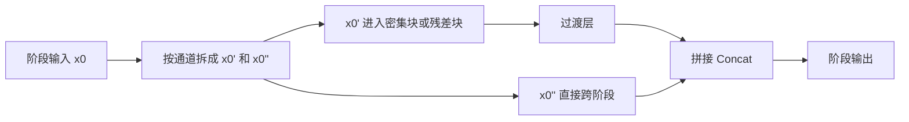

---
Title | paper CSPNet
-- | --
Created @ | `2023-02-21T23:02:39Z`
Updated @| `2026-11-26T08:44:03Z`
Labels | ``
Edit @| [here](https://github.com/junxnone/aiwiki/issues/385)

---
# CSPNet

CSPNet（Cross Stage Partial Network，跨阶段局部网络）把每个阶段的特征图分成两部分：一部分走原来的密集计算块，另一部分直接跨过计算块，最后在阶段末拼接。

- 增加了 CNN 学习能力
- 消除了部分计算瓶颈
- 减少了内存消耗

## Cross Stage Partial Network

### 核心思路

图中：

- 输入特征按通道拆成两份：$x_0'$ 进入原来的计算块，$x_0''$ 直接连到阶段末尾
- 两路在阶段末拼接，再经过过渡层输出
- 关键结论：梯度流被分成两条不同的路径，避免重复的梯度信息；计算只在一半通道上做，减少计算量

以 DenseNet 为例，原始密集块与 CSP 版本的关系：

$$
\begin{aligned}
&\text{DenseNet:}\quad x_k=w_k*[x_0,x_1,\dots,x_{k-1}]\
&\text{CSPDenseNet:}\quad x_k=w_k*[x_0'',x_1,\dots,x_{k-1}],\quad x_T=w_T*[x_0'',x_k],\quad x_U=w_U*[x_0',x_T]
\end{aligned}
$$

其中：

- $x_k$：第 $k$ 层输出；$w_k$：第 $k$ 层的卷积权重；$*$：卷积；$[\cdot,\cdot]$：通道拼接
- $x_0',x_0''$：阶段输入 $x_0$ 按通道拆成的两部分
- $x_T$：过渡层（transition）输出，$w_T$ 为其权重；$x_U$：阶段最终输出，$w_U$ 为最后一个过渡层权重
- 含义：密集块里只有 $x_0''$ 参与，$x_0'$ 绕过密集块，在最后才与过渡后的特征拼接

### DenseNet vs CSPDenseNet

图中：以上两图为原文档附带的 DenseNet 与 CSPDenseNet 结构对比图。

### ResNet vs CSPResNet

图中：该图为原文档附带的 ResNet 与 CSPResNet 结构对比图。

### 对比设计

图中：该图为原文档附带的不同设计方案对比图（如不同的拼接与过渡层位置）。

#### 对比结果

图中：该图为原文档附带的对比设计的实验结果。

## 优点

| 优点 | 原因 |
| --- | --- |
| 增强学习能力 | 梯度流被截断为两条路径，减少重复的梯度信息 |
| 降低计算瓶颈 | 只有一半通道进入计算块，计算更均衡 |
| 降低内存消耗 | 减少特征图通道和跨层拼接的数据量 |

表中：对比结论：CSP 是通用结构，可用于 ResNet、DenseNet、ResNeXt 等，后来被 YOLOv4、YOLOv5 等检测器广泛采用。

## Reference

- 2019 **CSPNet**   CSPNet: A New Backbone that can Enhance Learning Capability of CNN [[paper](https://arxiv.org/pdf/1911.11929.pdf)]

