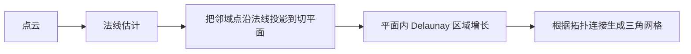

---
Title | 3D Algos triangulation
-- | --
Created @ | `2023-03-28T13:19:47Z`
Updated @| `2026-11-26T09:16:40Z`
Labels | ``
Edit @| [here](https://github.com/junxnone/aiwiki/issues/399)

---
# GreedyProjectionTriangulation

- 对原始点云进行快速三角化的算法
- 选取一个样本三角片作为初始曲面，不断扩张曲面边界，最后形成一张完整的三角网格曲面
  - 将三维点通过法线投影到某一平面
  - 对投影得到的点云作平面内的三角化(基于Delaunay法则的空间区域增长算法)
  - 根据平面内三位点的拓扑连接关系获得一个三角网格曲面模型
- 需要表面光滑且密度变化均匀(滤波/平滑处理)

## 流程



图中：

- 先估计每个点的法线，这是算法的必要输入
- 对每个点，把它的邻域点投影到法线定义的切平面，在二维里做三角化
- 把二维连接关系映射回三维点，得到三角网格
- 关键结论：局部三角化加区域增长，速度快，适合大规模、有噪声的点云

## 基于Delaunay法则的空间区域增长算法
- 选取一个初始三角面片，不断的向外扩张最后形成一个完整的三角网格曲面
- **Delaunay 三角剖分**: 所有三角形的外接圆均满足空圆性质的三角剖分
  - 最大化最小角
  - 唯一性（任意四点不能共圆）
- **空圆性质(特性)**: 即一个三角形（或边）的外接圆范围内（边界除外），不包含点集P中的任何顶点
- **Delaunay边**: 满足空圆特性的边
- Lawson算法
- Bowyer-Watson算法

空圆性质可以写成：对三角形 $T_{ijk}$ 的外接圆 $C(T_{ijk})$，

$$
\forall\, p_m\in P\setminus\{p_i,p_j,p_k\}:\quad p_m\notin \mathrm{int}\,C(T_{ijk})
$$

其中：$P$ 为点集；$p_i,p_j,p_k$ 为三角形的三个顶点；$p_m$ 为其他任意点；$\mathrm{int}\,C$ 表示外接圆的内部。即外接圆内不含其他任何点。

## 主要参数（PCL）

| 参数 | 函数 | 含义 |
| --- | --- | --- |
| 搜索半径 | `setSearchRadius` | 每个点可连接的最大边长，即三角形的最大边长 |
| 近邻倍数 | `setMu` | 搜索半径相对最近邻距离的倍数，$r=\mu\,d_{nn}$，适应密度变化 |
| 最大近邻数 | `setMaximumNearestNeighbors` | 每个点最多考虑的邻居数 |
| 最大表面角 | `setMaximumSurfaceAngle` | 法线夹角超过该值的点不连接，用于保留尖锐边缘 |
| 最小 / 最大角 | `setMinimumAngle` / `setMaximumAngle` | 限制三角形内角范围，避免过于狭长 |
| 法线一致性 | `setNormalConsistency` | 法线朝向是否一致 |

表中：

- $d_{nn}$：到最近邻点的距离
- 对比结论：半径过小会产生孔洞，过大会把不相邻的表面连在一起

```cpp
#include <pcl/surface/gp3.h>

pcl::GreedyProjectionTriangulation<pcl::PointNormal> gp3;
pcl::PolygonMesh triangles;
gp3.setSearchRadius(0.025);
gp3.setMu(2.5);
gp3.setMaximumNearestNeighbors(100);
gp3.setMaximumSurfaceAngle(M_PI / 4);   // 45 度
gp3.setMinimumAngle(M_PI / 18);         // 10 度
gp3.setMaximumAngle(2 * M_PI / 3);      // 120 度
gp3.setNormalConsistency(false);
gp3.setInputCloud(cloud_with_normals);  // 需要带法线的点云
gp3.reconstruct(triangles);
```

## Reference

- [Fast triangulation of unordered point clouds](https://pcl.readthedocs.io/projects/tutorials/en/latest/greedy_projection.html)
- [On fast surface reconstruction methods for large and noisy point clouds](https://github.com/junxnone/aiwiki/files/11089792/marton09icra.pdf)

