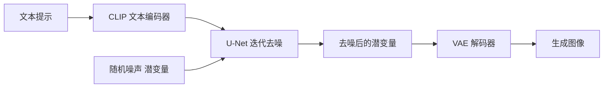

---
Title | LM VLM StableDiffusion
-- | --
Created @ | `2023-05-16T13:25:14Z`
Updated @| `2026-11-26T10:21:09Z`
Labels | ``
Edit @| [here](https://github.com/junxnone/aiwiki/issues/402)

---
# Stable Diffusion
- Text2Image
- Image2Image
- Depth2Image

Stable Diffusion 是一个**潜空间扩散模型**（Latent Diffusion Model）：不是在像素上做扩散，而是在由自编码器压缩后的低维潜空间里扩散，因此显存和计算量大幅降低，可以在消费级显卡上运行。

## 结构

图中：

- **文本编码器**（CLIP）把提示词变成向量，通过交叉注意力注入 U-Net，控制生成内容
- **U-Net** 在潜空间里从随机噪声开始，迭代地预测并去除噪声
- **VAE 解码器**把最终的潜变量还原成图像
- 关键结论：「在小的潜空间里去噪、最后解码」是 Stable Diffusion 高效的原因

## 训练目标与加噪

前向过程逐步给潜变量 $z_0$ 加噪，网络学习预测所加的噪声：

$$
z_t=\sqrt{\bar{\alpha}_t}\,z_0+\sqrt{1-\bar{\alpha}_t}\,\epsilon,\qquad
\mathcal{L}=\mathbb{E}_{z,c,\epsilon,t}\Big[\big\lVert\epsilon-\epsilon_\theta(z_t,t,c)\big\rVert_2^2\Big]
$$

其中：

- $z_0$：图像经 VAE 编码得到的潜变量；$z_t$：加噪到第 $t$ 步的潜变量；$\epsilon\sim\mathcal{N}(0,I)$：所加的高斯噪声
- $\bar{\alpha}_t$：噪声调度系数，$t$ 越大越接近 0，$z_t$ 越接近纯噪声
- $c$：条件（文本嵌入）；$\epsilon_\theta$：U-Net 预测的噪声
- $\mathcal{L}$：预测噪声与真实噪声的均方误差

采样时使用无分类器引导（CFG）：

$$
\tilde{\epsilon}=\epsilon_\theta(z_t,\varnothing)+s\big(\epsilon_\theta(z_t,c)-\epsilon_\theta(z_t,\varnothing)\big)
$$

其中：$\varnothing$ 为空提示；$s$ 为引导系数（webui 中的 CFG Scale），越大越贴合提示词，但多样性下降。参数的使用见 [SD 应用 webui](https://github.com/junxnone/aiwiki/issues/440)。

## Text2Image

图中：该图为原文档附带的 Text2Image 流程示意图，对应上面的「文本 → 潜空间去噪 → 解码」。

## Depth2Image

图中：该图为原文档附带的 Depth2Image 示意图：除文本外，再用深度图作条件，生成与原图结构一致的新图。

## Inference

图中：该图为原文档附带的推理流程示意图。

## 三种任务对比

| 任务 | 输入 | 做法 |
| --- | --- | --- |
| Text2Image | 文本 | 从纯噪声开始去噪 |
| Image2Image | 图像 + 文本 | 给输入图加一部分噪声，再去噪，强度决定与原图的相似度 |
| Depth2Image | 图像 + 深度 + 文本 | 用深度图约束结构，只改变风格和内容 |

表中：对比结论：三种任务共用同一个模型，区别只在起点（噪声或加噪的图）和额外条件。相关微调见 [DreamBooth](https://github.com/junxnone/aiwiki/issues/405)、[LoRA](https://github.com/junxnone/aiwiki/issues/406)，对比模型见 [Imagen](https://github.com/junxnone/aiwiki/issues/413)。

## Reference
- 2021.12 [High-Resolution Image Synthesis with Latent Diffusion Models](https://arxiv.org/abs/2112.10752)
- [awesome-stable-diffusion](https://github.com/awesome-stable-diffusion/awesome-stable-diffusion)
- [Stable Diffusion reimagine](https://clipdrop.co/stable-diffusion-reimagine)
- [Stable diffusion - Hugging Face](https://huggingface.co/docs/diffusers/v0.16.0/en/api/pipelines/stable_diffusion/overview)
- [Stable Diffusion Colab Inference](https://colab.research.google.com/github/huggingface/notebooks/blob/main/diffusers/stable_diffusion.ipynb)

