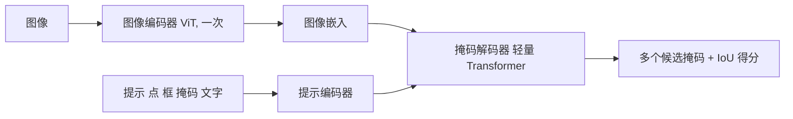

---
Title | LM VLM SAM
-- | --
Created @ | `2023-06-07T02:11:14Z`
Updated @| `2026-11-26T08:28:47Z`
Labels | ``
Edit @| [here](https://github.com/junxnone/aiwiki/issues/414)

---
# SAM 
- SAM - `Segment Anything Model`
- a promptable segmentation task
- a segmentation model (SAM) that powers data annotation and enables zero-shot transfer to a range
- of tasks via prompt engineering
- a data engine for collecting SA-1B, our dataset of over 1 billion masks.

## 三个核心组成

| 组成 | 内容 |
| --- | --- |
| Task | 可提示分割（promptable segmentation）：给任意提示（点、框、掩码、文字），输出有效的分割掩码 |
| Model | SAM：图像编码器 + 提示编码器 + 掩码解码器 |
| Data | 数据引擎：模型辅助标注，构建 SA-1B（约 1100 万张图像、超过 10 亿个掩码） |

表中：

- **可提示**：像大语言模型靠 prompt 适应不同任务，分割模型靠点、框等提示适应不同需求
- 对比结论：任务、模型、数据三者相互促进，使模型零样本泛化到新数据和新任务

## Arch

图中：

- **图像编码器**：基于 MAE 预训练的 ViT，对每张图只运行一次，生成图像嵌入（计算量大）
- **提示编码器**：点和框用位置编码加可学习类型嵌入；掩码用卷积；文字用 CLIP 文本编码器
- **掩码解码器**：轻量的 Transformer，结合图像嵌入和提示嵌入，输出掩码，单次约几十毫秒，可在浏览器里交互
- 关键结论：重的图像编码只算一次，每次换提示只需轻量解码，因此能实时交互

## 歧义与损失

单个点提示可能对应多个合理目标（如点在衬衫上：衬衫、人整体）。SAM 一次输出多个候选掩码（默认 3 个）及各自的 IoU 预测得分，训练时只对损失最小的那个反传。训练损失为 Focal Loss 与 Dice Loss 的加权和：

$$
\mathcal{L}_{mask} = 20\,\mathcal{L}_{focal} + \mathcal{L}_{dice}
$$

其中：

- $\mathcal{L}_{focal}$：Focal Loss，缓解前景背景像素不平衡，见 [Focal Loss](https://github.com/junxnone/aiwiki/issues/284)
- $\mathcal{L}_{dice}$：Dice Loss，衡量预测与真值的重叠程度，见 [Dice Loss](https://github.com/junxnone/aiwiki/issues/283)
- 系数 20：Focal Loss 的权重相对较大（论文设定的 20:1 比例）
- 另外还有对 IoU 预测的均方误差损失，使模型学会评估自己掩码的质量

## 数据引擎

| 阶段 | 做法 |
| --- | --- |
| 手动辅助 | 标注员用 SAM 点选，模型辅助生成掩码 |
| 半自动 | 模型先自动标出一部分物体，标注员补标其余 |
| 全自动 | 用规则点网格提示模型，自动生成掩码，得到绝大部分 SA-1B |

表中：

- 三个阶段逐步减少人工参与，模型随着数据增多而变强，再反过来加速标注
- 对比结论：数据规模靠模型自己「滚雪球」得到

## 应用

- 与 LaMa（见 [LaMa](https://github.com/junxnone/aiwiki/issues/404)）组合：圈选后擦除并修复
- 与 GLIP / Grounding DINO（见 [GLIP](https://github.com/junxnone/aiwiki/issues/463)）组合：用文字检测出框，再用 SAM 得到精细掩码

## Reference

- paper 2023 [Segment Anything](https://arxiv.org/abs/2304.02643) [[code](https://github.com/facebookresearch/segment-anything)] [[demo](https://segment-anything.com/demo)]

