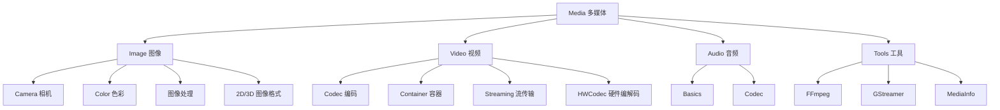

---
Title | Media
-- | --
Created @ | `2023-06-16T00:18:47Z`
Updated @| `2026-11-25T16:30:54Z`
Labels | ``
Edit @| [here](https://github.com/junxnone/aiwiki/issues/417)

---
# Media

多媒体：音频 (Audio)、图像 (Image)、视频 (Video) 的基础知识、格式、采集设备和处理工具。本文是整个系列的入口。

## 系列结构

下图按「数据类型 → 采集 → 编码 → 传输 → 工具」展示本系列的文章分布：

图中：

- 第一层是四个入口：Image、Video、Audio 是三类数据，Tools 是处理它们的工具
- Image 下分相机、色彩、图像处理和 2D/3D 格式；Video 下按「编码 → 容器 → 流传输 → 硬件编解码」的顺序展开；Audio 下是基础和编码
- 三类数据最终都由工具处理：FFmpeg 偏离线批处理，GStreamer 偏实时 pipeline，MediaInfo 用于查看信息

## 文章导航

### Image 图像

文章 | 内容
-- | --
[图像](/0325_Media_Image) | 图像与视觉系统概述
[2D 图像](/0035_Media_Image_2DImage) | 像素格式、图像文件格式
[3D 图像](/0039_Media_Image_3DImage) | 深度图、体素、点云、网格及文件格式
[Camera](/0107_Media_Image_Camera) | 相机分类、标准与厂商
[Sensor](/0788_Media_Image_Camera_Sensor) | CCD/CMOS、快门、视场、面阵线阵
[Exposure](/0789_Media_Image_Camera_Exposure) | 曝光时间、增益、自动曝光、白平衡
[Calibration](/0787_Media_Image_Camera_Calibration) | 张正友标定、重投影误差
[GenICam](/0106_Media_Image_Camera_GenICam) | 工业相机通用接口标准
[像素格式](/0119_Media_Image_Camera_PixelFormat) | Packed/Planar、Mono/Bayer/RGB/YUV
[Image Format](/0782_Media_Image_Format) | JPEG/PNG/BMP/TIFF/RAW
[Bayer](/0784_Media_Image_Bayer) | CFA 排列与去马赛克
[ISP](/0785_Media_Image_ISP) | RAW 到图像的处理流水线
[相机内参](/0547_Media_Image_Camera_相机内参) | 内参矩阵 K、畸变、标定
[相机坐标系](/0548_Media_Image_Camera_相机坐标系) | 世界/相机/像素坐标系转换
[低延迟](/0037_Media_Image_Camera_LowLatency) | 采集到显示的延迟构成
[Color](/0126_Media_Image_Color) | 色彩模型、色彩空间、色域
[YUV](/0121_Media_Image_Color_Model_YUV) | 亮度色度、采样格式、与 RGB 转换
[Gamma](/0783_Media_Image_Color_Gamma) | 非线性编码与 sRGB
[Histogram](/0342_Media_Image_Histogram) | 直方图与均衡
[Resize](/0347_Media_Image_Resize) | 插值方法
[透视变换](/0345_Media_Image_PT) | 单应矩阵、透视与仿射
[Affine](/0786_Media_Image_Affine) | 平移旋转缩放的矩阵表示

### Video 视频

文章 | 内容
-- | --
[Video](/0036_Media_Video) | 原始数据、编码、容器三层概念
[Video Codec](/0770_Media_Video_Codec) | 压缩原理与常见编码
[Video Container](/0776_Media_Video_Container) | mp4/mkv/ts 结构
[Video Streaming](/0771_Media_Video_Streaming) | RTSP/HLS/WebRTC
[Video HWCodec](/0772_Media_Video_HWCodec) | 硬件编解码

### Audio 音频

文章 | 内容
-- | --
[Audio](/0767_Media_Audio) | 音频入口
[Audio Basics](/0775_Media_Audio_Basics) | 采样、量化、PCM
[Audio Codec](/0769_Media_Audio_Codec) | WAV/FLAC/MP3/AAC/Opus

### Tools 工具

文章 | 内容
-- | --
[多媒体处理工具](/0421_Media_Tools) | 工具选择
[FFmpeg](/0774_Media_Tools_FFmpeg) | 转码、截取、取流
[GStreamer](/0109_Media_Tools_GStreamer) | pipeline 框架
[MediaInfo](/0773_Media_Tools_MediaInfo) | 查看媒体信息

表中：每个小节是一类主题，左列为文章，右列概括内容；点击标题进入对应文章。

## 相关系列

- [OpenCV](/0105_OpenCV) - 图像处理库，包含滤波、形态学、特征、视频读写等
- 机器视觉应用：[定拍 vs 飞拍](/0038_Media_Image_Camera_定拍飞拍)

## 阅读路径

- 做图像算法：[2D 图像](/0035_Media_Image_2DImage) → [像素格式](/0119_Media_Image_Camera_PixelFormat) → [Bayer](/0784_Media_Image_Bayer) → [ISP](/0785_Media_Image_ISP) → [Color](/0126_Media_Image_Color) → [Resize](/0347_Media_Image_Resize)
- 做视频应用：[Video](/0036_Media_Video) → [Video Codec](/0770_Media_Video_Codec) → [Video Container](/0776_Media_Video_Container) → [Video Streaming](/0771_Media_Video_Streaming) → [FFmpeg](/0774_Media_Tools_FFmpeg)
- 做音频应用：[Audio Basics](/0775_Media_Audio_Basics) → [Audio Codec](/0769_Media_Audio_Codec) → [FFmpeg](/0774_Media_Tools_FFmpeg)
- 接工业相机：[Camera](/0107_Media_Image_Camera) → [GenICam](/0106_Media_Image_Camera_GenICam) → [Sensor](/0788_Media_Image_Camera_Sensor) → [Exposure](/0789_Media_Image_Camera_Exposure) → [Calibration](/0787_Media_Image_Camera_Calibration)

