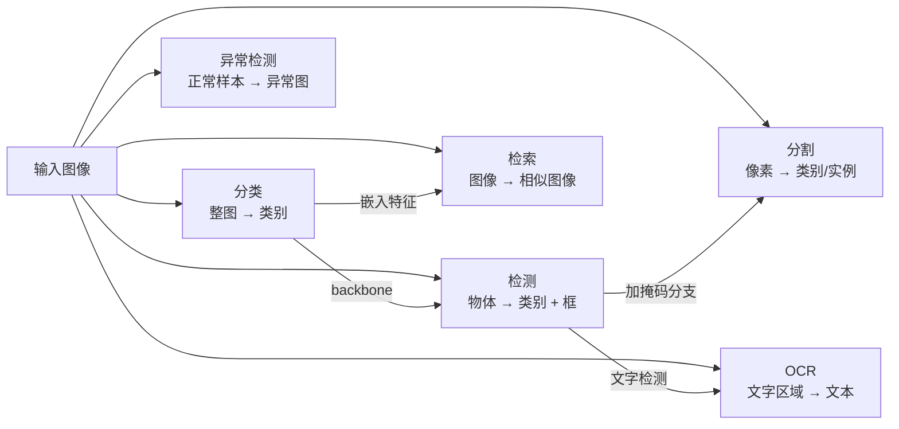

---
Title | ML Tasks Image
-- | --
Created @ | `2023-06-17T11:31:29Z`
Updated @| `2026-11-26T01:30:46Z`
Labels | ``
Edit @| [here](https://github.com/junxnone/aiwiki/issues/420)

---
# Image 相关 Tasks

图像相关的机器学习任务：分类、检测、分割、检索、OCR、异常检测等。本文是这个系列的入口，说明各任务的区别、演进脉络，并列出已有文章和建议新增的文章。

- 分类
- 检测
- 分割
- Retrieval
- OCR
- ...

## 任务总览

下图按「输出是什么」把图像任务分成几类，说明它们之间的递进关系：

图中：

- 第一列是各任务的输入输出；箭头 `backbone`、`加掩码分支` 等表示技术上的承接：分类网络是检测、分割的骨干，检测加上掩码分支变成实例分割，分类网络的嵌入特征可用于检索，OCR 先做文字检测再识别
- 任务越靠下输出越精细：分类给整图一个标签，检测给每个物体框，分割给每个像素标签
- 异常检测的特点是训练时只有正常样本，不属于传统的有监督任务

任务 | 输入 → 输出 | 典型指标 | 本系列文章
-- | -- | -- | --
分类 | 图像 → 类别 | Top-1/Top-5 准确率 | [Classification](/0061_ML_Tasks_Image_Classification)
检测 | 图像 → 框 + 类别 | mAP | [Detection](/0152_ML_Tasks_Image_Detection)
分割 | 图像 → 像素类别/实例掩码 | mIoU、掩码 AP | [Segmentation](/0159_ML_Tasks_Image_Segmentation)
检索 | 图像 → 相似图像列表 | Recall@K、mAP | [Retrieval](/0278_ML_Tasks_Image_Retrieval)
OCR | 图像 → 文本 | 字符准确率、编辑距离 | [OCR](/0200_ML_Tasks_Image_OCR)
异常检测 | 图像 → 异常分数/异常图 | AUROC、PRO | [Anomaly](/0277_ML_Tasks_Image_Anomaly)
高光去除 | 图像 → 去高光图像 | PSNR、SSIM | [SHR](/0540_ML_Tasks_Image_SHR)

表中：`典型指标` 是该任务最常用的评价指标，其公式在各文章中说明；不同任务不能直接比较数值。

## 分类

文章 | 要点
-- | --
[Classification](/0061_ML_Tasks_Image_Classification) | 任务类型与损失函数、指标、演进图
[History](/0166_ML_Tasks_Image_Classification_History) | 经典网络时间线
[LeNet](/0024_ML_Tasks_Image_Classification_LeNet) | 卷积网络起点，逐层参数量核对
[AlexNet](/0027_ML_Tasks_Image_Classification_AlexNet) | ReLU、Dropout、LRN
[VGGNet](/0146_ML_Tasks_Image_Classification_VGGNet) | 小卷积堆叠，参数分布
[Inception](/0049_ML_Tasks_Image_Classification_Inception) | 总览；[V1](/0048_ML_Tasks_Image_Classification_Inception_V1)、[V2/V3](/0046_ML_Tasks_Image_Classification_Inception_V2V3)、[V4](/0047_ML_Tasks_Image_Classification_Inception_V4)
[Xception](/0050_ML_Tasks_Image_Classification_Xception) | 深度可分离卷积
[ResNet](/0051_ML_Tasks_Image_Classification_ResNet) | 残差学习，各深度对比
[MobileNet](/0045_ML_Tasks_Image_Classification_MobileNet) | 总览；[V1](/0042_ML_Tasks_Image_Classification_MobileNet_V1)、[V2](/0043_ML_Tasks_Image_Classification_MobileNet_V2)、[V3](/0044_ML_Tasks_Image_Classification_MobileNet_V3)
[DenseNet](/0799_ML_Tasks_Image_Classification_DenseNet)、[SENet](/0800_ML_Tasks_Image_Classification_SENet)、[EfficientNet](/0801_ML_Tasks_Image_Classification_EfficientNet) | 稠密连接、通道注意力、复合缩放

表中：左列是文章，右列是该文章的重点内容；建议先读 Classification 和 History 建立脉络，再按需读各网络。

## 检测

文章 | 要点
-- | --
[Detection](/0152_ML_Tasks_Image_Detection) | IoU、NMS、mAP、框回归、Focal Loss
[RCNNs](/0060_ML_Tasks_Image_Detection_RCNNs) | R-CNN 三代对比；[R-CNN](/0057_ML_Tasks_Image_Detection_RCNN)、[Fast](/0058_ML_Tasks_Image_Detection_FastRCNN)、[Faster](/0059_ML_Tasks_Image_Detection_FasterRCNN)
[YOLO](/0053_ML_Tasks_Image_Detection_YOLO) | 系列总览；[V1](/0054_ML_Tasks_Image_Detection_YOLO_V1)、[V2](/0055_ML_Tasks_Image_Detection_YOLO_V2)、[V3](/0056_ML_Tasks_Image_Detection_YOLO_V3)、[tiny](/0052_ML_Tasks_Image_Detection_YOLO_tiny)、[V5](/0379_ML_Tasks_Image_Detection_YOLO_V5)
[SSD](/0802_ML_Tasks_Image_Detection_SSD)、[FPN](/0803_ML_Tasks_Image_Detection_FPN)、[RetinaNet](/0804_ML_Tasks_Image_Detection_RetinaNet)、[Loss](/0805_ML_Tasks_Image_Detection_Loss) | 多尺度检测、Focal Loss、IoU 系列损失

## 分割

文章 | 要点
-- | --
[Segmentation](/0159_ML_Tasks_Image_Segmentation) | 三类任务、mIoU/Dice、损失、演进
[FCN](/0160_ML_Tasks_Image_Segmentation_FCN) | 全卷积、跳连融合
[UNet](/0161_ML_Tasks_Image_Segmentation_UNet) | 编码器-解码器、加权损失
[Deeplab](/0162_ML_Tasks_Image_Segmentation_Deeplab) | 空洞卷积、ASPP、CRF
[Instance](/0167_ML_Tasks_Image_Segmentation_Instance) | 实例分割的三类方法
[MaskRCNN](/0163_ML_Tasks_Image_Segmentation_MaskRCNN)、[MSRCNN](/0164_ML_Tasks_Image_Segmentation_MSRCNN) | 掩码分支与掩码质量
[PSPNet](/0806_ML_Tasks_Image_Segmentation_PSPNet) | 金字塔池化

## 检索

文章 | 要点
-- | --
[Retrieval](/0278_ML_Tasks_Image_Retrieval) | 检索流程、度量学习、指标、近似搜索
[CBIR](/0155_ML_Tasks_Image_Retrieval_CBIR) | 基于内容的检索
[VLAD](/0154_ML_Tasks_Image_Retrieval_CBIR_VLAD) | BoW、VLAD、NetVLAD、Fisher Vector
[Siamese](/0153_ML_Tasks_Image_Retrieval_CBIR_SiameseNetwork)、[Triplet](/0156_ML_Tasks_Image_Retrieval_CBIR_TripletNetwork) | 对比损失、三元组损失
[ArcFace](/0807_ML_Tasks_Image_Retrieval_ArcFace) | 角度间隔损失

## OCR

文章 | 要点
-- | --
[OCR](/0200_ML_Tasks_Image_OCR) | OCR 总览
[CTC](/0189_ML_Tasks_Image_OCR_CTC)、[Metrics](/0190_ML_Tasks_Image_OCR_Metrics) | 序列对齐、评价指标
检测：[EAST](/0193_ML_Tasks_Image_OCR_EAST)、[CTPN](/0197_ML_Tasks_Image_OCR_CTPN)、[TextField](/0194_ML_Tasks_Image_OCR_TextField)、[DBNet](/0778_ML_Tasks_Image_OCR_DBNet)、[FOTS](/0195_ML_Tasks_Image_OCR_FOTS) | 文字区域检测
识别：[CRNN](/0196_ML_Tasks_Image_OCR_CRNN)、[SW-CNN-CTC](/0188_ML_Tasks_Image_OCR_SW)、[CA-FCN](/0186_ML_Tasks_Image_OCR_CAFCN)、[TextScanner](/0192_ML_Tasks_Image_OCR_TextScanner)、[SCAN](/0191_ML_Tasks_Image_OCR_SCAN)、[SVTR](/0779_ML_Tasks_Image_OCR_SVTR)、[TrOCR](/0780_ML_Tasks_Image_OCR_TrOCR) | 文本识别
端到端/工具：[Donut](/0781_ML_Tasks_Image_OCR_Donut)、[DeepSeekOCR](/0790_ML_Tasks_Image_OCR_DeepSeekOCR)、[PaddleOCR](/0791_ML_Tasks_Image_OCR_PaddleOCR)、[Tesseract](/0792_ML_Tasks_Image_OCR_Tesseract)、[Calamari](/0201_ML_Tasks_Image_OCR_Calamari)、[TRDG](/0187_ML_Tasks_Image_OCR_Tools_TextRecognitionDataGenerator) | 方案与数据合成
其他：[Attention](/0793_ML_Tasks_Image_OCR_Attention)、[Lexicon](/0198_ML_Tasks_Image_OCR_Lexicon)、[Augmentation](/0203_ML_Tasks_Image_OCR_Augmentation)、[Calamari Voting](/0202_ML_Tasks_Image_OCR_Calamari_Voting) | 解码、增强、投票

表中：OCR 子文章较多，按「检测 → 识别 → 端到端」分组，对应常见的两阶段 OCR 流水线。

## 异常检测

文章 | 要点
-- | --
[Anomaly](/0277_ML_Tasks_Image_Anomaly) | 方法分类、异常分数公式、对比与选择
[MVTec](/0323_ML_Tasks_Image_Anomaly_MVTec) | 数据集、AUROC 与 PRO
[Synthesis](/0517_ML_Tasks_Image_Anomaly_Synthesis) | 异常缺陷生成
[Pipeline](/0521_ML_Tasks_Image_Anomaly_Pipeline) | 算法落地实践
论文笔记 | [PaDiM](/0322_paper_PaDiM)、[STFPM](/0324_paper_STFPM)、[PatchCore](/0535_paper_PatchCore)、[CFlow](/0735_paper_CFlow)、[FastFlow](/0736_paper_FastFlow)、[DRAEM](/0744_paper_DRAEM)、[Reverse Distillation](/0749_paper_ReverseDistillation)、[Dinomaly](/0753_paper_Dinomaly)、[WinCLIP](/0468_paper_WinCLIP)、[AnomalyCLIP](/0466_paper_AnomalyCLIP) 等

## 共同的基础概念

概念 | 出现在 | 文章
-- | -- | --
卷积、感受野、参数量计算 | 所有 CNN | [LeNet](/0024_ML_Tasks_Image_Classification_LeNet)
残差连接 | 分类、检测、分割 | [ResNet](/0051_ML_Tasks_Image_Classification_ResNet)
深度可分离卷积 | 轻量化网络 | [Xception](/0050_ML_Tasks_Image_Classification_Xception)、[MobileNet](/0045_ML_Tasks_Image_Classification_MobileNet)
IoU、NMS | 检测、分割评估 | [Detection](/0152_ML_Tasks_Image_Detection)
度量学习 | 检索、识别、异常检测 | [Retrieval](/0278_ML_Tasks_Image_Retrieval)
CTC | OCR | [CTC](/0189_ML_Tasks_Image_OCR_CTC)

表中：这些概念在多个任务里重复出现，学一次可以复用；先理解它们再看具体任务会更快。

## 建议新增的文章

下面是目前缺失、值得补充的方向，按任务分组 (标题沿用现有的命名层级)：

任务 | 建议标题 | 内容要点
-- | -- | --
分类 | [DenseNet](/0799_ML_Tasks_Image_Classification_DenseNet) (已建) | 稠密连接、特征复用
分类 | [SENet](/0800_ML_Tasks_Image_Classification_SENet) (已建) | 通道注意力，Squeeze-and-Excitation
分类 | [EfficientNet](/0801_ML_Tasks_Image_Classification_EfficientNet) (已建) | 复合缩放 (深度/宽度/分辨率)，NAS
分类 | ML Tasks Image Classification ViT | Vision Transformer、patch 嵌入、与 CNN 的对比
分类 | ML Tasks Image Classification ConvNeXt | 用现代训练配方改造纯卷积网络
检测 | [SSD](/0802_ML_Tasks_Image_Detection_SSD) (已建) | 多尺度默认框，对比 YOLO
检测 | [RetinaNet](/0804_ML_Tasks_Image_Detection_RetinaNet) (已建) | Focal Loss、FPN
检测 | [FPN](/0803_ML_Tasks_Image_Detection_FPN) (已建) | 特征金字塔，多尺度融合
检测 | ML Tasks Image Detection YOLO V4V7V8 | 近年的 YOLO 演进、anchor-free
检测 | ML Tasks Image Detection DETR | Transformer 检测，二分图匹配，无需 NMS
检测 | [Loss](/0805_ML_Tasks_Image_Detection_Loss) (已建) | GIoU/DIoU/CIoU 等框回归损失
分割 | [PSPNet](/0806_ML_Tasks_Image_Segmentation_PSPNet) (已建) | 金字塔池化
分割 | ML Tasks Image Segmentation SegFormer | Transformer 分割
分割 | ML Tasks Image Segmentation SAM | 提示式通用分割
分割 | ML Tasks Image Segmentation Panoptic | 全景分割与 PQ
检索 | [ArcFace](/0807_ML_Tasks_Image_Retrieval_ArcFace) (已建) | 角度间隔损失
检索 | ML Tasks Image Retrieval CLIP | 图文对比学习，文本搜图
检索 | ML Tasks Image Retrieval Faiss | 近似最近邻索引 (IVF/PQ/HNSW)
新任务 | ML Tasks Image Keypoint | 人体姿态/关键点检测
新任务 | ML Tasks Image Depth | 单目深度估计，与 [3D 图像](/0039_Media_Image_3DImage) 相关
新任务 | ML Tasks Image SuperResolution | 超分辨率，PSNR/SSIM
新任务 | ML Tasks Image Denoise | 去噪，与 [ISP](/0785_Media_Image_ISP) 相关

表中：`建议标题` 即未来的 issue title，`内容要点` 是该文章要覆盖的重点。优先级建议：DenseNet/SENet/EfficientNet/ViT (补全分类演进)、SSD/RetinaNet/FPN (补全检测里程碑)、SAM (当前最重要的通用分割)、CLIP/Faiss (检索落地)。

## 相关系列

- 图像基础：[Media Image](/0325_Media_Image)、[Media](/0417_Media)
- 模型压缩与部署：[Quantization](/0312_MO_Quantization)、[KD](/0207_MO_KD)
- 时间序列任务见 [ML Tasks TimeSeries](/0603_ML_Tasks_TimeSeries)

