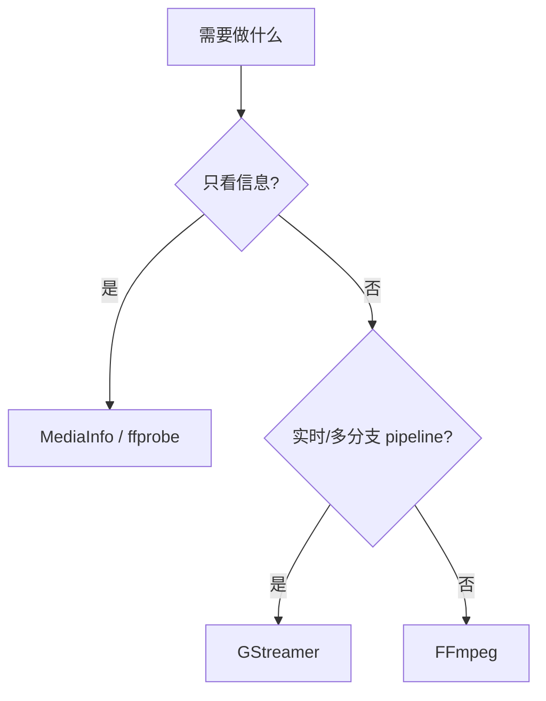

---
Title | Media Tools
-- | --
Created @ | `2023-06-17T15:29:12Z`
Updated @| `2026-11-25T16:21:32Z`
Labels | ``
Edit @| [here](https://github.com/junxnone/aiwiki/issues/421)

---
# 多媒体处理工具

多媒体处理常用的命令行工具和框架，按用途分为处理、探测、实时 pipeline 三类。

## 工具一览

工具 | 类型 | 主要用途 | 文章
-- | -- | -- | --
GStreamer | pipeline 框架 | 实时音视频处理，摄像头取流，插件丰富 | [GStreamer](/0109_Media_Tools_GStreamer)
FFmpeg | 命令行工具 + 库 | 转码、转封装、截取、抽帧、取流 | [FFmpeg](/0774_Media_Tools_FFmpeg)
MediaInfo | 探测工具 | 查看容器、编码、分辨率、帧率等信息 | [MediaInfo](/0773_Media_Tools_MediaInfo)
ffprobe | 探测工具 | 脚本化探测，可按包/帧分析 | [MediaInfo](/0773_Media_Tools_MediaInfo)
gst-discoverer | 探测工具 | 确认 GStreamer 可解析的拓扑 | [gst-discoverer](/0111_Media_Tools_GStreamer_gstdiscoverer)

表中：`类型` 是工具的形态，`文章` 是本站对应的笔记。批处理、离线转码选 FFmpeg；实时视频链路和多分支处理选 GStreamer；只想看信息选 MediaInfo/ffprobe。

## 选择流程

下图帮助根据需求选择工具：

图中：

- 菱形是判断条件，矩形是结论
- 只需要确认文件的编码、分辨率等信息时用探测工具，不需要处理数据
- 需要接摄像头、同时做显示/推流/录制等实时多分支处理时用 GStreamer
- 其他离线处理 (转码、截取、抽帧) 用 FFmpeg 最简单

## Reference
- [FFmpeg](https://ffmpeg.org/)
- [GStreamer](https://gstreamer.freedesktop.org/)
- [MediaInfo](https://mediaarea.net/en/MediaInfo)

