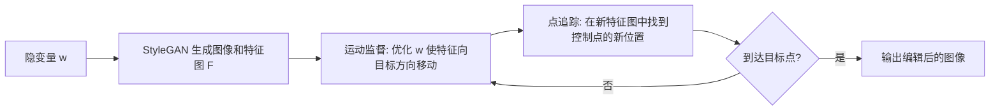

---
Title | LM VLM DragGAN
-- | --
Created @ | `2023-06-29T10:31:41Z`
Updated @| `2026-11-26T08:28:45Z`
Labels | ``
Edit @| [here](https://github.com/junxnone/aiwiki/issues/429)

---
# DragGAN
- 通过拖拽可以自动完善图像中的人/动物姿态，衣服/物体/...形状

## 原理

用户在生成图像上指定若干「控制点」（handle points）和对应的「目标点」（target points），DragGAN 通过优化 GAN 的隐变量，让控制点移动到目标点，同时保持图像真实。核心是反复交替两个步骤：

图中：

- 隐变量 $w$ 经过 StyleGAN 生成器得到图像和中间特征图 $F$
- **运动监督**：沿目标方向把控制点附近的特征「推」一小步，反向传播更新 $w$
- **点追踪**：由于图像变了，控制点的位置也变了，需要在新特征图里重新找到它
- 循环直到所有控制点到达目标点；关键结论：全程只优化隐变量，不需要额外训练网络

## 运动监督

$$
\mathcal{L}=\sum_{i=1}^{n}\ \sum_{q\in\Omega_1(p_i,r_1)}\left\lVert F(q)-\mathrm{sg}\big(F(q+d_i)\big)\right\rVert_1+\lambda\left\lVert (F-F_0)\odot(1-M)\right\rVert_1
$$

其中：

- $p_i$：第 $i$ 个控制点；$n$：控制点个数
- $\Omega_1(p_i,r_1)$：以 $p_i$ 为中心、半径 $r_1$ 的圆形邻域；$q$：邻域内的像素
- $d_i$：从 $p_i$ 指向目标点 $t_i$ 的单位方向向量
- $F(q)$：特征图在位置 $q$ 的特征；$\mathrm{sg}(\cdot)$：stop-gradient，不对目标位置的特征求梯度，使 $F(q)$ 向 $F(q+d_i)$ 靠拢，即内容沿 $d_i$ 移动一小步
- 第二项：约束掩码 $M$ 之外的区域保持不变；$F_0$ 为初始特征图，$\lambda$ 为权重
- $\lVert\cdot\rVert_1$：L1 范数

## 点追踪

$$
p_i \leftarrow \arg\min_{q\in\Omega_2(p_i,r_2)}\left\lVert F'(q)-f_i\right\rVert_1
$$

其中：

- $F'$：更新后的特征图；$f_i=F_0(p_i)$：初始控制点处的特征
- $\Omega_2(p_i,r_2)$：以当前 $p_i$ 为中心、半径 $r_2$ 的搜索邻域
- 含义：在邻域里找与初始特征最相似的位置，作为控制点的新位置，不需要额外的光流或点追踪网络

## 局限

- 只能编辑 GAN 隐空间内的图像，真实图像需要先做 GAN 反演（inversion），保真度会下降
- 训练集中没见过的姿态或极端形变效果差
- 需要对隐变量做多次迭代优化，比一次前向推理慢

## Reference
- 2023.5 [Drag Your GAN: Interactive Point-based Manipulation on the Generative Image Manifold](https://arxiv.org/abs/2305.10973)  [[code](https://github.com/XingangPan/DragGAN)]
- 2023.6 [DragDiffusion: Harnessing Diffusion Models for Interactive Point-based Image Editing](https://arxiv.org/abs/2306.14435)
- [How DragGAN Works: A Technical Deep Dive](https://chenliu-1996.github.io/blogs/ExplainDragGAN/main.pdf)

