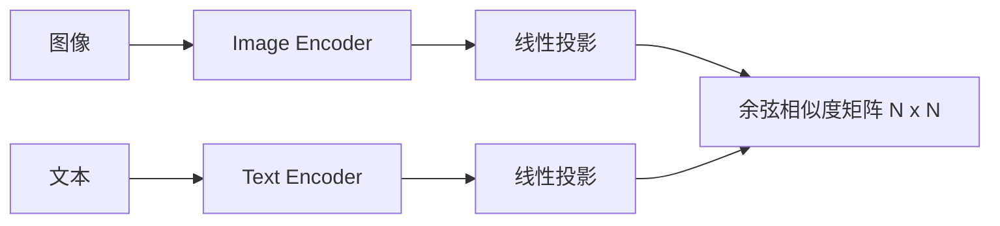

---
Title | paper CLIP
-- | --
Created @ | `2023-10-17T06:40:49Z`
Updated @| `2026-11-26T08:43:47Z`
Labels | ``
Edit @| [here](https://github.com/junxnone/aiwiki/issues/448)

---
# CLIP
- CLIP - `Contrastive Language–Image Pre-training` 对比语言图像预训练
- `Image` - `Text` -> `Image 分类`
- 可以学习到具有通用性的图像特征
- 可以进行零样本迁移学习

## 核心思想

用约 4 亿对网络图文，通过**对比学习**同时训练图像编码器和文本编码器，使配对的图像和文本在同一个嵌入空间里距离近，不配对的距离远。训练后，不用微调就能用「文字描述」做分类等任务。

## Arch
- Text Encoer & Image Encoder
- 使用线性投影将每个编码器的表征映射到多模态的嵌入空间

图中：以上两张图为原文档附带的 CLIP 结构示意图，对应上面的两个编码器和嵌入空间。

图中：

- 一个 batch 有 $N$ 对图文；图像和文本各自编码、投影到同一维度的嵌入空间
- 得到 $N\times N$ 的相似度矩阵：对角线是配对样本（正样本），其余是不配对样本（负样本）
- 关键结论：目标是让对角线相似度最大

## 训练目标

图像到文本方向的对比损失（文本到图像同理，最终取两者平均）：

$$
\mathcal{L}_{i\to t}=-\frac{1}{N}\sum_{i=1}^{N}\log\frac{\exp\big(\mathrm{sim}(v_i,t_i)/\tau\big)}{\sum_{j=1}^{N}\exp\big(\mathrm{sim}(v_i,t_j)/\tau\big)}
$$

其中：

- $N$：batch 内图文对数；$v_i$：第 $i$ 张图像的嵌入；$t_i$：与之配对的文本嵌入
- $\mathrm{sim}(\cdot,\cdot)$：余弦相似度；$\tau$：可学习的温度系数
- 分子只含配对样本，分母含 batch 内全部文本，即把「找到配对文本」视作 $N$ 类分类问题

### Image Encoder
- 作者尝试了 ResNet 和 ViT, ViT 效果更好一点

图中：该图为原文档附带的图像编码器相关示意图。

### Text Encoder
- Transformer

## Zero-shot Prediction
- 将数据集中的类别标签转换为文字描述: `bird` => `a photo of a “bird"`
- 转换向量：经过2个encoder，分别输出image和text的feature embedding
- 计算cosine similarity
- 预测类别：multinomial logistic regression classifier
- [example code](https://github.com/openai/CLIP/blob/main/README.md#zero-shot-prediction)

预测概率：

$$
p(y=c\mid x)=\frac{\exp\big(\mathrm{sim}(f(x),\,w_c)/\tau\big)}{\sum_{k=1}^{K}\exp\big(\mathrm{sim}(f(x),\,w_k)/\tau\big)}
$$

其中：

- $f(x)$：图像 $x$ 的嵌入；$w_c$：类别 $c$ 的文字描述（如 "a photo of a bird"）经文本编码器得到的嵌入
- $K$：类别总数；$\tau$：温度系数
- 相当于用文本嵌入当分类器权重，所以可以不训练就换类别；文字描述（prompt）怎么写会影响效果，进一步优化见 [CLIP Finetune](https://github.com/junxnone/aiwiki/issues/487)

## Reference
- [Code - OpenAI](https://github.com/OpenAI/CLIP)
- 2021.2 **CLIP** [Learning Transferable Visual Models From Natural Language Supervision](https://arxiv.org/abs/2103.00020)
- [【深度学习】详解 CLIP](https://blog.csdn.net/qq_39478403/article/details/127858015)

