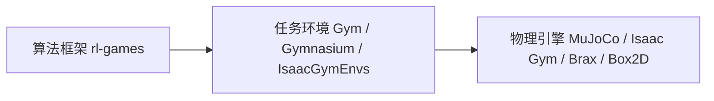

---
Title | RL Tools
-- | --
Created @ | `2023-10-31T09:22:19Z`
Updated @| `2026-11-26T08:07:39Z`
Labels | ``
Edit @| [here](https://github.com/junxnone/aiwiki/issues/454)

---
# RL Tools

强化学习常用的环境接口、算法框架与物理仿真器。所属背景见 [RL Robot](https://github.com/junxnone/aiwiki/issues/458)，仿真原理见 [RL Robot Simulation](https://github.com/junxnone/aiwiki/issues/797)。

## 工具栈总览

图中：

- 三层从左到右依次是：算法框架负责训练策略；任务环境用统一接口（`reset` / `step`）封装任务；物理引擎负责动力学与接触计算
- 关键结论：算法与环境通过接口解耦，更换物理引擎一般不需要改动算法

## Tasks Env / 算法框架

- [bidexhands](https://github.com/PKU-MARL/DexterousHands)：双手灵巧操作任务集，基于 Isaac Gym
- [rl-games](https://github.com/Denys88/rl_games)：高性能 RL 算法库，支持 PPO、A2C 等，与 Isaac Gym 集成
- [Gym](https://github.com/openai/gym) ==> [[Gymnasium](https://github.com/Farama-Foundation/Gymnasium)]
  - `OpenAI` ==> `Farama-Foundation`
  - 详见 [Tools Gym](https://github.com/junxnone/aiwiki/issues/453)

## 物理引擎模拟器

| 引擎 | 开发方 | 特点 |
| --- | --- | --- |
| Box2D | 开源社区 | 2D 物理，轻量，用于游戏与经典控制 |
| Isaac Gym | NVIDIA | GPU 并行，集成 rl-games |
| Brax | Google | 可微分、JAX 加速 |
| MuJoCo | Google DeepMind | 接触精度高、速度快，机器人研究标准 |

表中：

- **特点**：该引擎的核心优势；**可微分**指仿真可对动作求梯度
- 对比结论：2D 小任务用 Box2D，大规模并行用 Isaac Gym / Brax，高精度控制用 MuJoCo

- [Box2D](https://box2d.org/)
  - 用于游戏的 2D 物理引擎
  - >A 2D Physics Engine for Games
- [Isaac Gym](0453_Tools_Gym) ==> [[IsaacGymEnvs](https://github.com/NVIDIA-Omniverse/IsaacGymEnvs)]
  - Nvidia 开发的一款模拟器，用于强化学习
  - 集成了 rl-games
- [Brax](https://github.com/google/brax) 
  - Google 开发的一款开源物理模拟器
  - > Brax is a fast and fully differentiable physics engine used for research and development of robotics, human perception, materials science, reinforcement learning, and other simulation-heavy applications
- [MuJoCo](https://mujoco.org/) ([Github](https://github.com/google-deepmind/mujoco)) ==> [[dm_control](https://github.com/google-deepmind/dm_control)]
  - Google DeepMind 开发的一款开源物理引擎模拟器
  - > MuJoCo is a free and open source physics engine that aims to facilitate research and development in robotics, biomechanics, graphics and animation, and other areas where fast and accurate simulation is needed.

