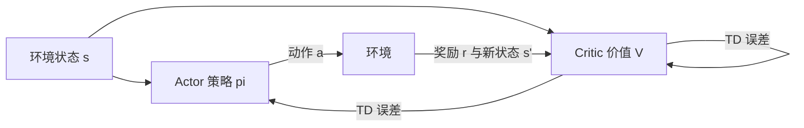

---
Title | RL AC
-- | --
Created @ | `2023-12-04T03:46:55Z`
Updated @| `2026-11-26T08:07:31Z`
Labels | ``
Edit @| [here](https://github.com/junxnone/aiwiki/issues/459)

---
# Actor Critic

Actor-Critic（演员-评论家）是一类结合**策略梯度**与**价值函数**的强化学习方法：用 Actor 决定怎么做，用 Critic 评估做得好不好，用 Critic 的评估来降低 Actor 梯度的方差。所属背景见 [RL Robot](https://github.com/junxnone/aiwiki/issues/458)。

## 两个角色

图中：

- **Actor（演员）**：输入状态，输出动作的概率分布（离散动作）或分布参数（连续动作），负责「推荐动作」
- **Critic（评论家）**：输入状态，输出对未来总回报的估计，负责「打分」
- 箭头：Actor 选动作与环境交互；环境返回奖励与新状态；Critic 据此计算 TD 误差，同时用来更新自己和 Actor
- 关键结论：Critic 提供比「整条轨迹回报」更低方差的学习信号，Actor 提供 Critic 需要评估的策略

## 为什么需要 Critic

纯策略梯度（REINFORCE）用整条轨迹的回报 $G_t$ 作权重，方差大、收敛慢：

$$
\nabla_\theta J(\theta)=\mathbb{E}_{\pi_\theta}\left[\nabla_\theta\log\pi_\theta(a_t\mid s_t)\,G_t\right]
$$

其中：

- $\theta$：Actor 的参数；$J(\theta)$：期望总回报，即优化目标
- $\pi_\theta(a\mid s)$：策略，在状态 $s$ 下选动作 $a$ 的概率
- $G_t=\sum_{k\ge0}\gamma^{k}r_{t+k}$：从时刻 $t$ 起的折扣回报；$\gamma\in[0,1)$ 为折扣因子，$r$ 为奖励
- $\nabla_\theta\log\pi_\theta$：使动作 $a_t$ 概率上升的方向；$G_t$ 越大，推得越用力

Actor-Critic 用 Critic 学到的价值函数替换 $G_t$，得到更稳定的更新（见下节）。

## 更新公式

Critic 用 TD（时间差分）误差学习状态价值 $V_w(s)$：

$$
\delta_t=r_t+\gamma V_w(s_{t+1})-V_w(s_t),\qquad
w\leftarrow w+\alpha_w\,\delta_t\,\nabla_w V_w(s_t)
$$

其中：

- $V_w(s)$：Critic 网络（参数 $w$）对状态 $s$ 的未来总回报估计
- $\delta_t$：TD 误差，「实际 + 后继估计」与「当前估计」之差；$\delta_t>0$ 说明这步比预期好
- $\alpha_w$：Critic 学习率

Actor 用 TD 误差作为权重更新策略：

$$
\theta\leftarrow\theta+\alpha_\theta\,\delta_t\,\nabla_\theta\log\pi_\theta(a_t\mid s_t)
$$

其中：

- $\alpha_\theta$：Actor 学习率
- $\delta_t$：作为「优势」的单步估计，好于预期则提升该动作概率，差于预期则降低

## 训练流程

1. 观察状态 $s_t$，Actor 采样动作 $a_t\sim\pi_\theta(\cdot\mid s_t)$
2. 执行 $a_t$，得到 $r_t$ 与 $s_{t+1}$
3. Critic 计算 TD 误差 $\delta_t$
4. 用 $\delta_t$ 更新 Critic（回归）与 Actor（策略梯度）
5. 重复；回合结束则重置环境

## 方法对比

| 方法 | 学习信号 | 方差 | 偏差 | 是否有 Critic |
| --- | --- | --- | --- | --- |
| REINFORCE | 整条回报 $G_t$ | 高 | 无 | 否 |
| Actor-Critic（TD） | $\delta_t$ | 低 | 有（受 Critic 精度影响） | 是 |
| A2C | 优势 $A(s,a)$ | 低 | 较小 | 是 |
| DQN | 值函数最大化 | — | — | 只有 Critic，无显式策略 |

表中：

- **方差/偏差**：策略梯度估计的统计性质；Critic 越准，偏差越小
- 对比结论：Actor-Critic 用少量偏差换取大幅降低的方差，训练更稳；A2C 进一步用优势函数改进（见 [RL A2C](https://github.com/junxnone/aiwiki/issues/460)）

## 常见变体

- A2C / A3C：优势函数 + 并行采样
- DDPG / TD3 / SAC：连续动作空间，确定性或最大熵策略，离策略（off-policy）
- PPO / TRPO：限制每次策略更新幅度，稳定性好，是机器人 RL 最常用的算法之一

## Reference

- [Actor Critic Method - Paddlepaddle](https://www.paddlepaddle.org.cn/documentation/docs/zh/practices/reinforcement_learning/actor_critic_method.html)

