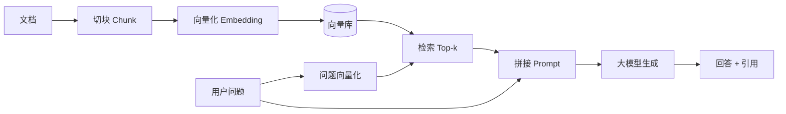

---
Title | LM RAG
-- | --
Created @ | `2024-02-20T01:35:11Z`
Updated @| `2026-11-26T08:28:38Z`
Labels | ``
Edit @| [here](https://github.com/junxnone/aiwiki/issues/461)

---
# RAG

- RAG - `Retrieval Augmented Generation` - 检索增强生成
- 在生成回答前，先从外部知识库检索相关内容，把它作为上下文交给大模型，让回答有据可依
- 应用
  - Q&A
  - 专业知识检索
  - 保密文档知识检索
  - 读论文/文章视频总结

## 为什么需要 RAG

| 问题 | 纯大模型 | 加入 RAG 后 |
| --- | --- | --- |
| 知识过时 | 只知道训练截止前的内容 | 检索最新文档 |
| 幻觉 | 容易编造事实 | 回答可引用检索到的原文 |
| 私有数据 | 没见过企业内部文档 | 文档只放在本地知识库，不必训练进模型 |
| 更新成本 | 更新知识要重新微调 | 只需更新知识库 |

表中：

- **幻觉**：模型生成看似合理但与事实不符的内容
- 对比结论：RAG 适合「知识经常变、需要引用来源、数据保密」的场景；需要改变模型风格、格式或能力时更适合微调（见 [大模型对齐训练](https://github.com/junxnone/aiwiki/issues/568)）

## 基本流程

图中：

- 上半部分是**离线建库**：文档切成块，用 Embedding 模型转成向量，存入向量库
- 下半部分是**在线问答**：问题向量化后，在向量库里检索最相近的 $ 个块，和问题一起拼成 Prompt 交给大模型
- 关键结论：大模型只负责「读材料、写回答」，知识存放在外部库里

## 检索：向量相似度

用余弦相似度衡量问题与文档块的相关程度：

$$
\text{sim}(q, d) = \frac{q\cdot d}{\lVert q\rVert\,\lVert d\rVert}
$$

其中：

- $q$：问题的 Embedding 向量；$d$：文档块的 Embedding 向量
- $q\cdot d$：向量内积；$\lVert\cdot\rVert$：向量的模
- $\text{sim}\in[-1,1]$，越大表示语义越接近；取相似度最高的 $k$ 个块作为上下文
- 向量规模大时用近似最近邻（ANN）加速，见 [ML NNS ANN](https://github.com/junxnone/aiwiki/issues/103)、[Annoy](https://github.com/junxnone/aiwiki/issues/333)、[HNSW](https://github.com/junxnone/aiwiki/issues/334)

## 生成：RAG 的概率形式

原始 RAG 论文把检索到的文档 $z$ 当作隐变量：

$$
p(y\mid x) \approx \sum_{z\in \text{top-}k(p_\eta(\cdot\mid x))} p_\eta(z\mid x)\; p_\theta(y\mid x, z)
$$

其中：

- $x$：用户输入（问题）；$y$：生成的回答
- $z$：检索到的文档块；$\text{top-}k$：检索器给出的前 $k$ 个
- $p_\eta(z\mid x)$：检索器（参数 $\eta$）给出文档 $z$ 与问题 $x$ 的相关概率
- $p_\theta(y\mid x,z)$：生成器（参数 $\theta$）在问题和文档条件下生成回答的概率
- 工程中常直接把 top-$k$ 文档拼进 Prompt，不显式求和

## 关键环节与常见优化

| 环节 | 要点 | 常见优化 |
| --- | --- | --- |
| 切块 | 块太大噪声多，太小丢上下文 | 按语义/标题切分，块间保留重叠 |
| Embedding | 决定检索质量 | 选合适语种与领域的模型，必要时微调 |
| 检索 | 单一向量检索可能漏掉关键词 | 混合检索（向量 + BM25 关键词） |
| 重排 | Top-k 里排序不一定最优 | 用 Cross-Encoder / Reranker 重排 |
| 生成 | 模型可能忽略上下文 | Prompt 要求「只依据资料回答并给出处」 |
| 评估 | 检索和生成要分开评 | 检索看召回率；生成看忠实度、答案相关性 |

表中：

- **BM25**：经典关键词检索算法；**Reranker**：对候选结果做精细二次排序的模型
- 对比结论：回答不准时，先判断是「没检索到」还是「检索到了没用好」，再针对性优化

## Tools
- [豆包 浏览器扩展](https://chrome.google.com/webstore/detail/dbjibobgilijgolhjdcbdebjhejelffo)

## Reference
- [Awesome-RAG](https://github.com/lucifertrj/Awesome-RAG)
- 2020 [Retrieval-Augmented Generation for Knowledge-Intensive NLP Tasks](https://arxiv.org/abs/2005.11401)

