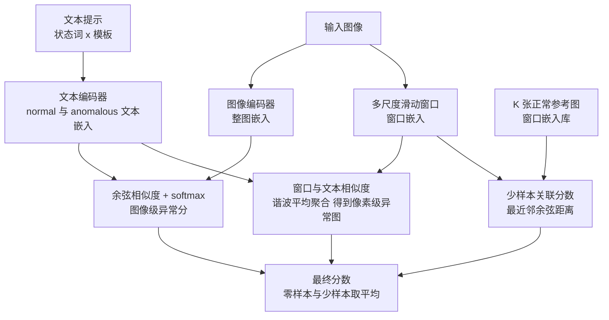

---
Title | paper WinCLIP
-- | --
Created @ | `2024-06-13T01:21:32Z`
Updated @| `2026-11-24T09:20:48Z`
Labels | ``
Edit @| [here](https://github.com/junxnone/aiwiki/issues/468)

---
# WinCLIP 零样本异常检测

*   通过使用手动设计的状态词和提示词模板关联异常/正常样本
*   **Compositional Prompt Ensemble** -> `Anomaly Classification`
*   **window-based CLIP** -> `Anomaly Segmentation`
*   **WinCLIP+** -> Few shot

## Arch

*   **CLIP-AC**
    *   基于 OpenCLIP 实现的的二分类异常检测框架
    *   prompts: `normal [o]` / `anomalous [o]`
*   **CPE** - `Compositional prompt ensemble`
    *   **state words**;
        *   `perfect/flawless/unblemished/without faw/without defect/without damage`
        *   `damaged/with flaw/with defect/with damage/...`
    *   **Text Template**
        *   `a cropped photo of the {}`
        *   `a close-up photo of a {}`
        *   `a photo of the {}`
        *   ...
*   CPE 生成的一些列 prompt 的 `text embedding`  进行  `Group Average` 和 `image embedding` 计算相似度生成 AC Score
*   **Window-based**
    *   通过 `sliding window` 生成 mid-scale/small-scale patch
    *   各 patch 分别通过 image encode 生成 window embedding ，组合成 mid/small embedding map
    *   mid/small embedding map 分别和 text embedding&#x20;
*   **Harmonic aggregation**
    *   每个窗口获取一个异常分数，将这个分数分散到所有window 中的 像素
    *   聚合 `overlapping` 处的多个分数, 通过 `armonic averaging` /`加权` 提升分割性能
*   **Multi-scale Aggeration**
    *   为了提升检测的多尺度能力，聚合多尺度的检测结果

## anomalib Impl

### Zero-Shot

- 计算  image score, 即 `image_embeddings` 和 `text_embeddings` 的余弦距离，再进行 softmax

<iframe frameborder="0" scrolling="no" style="width:100%; height:142px;" allow="clipboard-write" src="https://junxnone.github.io/emgithub/iframe.html?target=https%3A%2F%2Fgithub.com%2Fopenvinotoolkit%2Fanomalib%2Fblob%2F56843d2671977d07ad228e6e5d870bf7f240cf59%2Fsrc%2Fanomalib%2Fmodels%2Fimage%2Fwinclip%2Futils.py%23L95-L97&style=agate&type=code&showBorder=on&showLineNumbers=on&showFileMeta=on&showFullPath=on&showCopy=on"></iframe>

- 计算 Pixel Anomaly Map, 即 每个 `window_embeddings` 和 `text_embeddings` 计算余弦距离，并聚合

<iframe frameborder="0" scrolling="no" style="width:100%; height:226px;" allow="clipboard-write" src="https://junxnone.github.io/emgithub/iframe.html?target=https%3A%2F%2Fgithub.com%2Fopenvinotoolkit%2Fanomalib%2Fblob%2F22caf3badf610641c6b0d4f7ba5d6e1b1e419ce8%2Fsrc%2Fanomalib%2Fmodels%2Fimage%2Fwinclip%2Ftorch_model.py%23L275-L281&style=agate&type=code&showBorder=on&showLineNumbers=on&showFileMeta=on&showFullPath=on&showCopy=on"></iframe>

### Few-Shot

- pixel/image level score 分别 计算 few-shot branch 和 zero-shot 的均值 作为最终值

<iframe frameborder="0" scrolling="no" style="width:100%; height:142px;" allow="clipboard-write" src="https://junxnone.github.io/emgithub/iframe.html?target=https%3A%2F%2Fgithub.com%2Fopenvinotoolkit%2Fanomalib%2Fblob%2F22caf3badf610641c6b0d4f7ba5d6e1b1e419ce8%2Fsrc%2Fanomalib%2Fmodels%2Fimage%2Fwinclip%2Ftorch_model.py%23L243-L245&style=agate&type=code&showBorder=on&showLineNumbers=on&showFileMeta=on&showFullPath=on&showCopy=on"></iframe>

- Pixel Anomaly Map, 聚合 `patch_embedings`, `window_embeddings` 的余弦相似度

<iframe frameborder="0" scrolling="no" style="width:100%; height:352px;" allow="clipboard-write" src="https://junxnone.github.io/emgithub/iframe.html?target=https%3A%2F%2Fgithub.com%2Fopenvinotoolkit%2Fanomalib%2Fblob%2F22caf3badf610641c6b0d4f7ba5d6e1b1e419ce8%2Fsrc%2Fanomalib%2Fmodels%2Fimage%2Fwinclip%2Ftorch_model.py%23L304-L316&style=agate&type=code&showBorder=on&showLineNumbers=on&showFileMeta=on&showFullPath=on&showCopy=on"></iframe>

## 动机与思路

- 论文：[WinCLIP: Zero-/Few-Shot Anomaly Classification and Segmentation](https://arxiv.org/abs/2303.14814)（Jeong 等，AWS，CVPR 2023）。此前的工业异常检测大多要为每个检测任务训练专用模型，需要任务相关的图像和标注；而 CLIP 这类视觉语言模型在零样本分类上很强，但直接用于异常分类和分割效果不好（CLIP-AC 在 MVTec AD 上 AUROC 只有 74.0）
- 论文假设：**语言**在零样本、极少样本（1~4 张正常图）的异常检测中更重要。理由有三：①「正常」「异常」是依赖上下文的状态，语言能澄清它们（如「缺失的晶体管」对电路板是异常，「裂纹」对木头才是异常）；②语言可以具体地定义哪些偏离是缺陷、哪些是可接受的（如「划痕」与「可接受的微小划痕」）；③组合式的提示可以覆盖丰富的状态
- 论文的做法：①**组合式提示集成 (CPE)**：状态词 × 文本模板，生成「正常」与「异常」两个类原型；②**WinCLIP**：用滑动窗口高效地提取与语言对齐的多尺度密集特征，得到零样本分割图；③**WinCLIP+**：加入 $K$ 张正常参考图，融合语言与视觉两路互补的信息

## 流程图

下图是 WinCLIP 的整体流程，零样本和少样本共用大部分模块：

图中：

- 左上是**文本分支**：用「状态词 × 模板」组合出大量描述正常和异常的句子，通过文本编码器得到文本嵌入，再按「正常」「异常」两组各自取平均，作为两个类原型
- **图像级分数**：整图的图像嵌入与两个类原型计算余弦相似度，经 softmax 得到异常概率
- **像素级异常图**：用多尺度滑动窗口截取局部区域，每个窗口得到一个异常分数并分散到窗口内的像素，用谐波平均聚合重叠区域和不同尺度
- **少样本分支（WinCLIP+）**：保存 $K$ 张正常参考图的多尺度特征作为参考记忆，测试特征与它们做最近邻余弦距离，再与语言分支的预测融合

## 公式

**CLIP 零样本分类**。CLIP 用对比学习训练图像编码器 $f$ 和文本编码器 $g$，使配对的图文嵌入余弦相似度最大。给定输入 $\mathbf{x}$ 和一组文本 $S=\{s_1,\dots,s_k\}$，$k$ 类分类的概率为：

$$
p(\mathbf{s}=s_i \mid \mathbf{x}) = \frac{\exp\big(\langle f(\mathbf{x}), g(s_i)\rangle / \tau\big)}{\sum_{s \in S}\exp\big(\langle f(\mathbf{x}), g(s)\rangle / \tau\big)}
$$

其中：

- $f(\mathbf{x})$：图像嵌入；$g(s_i)$：第 $i$ 个文本的嵌入；$\langle\cdot,\cdot\rangle$：余弦相似度
- $\tau$：温度系数；$p$：图像属于第 $i$ 个文本描述的概率

**零样本异常分类 (CLIP-AC) 与组合式提示集成 (CPE)**。把类别写成两句话：「normal [o]」与「anomalous [o]」，其中 $[o]$ 是物体名称（没有时用 `object`）。CPE 不手写描述，而是枚举「状态词列表」与「模板列表」的所有组合，把得到的所有句子的文本嵌入**取平均**，分别作为正常和异常的类原型 $t_n$、$t_a$，异常分数就是 softmax 之后异常类的概率：

$$
\text{ascore}_0(\mathbf{x}) = \frac{\exp\big(\langle f(\mathbf{x}), t_a\rangle / \tau\big)}{\exp\big(\langle f(\mathbf{x}), t_n\rangle / \tau\big) + \exp\big(\langle f(\mathbf{x}), t_a\rangle / \tau\big)}
$$

其中：

- $t_n$、$t_a$：「正常」「异常」两类由 CPE 生成的平均文本嵌入；状态词如正常的「flawless」、异常的「damaged」，也可以加任务相关的词（如 PCB 上的「bad soldering」）；模板如「a photo of a [c] for visual inspection」
- $\text{ascore}_0 \in (0,1)$：越大越可能异常

**WinCLIP 的窗口特征**。对 $h \times w$ 的图像，用大小为 $k \times k$ 的滑动窗口，每个窗口是以 $(i,j)$ 为中心的二值掩码 $\mathbf{w}_{ij} \in \{0,1\}^{h \times w}$，把窗口内的图像区域送入图像编码器：

$$
\mathbf{F}^{W}_{ij} = f\big(\mathbf{x} \odot \mathbf{w}_{ij}\big)
$$

其中：

- $\odot$：逐元素乘积，窗口外置零；$\mathbf{F}^{W}_{ij} \in \mathbb{R}^d$：以 $(i,j)$ 为中心的窗口的嵌入；ViT 中直接丢弃被遮挡的 patch 再前向（类似 MAE），所以高效
- 这些嵌入来自 ViT 的 class token，**天然与文本对齐**；而 ViT 最后一层的 patch 特征 $\mathbf{F}^{P}$ 没有受过语言监督，且自注意力已混入全局信息，直接用于分割效果差
- 每个窗口的 $\text{ascore}_0$ 被分配给窗口覆盖的每个像素

**谐波平均聚合**：同一个像素被多个窗口覆盖，用谐波平均合并它们的分数 $\mathbf{M}^{W}_{0,uv}$：

$$
\bar{\mathbf{M}}^{W}_{0,ij} = \Bigg(\frac{1}{\sum_{u,v}(\mathbf{w}_{uv})_{ij}}\sum_{u,v}\frac{(\mathbf{w}_{uv})_{ij}}{\mathbf{M}^{W}_{0,uv}}\Bigg)^{-1}
$$

其中：

- $(\mathbf{w}_{uv})_{ij}$：窗口 $(u,v)$ 的掩码在像素 $(i,j)$ 处的取值（1 表示覆盖）；$\mathbf{M}^{W}_{0,uv}$：窗口 $(u,v)$ 的异常分数
- 谐波平均更偏向较小的数（对应「正常」）：只要有窗口认为正常，聚合结果就会被明显拉低，**抑制偶然的高分误报**；多尺度（小尺度 $2\times2$ patch、中尺度 $3\times3$ patch 和整图的 class token）之间也用谐波平均聚合

**WinCLIP+（少样本）**。把 $K$ 张正常图的特征存为参考记忆 $\mathbf{R}$，查询图像的位置 $(i,j)$ 与记忆的最近邻余弦距离作为分割预测：

$$
\mathbf{M}_{ij} = \min_{r \in \mathbf{R}}\ \tfrac{1}{2}\big(1 - \langle \mathbf{F}_{ij}, r\rangle\big)
$$

在三种特征（小尺度窗口特征、中尺度窗口特征、倒数第二层 patch 特征）上各建一个记忆并求平均，再与语言分支融合；图像级分数则取语言分数与参考分割图的最大值的平均：

$$
\mathbf{M}^{W} = \tfrac{1}{3}\big(\mathbf{M}^{P} + \mathbf{M}^{W}_{s} + \mathbf{M}^{W}_{m}\big), \qquad \text{ascore}_W(\mathbf{x}) = \tfrac{1}{2}\Big(\text{ascore}_0\big(f(\mathbf{x})\big) + \max_{ij}\mathbf{M}^{W}_{ij}\Big)
$$

其中：

- $\mathbf{F}_{ij}$：查询图像位置 $(i,j)$ 的特征；$r$：记忆里的参考特征；$\mathbf{M} \in [0,1]^{h\times w}$：分割预测，越大越异常
- $\mathbf{M}^{P}$、$\mathbf{M}^{W}_{s}$、$\mathbf{M}^{W}_{m}$：分别由 patch 特征、小尺度窗口特征、中尺度窗口特征的参考记忆得到的预测
- $\text{ascore}_W$：WinCLIP+ 的图像级分数：一半来自 CLIP 通过语言检索到的知识，另一半来自参考图的空间特征，二者互补。有些缺陷只能通过视觉参考来定义（如 MVTec 的 metal_nut 的「上下翻转」）

## 论文实验设置与结果

**实验设置**：

- 数据集：MVTec AD 和 VisA；指标：分类用 AUROC、AUPR 和 $F_1$-max（最佳阈值下的 F1），分割用像素级 AUROC (pAUROC)、PRO 和像素级 $F_1$-max（论文指出 AUROC 在不平衡数据上会虚高，所以补充了 $F_1$-max；见 [Anomaly Detection Metrics](/0711_ML_Metrics_Anomaly)）
- CLIP 实现用 OpenCLIP，**LAION-400M 预训练的 ViT-B/16+**；WinCLIP 在 ViT patch 嵌入上用步长 1（相当于像素级步长 16）；预处理沿用 OpenCLIP
- 对非正方形图像（VisA 多数）做「图像平铺」：沿长边取多个边长为短边的重叠方块，预测取平均；few-shot 结果是 5 个随机种子的均值和标准差

**零样本结果**（Table 1、Table 4）：

Method | MVTec AD 分类 AUROC | VisA 分类 AUROC | MVTec AD 分割 pAUROC | VisA 分割 pAUROC
-- | -- | -- | -- | --
CLIP-AC | 74.0 | 59.3 | - | -
CLIP-AC + 原 CLIP 提示集成 | 74.1 | 58.2 | - | -
Trans-MM | - | - | 57.5 | 49.4
MaskCLIP | - | - | 63.7 | 60.9
**WinCLIP** | **91.8** | **78.1** | **85.1** | **79.6**

表中是零样本结果：直接用 CLIP 做「normal / anomalous」二分类只有 74.0，而 WinCLIP 提升到 91.8；分割上，两个迁移过来的基线（Trans-MM 是 Transformer 的可解释性方法，MaskCLIP 是 CLIP 语义分割）远低于 WinCLIP。

**少样本结果**（MVTec AD / VisA，分类 AUROC / 分割 pAUROC）：

Shots | 方法 | 分类 AUROC（MVTec AD / VisA） | 分割 pAUROC（MVTec AD / VisA）
-- | -- | -- | --
1 | PatchCore | 83.4 / 79.9 | 92.0 / 95.4
1 | **WinCLIP+** | **93.1 / 83.8** | **95.2 / 96.4**
2 | PatchCore | 86.3 / 81.6 | 93.3 / 96.1
2 | **WinCLIP+** | **94.4 / 84.6** | **96.0 / 96.8**
4 | PatchCore | 88.8 / 85.3 | 94.3 / 96.8
4 | **WinCLIP+** | **95.2 / 87.3** | **96.2 / 97.2**

表中是 1/2/4-shot 与此前最强的少样本基线 PatchCore 的比较（SPADE 和 PaDiM 更低，未列出）：WinCLIP+ 在 1-shot 时相比 PatchCore 在 MVTec AD 的分类上高 9.7 个点、在 VisA 上高 5.3 个点（论文原文）；WinCLIP 的 0-shot 结果甚至超过其他方法的 few-shot 结果，而 WinCLIP+ 的 1/2/4-shot 均优于 WinCLIP 的 0-shot，说明参考图提供了额外价值。

**与多样本方法比较**（第 5.3 节）：4-shot 的 WinCLIP+（分类 95.2、分割 96.2）与利用全部训练样本调优的 CutPaste 相当；0-shot 的 WinCLIP 优于使用 10 个以上样本的 DifferNet（16-shot 为 87.3）和 TDG；4-shot WinCLIP+ 也优于 RegAD 的聚合 4-shot 结果。

**消融实验**（第 5.4 节）：

Name | 结论
-- | --
提示设计（Table 3，MVTec AD 分类 AUROC） | 仅「normal」的一类设计只有 34.2；两类设计（normal vs. anomalous）74.0；加状态词集成 89.8；再加模板集成 90.8；再加多裁剪预测 91.8。说明「anomalous」一词的文本监督至关重要，状态词集成的贡献最大
WinCLIP 分割 | 最后一层 patch token 与语言不对齐，效果差；「图像平铺」（先密集切片再逐个缩放前向）虽有局部特征，但计算开销大；WinCLIP 用窗口计算更快，性能更好。多尺度和谐波平均都能提升结果，说明分割既需要图像级的全局上下文，又需要中、小尺度的局部信息
WinCLIP+ | 分类上，$\text{ascore}_0$ 对 $\max \mathbf{M}^{W}$ 有明显增益，即使在 shot 数较多、视觉分支更强时语言分支仍然有益；分割上，在 $\mathbf{M}^{P}$ 之上加入中、小尺度窗口的预测能进一步提升
任务相关的状态词 | 加入数据集给出的缺陷类型（如「missing part」「burnt」）作为状态词，VisA 零样本分类平均 AUROC 再提升 0.8%，在较难的 PCB2 上提升 5.3%

表中的结论：语言端的「状态词 × 模板」和视觉端的「多尺度窗口 + 谐波平均」是零样本能力的来源；参考图则补足了语言难以表达的缺陷。

## anomalib 实现

下表是 anomalib 里 WinCLIP 的三个参数：

Parameter | 类型 | 含义 | 默认值
-- | -- | -- | --
`class_name` | str | 提示词里使用的类别名；不填则用数据集的类别名，没有则用 `object` | `null`
`k_shot` | int | 少样本模式下用的正常参考图数量，0 表示零样本 | `0`
`scales` | tuple | 多尺度窗口的尺度，每个整数为窗口大小（以 patch 个数计） | `[2, 3]`

表中：`class_name` 会直接写进提示词，物体名称与实际对象越贴切，零样本效果越好；`scales` 决定能检测的缺陷尺寸范围，默认的 2 和 3 对应论文里的小、中尺度窗口。anomalib 的 README 里 WinCLIP 的 benchmark 一栏写的是「Coming soon」，暂时没有官方数值，请参考上面论文报告的结果。

## 优缺点

- **优点**
  - 零样本：不需要任何训练数据，只给出物体名称即可检测，适合新产品冷启动
  - 少样本时只需几张正常图像，效果显著提升
  - 同时输出图像级分类和像素级分割
- **缺点**
  - 依赖 CLIP 对该类别和缺陷语义的理解，对 CLIP 没见过的工业物体或细微缺陷效果有限
  - 提示词的设计对结果影响大，需要手工选择状态词和模板
  - 滑动窗口多尺度推理，计算量比单次前向大；定位精度受窗口粒度限制（小尺度窗口对应 $32\times32$ 像素）

## Reference
- [深度学习论文: WinCLIP: Zero-/Few-Shot Anomaly Classification and Segmentation](https://blog.csdn.net/shanglianlm/article/details/132432407)

