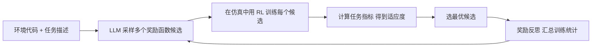

---
Title | paper Eureka
-- | --
Created @ | `2024-06-22T09:43:36Z`
Updated @| `2026-11-26T08:44:01Z`
Labels | ``
Edit @| [here](https://github.com/junxnone/aiwiki/issues/470)

---
# Eureka
- **Eureka** - `Evolution-driven Universal REward Kit for Agent`
- 使用 LLMs(GPT-4) 生成 RL 中的奖励函数(替代手动设计激励函数)
  - 没有预定义激励函数模板
- curriculum learning
- RLHF 微调激励函数
- Input
  - 原始环境源代码(没有 reward code)
  - 任务描述
- Output
  - 奖励函数

## 为什么需要它

强化学习的效果高度依赖**奖励函数**（见 [RL Tasks](https://github.com/junxnone/aiwiki/issues/457)），但手工设计奖励既费时又需要经验。Eureka 让大语言模型读环境代码和任务描述，直接写出奖励函数代码，再通过进化式的迭代不断改进。

## Arch

图中：该图为原文档附带的 Eureka 架构图，对应下面的迭代流程。

图中：

- LLM 一次采样多个奖励函数候选（避免单个候选质量不稳定）
- 每个候选都在仿真环境中训练一个 RL 策略（常见环境见 [Tools Gym](https://github.com/junxnone/aiwiki/issues/453)、[RL Robot Simulation](https://github.com/junxnone/aiwiki/issues/797)）
- 用任务本身的成功指标评价各候选；选出最好的一个
- **奖励反思**：把最优候选训练过程中各奖励分量的变化等统计文字化，反馈给 LLM，让它针对性地修改
- 循环若干轮，奖励函数逐步进化

目标可以写成：

$$
R^{*}=\arg\max_{R\in\mathcal{R}}\ F\big(\pi_R\big)
$$

其中：

- $R$：LLM 生成的奖励函数（代码）；$\mathcal{R}$：它可能生成的奖励函数空间
- $\pi_R$：使用奖励 $R$ 训练得到的策略
- $F(\cdot)$：适应度函数，由任务的真实成功指标定义（而不是奖励本身）
- $R^{*}$：适应度最高的奖励函数

## 关键点

| 要素 | 作用 |
| --- | --- |
| 环境代码作为上下文 | 让 LLM 知道有哪些状态变量可用于写奖励 |
| 多候选采样 | 提高至少有一个可运行且有效的奖励的概率 |
| 奖励反思 | 把训练统计变成文字反馈，驱动进化改进 |
| 进化搜索 | 迭代选择最优并改进 |

表中：对比结论：与「一次性让 LLM 写奖励」相比，进化加反思让奖励质量逐轮提升。

## python package Eureka
- 使用 GPT4, 需要 `OpenAI API Key`
  - 需要用[虚拟 SMS 服务](https://sms-activate.org/)，充值最少 `2＄`(印度尼西亚 虚拟号码使用一次约 `0.11＄`)
  - 注册 OpenAI 后约 `5 ＄` 的免费使用额度
  
## Reference
- [paper **Eureka**: Human-Level Reward Design via Coding Large Language Models](https://arxiv.org/abs/2310.12931)
- [Code](https://github.com/eureka-research/Eureka)

