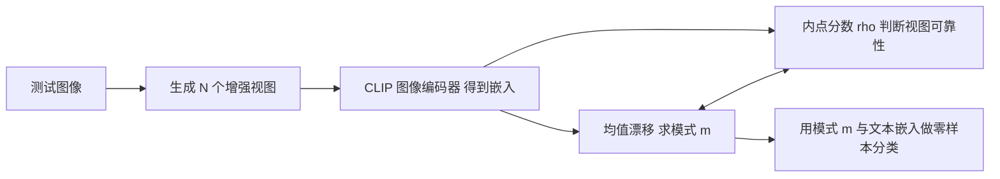

---
Title | paper MTA
-- | --
Created @ | `2024-10-11T03:12:36Z`
Updated @| `2026-11-26T08:43:54Z`
Labels | ``
Edit @| [here](https://github.com/junxnone/aiwiki/issues/479)

---
# MTA
- 基于均值漂移算法
- 通过优化潜在的内点变量（inlierness variables）自动管理测试时增强的视图，直接在优化过程中集成对增强视图的评估，无需训练模型的参数或提示
- 通过不断迭代更新模式估计值，使得模式逐渐收敛到数据的密集区域，从而找到数据的一种代表性模式。
- 通过交替更新内点分数和模式，以实现对测试时增强的稳健多模态均值漂移，从而提高视觉 - 语言模型的测试时零样本泛化能力

## 背景：测试时增强

测试时增强（TTA）对同一张测试图做随机裁剪等增强，得到多个视图，再综合各视图的预测。但随机裁剪的视图里可能包含没有目标的背景块，直接平均会引入噪声。MTA 的思路是：不手工筛选，而是自动判断哪些视图是「可靠的内点」，并找到这些视图嵌入的「模式」作为最终表示。

## 流程

图中：

- 图像做多次增强，每个视图经 CLIP 图像编码器得到嵌入 $z_i$
- 交替执行：在当前内点分数下更新模式，再根据模式更新各视图的内点分数，直到收敛
- 最终用收敛的模式和类别文本嵌入做零样本分类
- 关键结论：不训练、不学提示词，仅在测试阶段做优化

## 均值漂移 (Mean Shift)

均值漂移是一种寻找数据密度峰值（模式）的迭代方法：

$$
m\leftarrow\frac{\sum_{i=1}^{N}\rho_i\,K(m,z_i)\,z_i}{\sum_{i=1}^{N}\rho_i\,K(m,z_i)}
$$

其中：

- $m$：当前模式估计，每次迭代向数据密集处移动
- $z_i$：第 $i$ 个增强视图的嵌入；$N$：视图数量
- $K(m,z_i)$：核函数，衡量 $z_i$ 与当前 $m$ 的接近程度（越接近权重越大）
- $\rho_i$：第 $i$ 个视图的内点分数（inlierness），越大表示该视图越可靠
- 迭代使 $m$ 收敛到密度峰值，对离群视图不敏感；具体目标函数与内点分数的更新规则以论文为准

## 优点与限制

- 优点：不需要训练和提示词，对 CLIP 等视觉-语言模型即插即用，可与其他方法叠加
- 限制：需要对每张测试图做多次编码，推理开销随视图数增加

## Reference
- [On the test-time zero-shot generalization of vision-language models: Do we really need prompt learning?](https://arxiv.org/abs/2405.02266)
- [Code](https://github.com/MaxZanella/MTA)
- 所属方法汇总见 [CLIP Finetune](https://github.com/junxnone/aiwiki/issues/487)

